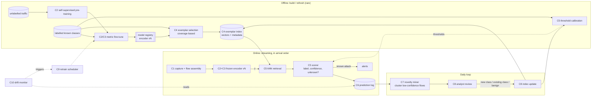
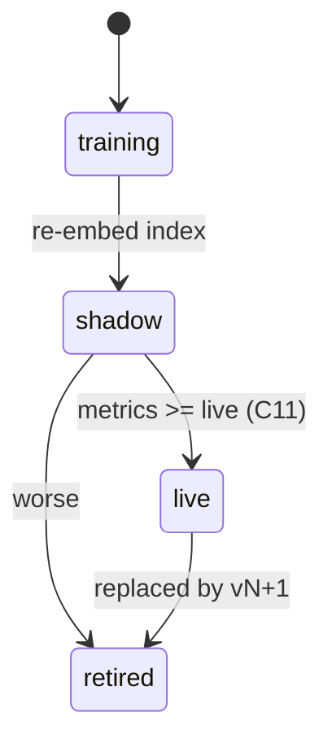
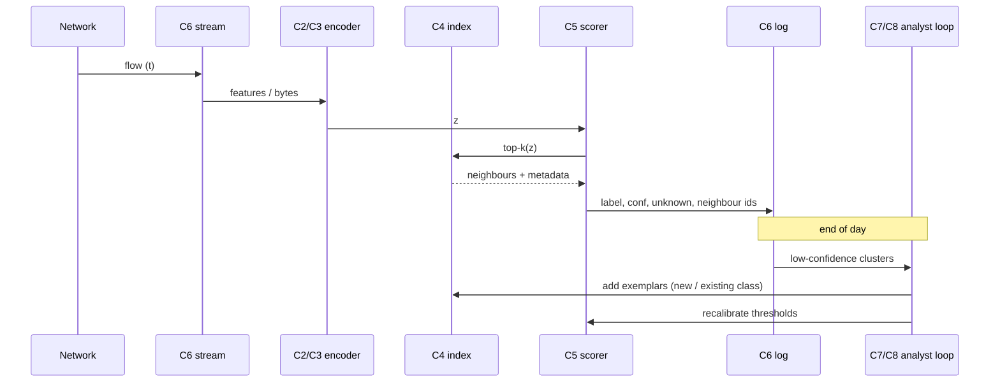

# Architecture (draft v0.1 — for review)

Retrieval-based, open-set, incrementally-learning network intrusion detection.
Each component is numbered (**C1…C11**) so you can mark which ones to change. Each one has a default and some alternatives.

---

## 1. Goals and what we take from BFS-NID

**What the system does**
- Classify flows **in arrival order**, each with a label and a confidence.
- Flag flows that look like **no known class** (candidate new attacks).
- Once a day, analysts label the flagged flows. The labels go **into the index** as a new class or as new examples of an existing class. No retraining is needed.
- Cope with **drift**, because both attack and benign traffic change over time.

**From BFS-NID (Du et al., TNSM 2024)**

| BFS-NID does | We keep | We change, and why |
|---|---|---|
| Raw bi-flows: 5-tuple, 64 s timeout, 120 s reset; first 16 packets × 256 bytes → 64×64 image; IP/MAC zeroed | Same input format for v1 | Also mask ports, TTL, checksums, seq/ack and IP-ID. These are known shortcut fields. |
| ViT with one patch per packet, MAE self-supervised pre-training (75% mask), 512-d | Self-supervised pre-training, then freeze | Same idea. Size it smaller (ViT-Large is too big for line rate). |
| **One prototype per class** (the mean embedding), cosine scoring | Cosine scoring | **Many examples per class** in an index. They report **15% benign FP**, which they blame on benign diversity. A single mean can't represent a class with many modes. |
| Per-session projection layer + "branch fusion" | Optional (C3-b) | Inference cost grows with the number of sessions. Start with one shared projection. |
| Closed set: every test flow belongs to a known class | — | **Open set**: an "unknown" outcome plus calibrated rejection (C5). |
| Random 2000 / 5 / 100 samples per class, Top-1 accuracy, PD | — | **Time-ordered replay**, a held-out-attack test, benign FPR, analyst load (C11). |

---

## 2. System overview



---

## 3. Components

### C1 · Input: capture and flow assembly
- **v0:** flow features from the **corrected CIC-IDS2017** re-extraction (Engelen et al. 2021 / Liu et al. 2022). The original MachineLearningCVE CSVs have more than 25% artefact flows and labelling errors. The corrected release should also restore timestamps; to verify.
- **v1:** raw bytes from the CIC-IDS2017 PCAPs, built as in BFS-NID, with the extra masking listed in §1.
- **Interface:** `Flow{flow_id, t_start, t_end, payload: features | byte_tensor}`. Everything downstream depends only on this.
- *Alternatives:* nPrint bit-level representation; packet-sequence tokens (ET-BERT style).

### C2 · Encoder backbone
- **Default:**
  - Self-supervised pre-training on *all* traffic, unlabelled. Use masked-feature reconstruction for v0 tabular input and MAE for v1 bytes.
  - Then supervised fine-tuning on the base classes.
  - Then **freeze**.
- Size: v0 is an MLP (the current GLU block is fine). v1 is a small ViT or 1-D transformer with one token per packet.
- *Alternatives:* (a) supervised only, which is what we have now. (b) Never fine-tune: SSL only + projection.

### C3 · Embedding / projection head
- **Default:** one shared projection to an L2-normalised 128-d space. Loss: **multi-proxy** metric loss (e.g. SoftTriple or Proxy-Anchor with K proxies per class), so a class can occupy several regions. Plain SupCon tends to collapse benign toward one point.
- *Alternatives:* (b) per-session projections + fusion (BFS-NID). (c) SupCon, which is what we have now.

### C4 · Exemplar index (the engineering core)
- **Data model** (below): a vector, plus metadata in a separate store, keyed by `exemplar_id`.
- **Selection:** a k-center (coverage) coreset per class, with a **per-class budget proportional to that class's spread**, not its row count. Benign gets the largest budget.
- **Operations:** `add`, `relabel`, `retire` (soft delete), `age-out` (TTL / reservoir), `re-embed(vN→vN+1)`.
- **Backend:** FAISS `IndexIDMap(Flat)` for v0. IVF-PQ or HNSW in shards by encoder version at scale. Metadata in SQLite for v0, Postgres later.
- **Health metrics:**
  - Benign **coverage radius**: the 95th-percentile distance from held-out benign flows to their nearest exemplar.
  - Exemplars per class.
  - Age distribution.

```mermaid
erDiagram
  EXEMPLAR {
    int    exemplar_id PK
    string class_id FK
    string encoder_version
    float  t_observed
    float  t_added
    string source "train | analyst | auto"
    string flow_ref "pointer to raw flow (for re-embedding)"
    bool   active
  }
  CLASS {
    string class_id PK
    string name
    string family "dos | web | brute | recon | benign | ..."
    float  t_first_seen
    float  threshold "C5 calibrated reject distance"
  }
  ENCODER {
    string encoder_version PK
    string status "shadow | live | retired"
    float  t_trained
  }
  CLASS ||--o{ EXEMPLAR : has
  ENCODER ||--o{ EXEMPLAR : embeds
```

### C5 · Scorer (classification + open-set rejection)
- **Default:**
  - Retrieve the top-k neighbours (k≈20).
  - Class score = similarity-weighted vote, plus each class's nearest distance.
  - **Unknown score** = distance to the k-th neighbour (deep-kNN OOD, Sun et al. 2022).
  - Per-class reject thresholds are set by **conformal calibration** on held-out data, giving a target benign FPR (e.g. 1%).
- **Output:** `{label, confidence, unknown: bool, nearest exemplar_ids}`. The neighbour IDs are the explanation an analyst sees.
- *Alternatives:* (b) prototype-mean cosine (BFS-NID). (c) A learned reranker over the neighbours, which is today's cross-attention head. It's closed-set, so use it only as an add-on.

### C6 · Stream service
- Ingest in time order in micro-batches (e.g. 1 s), encode, score, and append to the prediction log: `flow_id, t, label, conf, unknown, encoder_version, index_snapshot_id`.
- v0 is a Python replay loop over the dataset. Later, a Kafka consumer.

### C7 · Novelty miner (end of day)
- Take flows that are `unknown` or `conf < τ`.
- **Cluster** them (HDBSCAN on embeddings) and rank the clusters by size × distance-to-known.
- Send analysts **clusters, not flows**: each one with representative members, nearest known classes, and a time histogram.

### C8 · Analyst review and index update
- Per cluster: **new class** (with a name and family), **existing class**, **benign (false positive)**, or **ignore**.
- On a decision: add k representative exemplars, recalibrate that class's threshold, and log provenance.
- A new class is live the **next minute**, with no retraining.
- v0 simulates this with an **oracle analyst** that uses ground-truth labels and a daily budget (e.g. 50 flows).

### C9 · Retrain scheduler
- Triggers:
  - number of analyst-added classes > N
  - drift alarm (C10)
  - calendar (e.g. monthly)
- Procedure:
  - Train vN+1 on all labelled data so far.
  - Re-embed the index from `flow_ref`.
  - Run it in **shadow** next to vN.
  - Promote if the metrics hold.



### C10 · Drift monitor
- Daily, per class: the distribution of nearest-exemplar distances, the unknown rate, benign FPR (from analyst FP labels), and coverage radius.
- Alarms feed C9 (retrain) and C4 (refresh or expand exemplars).

### C11 · Evaluation harness
- **Time-ordered replay:** score each flow before anything learns from it.
- **Held-out attack:** remove one attack class from training. Measure unknown-detection AUROC and FPR@95TPR, then time-to-detect after the analyst adds k shots.
- **K-shot curves:** F1 of a new class vs. k ∈ {1, 5, 10, 50}.
- **Operational metrics:** benign FPR, analyst flows/day, index size, p99 latency.
- **Baselines** under the *same* protocol: XGBoost retrained daily, BFS-NID-style prototypes, the current exp5 RAG.

---

## 4. Request lifecycle



---

## 5. Build order

| Step | Scope | Done when |
|---|---|---|
| v0.1 | C1 (corrected flows), C2/C3 (MLP + multi-proxy), C4 (flat + SQLite), C5, C11 replay | Held-out-attack AUROC and benign FPR reported vs. XGBoost |
| v0.2 | C7 + C8 with oracle analyst, multi-day replay | k-shot curves; time-to-detect for held-out attacks |
| v0.3 | C9 + C10 (re-embed, shadow) | Encoder swap without losing analyst-added classes |
| v1 | C1/C2 raw bytes (PCAP → masked bi-flow tensors, MAE) | v0 metrics matched or beaten on the same protocol |

## 6. Open questions
1. Is the **base session** benign only, or benign plus a few attack families? This sets how much the encoder knows up front.
2. Granularity: **bi-flow** (BFS-NID) or **flow** (CICFlowMeter)? This also affects how labels align with the corrected dataset.
3. Is the analyst budget per day realistic? I'd use 50–200 flows/day as the default.
4. Latency target, which bounds encoder size and the index backend.
5. Is a second dataset in scope for v1 (CSE-CIC-IDS2018, UNSW-NB15) to test cross-network transfer?
