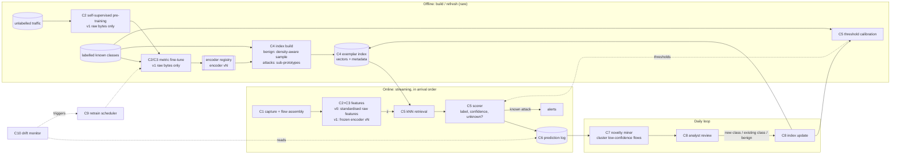
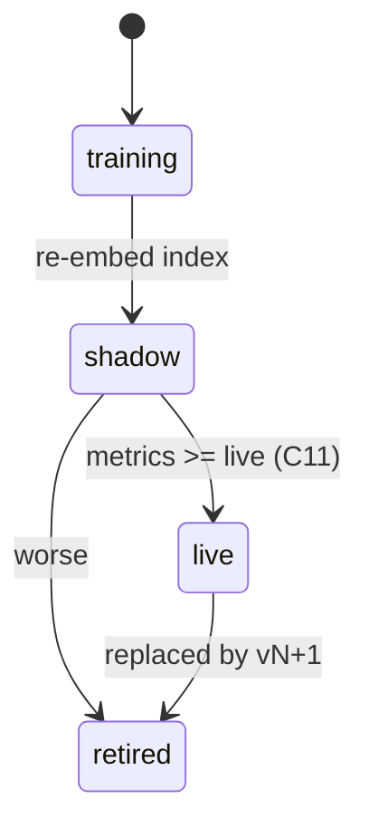
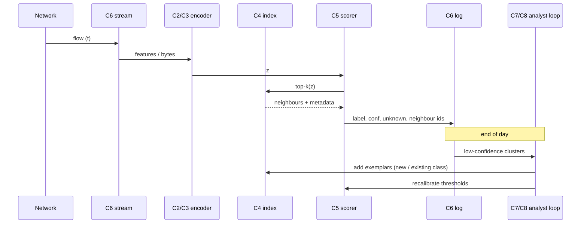

# Architecture (draft v0.2 — updated after spikes H1–H6)

Retrieval-based, open-set, incrementally-learning network intrusion detection.
Each component is numbered (**C1…C11**) so you can mark which ones to change. Each one has a default and some alternatives.

> **v0.2:** components below are updated with what the spikes showed ([`experiments.md`](experiments.md), [`SPIKE_PLAN.md`](SPIKE_PLAN.md), [`SPIKE_PLAN_2.md`](SPIKE_PLAN_2.md)). Parts that are still untested are marked *(untested)*; changes from v0.1 are marked **[v0.2]**.

## 0. What the spikes changed

| Finding (spike) | Change to the design |
|---|---|
| The learned encoder never beat standardised raw features, on two datasets (H1, H2) | **C2/C3:** v0 uses raw features directly. The encoder is deferred to the raw-byte stage. |
| Unseen attack families land far from known data: kNN flagged 82% at 1% false alarms vs. 42% for XGBoost (H1, H2) | **C5:** keep the kNN-distance novelty score as the open-set signal. |
| Five labelled examples name a new class about as well as retraining, with no damage to known classes (H2) | **C4/C8:** insertion without retraining works. |
| A bounded benign index loses detection (20k entries catch 68% of attacks, 512k catch 86%); random beats k-center for benign (H3) | **C4:** benign is a large index of real flows, not a small coverage coreset. |
| A one-class benign gate (VAE/AE) catches fewer attacks than the kNN benign index; a pure gate hides known attacks from the attack index (H5, H5b, H6) | **Layer-1 gate dropped** for now. |
| Density-aware benign sampling lowers false alarms (0.9% vs. 1.2%) (H6, B3) | **C4:** benign sampling rule is B3. |
| Ageing out exemplars makes the index forget (DoS held-out naming 0.89 → 0.00); sub-prototypes do not (H6, A2 vs. A3b) | **C4/C8:** no age-based deletion; attacks are stored as sub-prototypes. |
| A kNN vote over a mixed benign + attack index names far-away flows after the nearest known class (infiltration named DoS) (H6) | **C5:** naming uses a radius rule; otherwise "unknown". |
| Bot is missed by every method on flow features (H1, H3, H5, H6) | Needs raw bytes or host/time context. |
| The fixed threshold gives 2–3% false alarms in the busiest hours (H6) | **C5/C10:** threshold re-calibration is required *(untested)*. |

---

## 1. Goals and what we take from BFS-NID

**What the system does**
- Classify flows **in arrival order**, each with a label and a confidence.
- Flag flows that look like **no known class** (candidate new attacks).
- Once a day, analysts label the flagged flows. The labels go **into the index** as a new class or as new examples of an existing class. No retraining is needed.
- Cope with **drift**, because both attack and benign traffic change over time.

**From BFS-NID (Du et al., TNSM 2024)**

| BFS-NID does | We keep | We change, and why |
|---|---|---|
| Raw bi-flows: 5-tuple, 64 s timeout, 120 s reset; first 16 packets × 256 bytes → 64×64 image; IP/MAC zeroed | Same input format for v1 | Also mask ports, TTL, checksums, seq/ack and IP-ID. These are known shortcut fields. |
| ViT with one patch per packet, MAE self-supervised pre-training (75% mask), 512-d | Self-supervised pre-training, then freeze | Same idea. Size it smaller (ViT-Large is too big for line rate). |
| **One prototype per class** (the mean embedding), cosine scoring | Cosine scoring | **Many examples per class** in an index. They report **15% benign FP**, which they blame on benign diversity. A single mean can't represent a class with many modes. |
| Per-session projection layer + "branch fusion" | Optional (C3-b) | Inference cost grows with the number of sessions. Start with one shared projection. |
| Closed set: every test flow belongs to a known class | — | **Open set**: an "unknown" outcome plus calibrated rejection (C5). |
| Random 2000 / 5 / 100 samples per class, Top-1 accuracy, PD | — | **Time-ordered replay**, a held-out-attack test, benign FPR, analyst load (C11). |

---

## 2. System overview



---

## 3. Components

### C1 · Input: capture and flow assembly
- **v0 [v0.2: confirmed]:** flow features from the **corrected CIC-IDS2017** re-extraction (Engelen et al., CNS 2022). The original MachineLearningCVE CSVs have artefact flows and labelling errors. The corrected release has real timestamps (rows are *not* sorted in time, so sort first), drops "Attempted" attacks, and has 82 usable features after removing identifiers and duplicates (1.71M flows).
- **Preprocessing used in the spikes:** signed log1p, standardise on training data, clip at ±10. Destination port and all IDs are dropped.
- **Time:** the capture is about 8 hours per day (11:55–20:00), so 1-hour blocks give about 9 per day. Sub-attacks are merged into one family label each.
- **v1:** raw bytes from the CIC-IDS2017 PCAPs, built as in BFS-NID, with the extra masking listed in §1.
- **Interface:** `Flow{flow_id, t_start, t_end, payload: features | byte_tensor}`. Everything downstream depends only on this.
- *Alternatives:* nPrint bit-level representation; packet-sequence tokens (ET-BERT style).

### C2 · Encoder backbone
- **[v0.2] v0 has no encoder.** Standardised raw features beat the SupCon encoder in H1 and H2 on both datasets (it compresses the benign region, so unknowns land closer to benign). Revisit with raw bytes (v1), where a learned representation is needed.
- **Default for v1:**
  - Self-supervised pre-training on *all* traffic, unlabelled. Use masked-feature reconstruction for v0 tabular input and MAE for v1 bytes.
  - Then supervised fine-tuning on the base classes.
  - Then **freeze**.
- Size: v0 is an MLP (the current GLU block is fine). v1 is a small ViT or 1-D transformer with one token per packet.
- *Alternatives:* (a) supervised only, which is what we have now. (b) Never fine-tune: SSL only + projection.

### C3 · Embedding / projection head
- **[v0.2] Not needed for v0** (raw features; see C2). The rest applies to v1.
- **Default for v1:** one shared projection to an L2-normalised 128-d space. Loss: **multi-proxy** metric loss (e.g. SoftTriple or Proxy-Anchor with K proxies per class), so a class can occupy several regions. Plain SupCon tends to collapse benign toward one point.
- *Alternatives:* (b) per-session projections + fusion (BFS-NID). (c) SupCon, which is what we have now.

### C4 · Exemplar index (the engineering core)
- **Data model** (below): a vector, plus metadata in a separate store, keyed by `exemplar_id`.
- **[v0.2] Two stores with different rules:**
  - **Benign: a large index of real flows (100k entries tested), sampled density-aware (B3).** K-means splits the benign pool into clusters (2,000), and each flow is drawn with weight ∝ (cluster size)^-0.5. That gave 0.9% benign false alarms vs. 1.2% for a random sample (H6). Random beats k-center for benign (H3), and **small benign indexes lose detection** (H3). Recency weighting (B2) gave no gain. A VAE in place of the benign index (B4) failed (see §0).
  - **Attacks: sub-prototypes, not raw exemplars (A3b).** Each class has up to 100 sub-prototypes, each a centroid with a **radius**, a count and a last-seen time. A new label merges into the nearest prototype of its class if inside its radius, otherwise opens a new one. When over the cap, the two closest merge. **Nothing is aged out.** This keeps ~250–340 attack entries instead of 4–6k, avoids forgetting (A2 forgot DoS), and gives the radius that C5 uses for naming. Cost: lower naming recall than raw exemplars at tight radii (see C5).
  - *(v0.1 text, superseded)* per-class k-center coreset with spread-proportional budgets, and TTL age-out.
- **Operations:** `add`, `relabel`, `merge`, `retire` (soft delete, manual), `re-embed(vN→vN+1)`.
- **Backend:** FAISS `IndexFlatL2` for v0. Capped flat search vs. a large index with ANN (HNSW / IVF-PQ) is a parked spike ([`SPIKE_PLAN_3.md`](SPIKE_PLAN_3.md)). FAISS Flat cannot delete, so the index is rebuilt after an update. Metadata in SQLite for v0, Postgres later.
- **Health metrics:**
  - Benign **coverage radius**: the 95th-percentile distance from held-out benign flows to their nearest exemplar.
  - Exemplars per class.
  - Age distribution.

```mermaid
erDiagram
  EXEMPLAR {
    int    exemplar_id PK
    string class_id FK
    string encoder_version
    float  t_observed
    float  t_added
    string source "train | analyst | auto"
    string flow_ref "pointer to raw flow (for re-embedding)"
    bool   active
  }
  CLASS {
    string class_id PK
    string name
    string family "dos | web | brute | recon | benign | ..."
    float  t_first_seen
    float  threshold "C5 calibrated reject distance"
  }
  ENCODER {
    string encoder_version PK
    string status "shadow | live | retired"
    float  t_trained
  }
  CLASS ||--o{ EXEMPLAR : has
  ENCODER ||--o{ EXEMPLAR : embeds
```

### C5 · Scorer (classification + open-set rejection)
- **[v0.2] What worked:**
  - **Novelty score** = mean distance to the 10 nearest index entries (H1–H3: AUROC about 0.96 on unseen families). A flow is flagged if it exceeds τ, the 99th percentile of held-out benign scores (about 1% benign false alarms; tested with one fixed τ).
  - **Naming (A3b rule):** a sub-prototype claims a flow if the flow is **inside its radius and closer than the nearest benign entry**. Otherwise a flagged flow is "unknown" and goes to review.
  - **Not the kNN vote over a mixed index.** A vote over benign + attack entries names far-away flows after the nearest known class (infiltration → DoS, up to 8% of attack flows misnamed), and with a class stored as few centroids the benign neighbours outvote it.
  - **Radius is the trade-off, with no setting that wins on both:** 0.5×τ gives about 0.1% misnamed but low naming recall (portscan 0.17); 2×τ recovers portscan (0.75) but misnames 14–22%. Raw-exemplar append-only (A1) with 500 labels/block still has the best portscan naming (0.82) at 8% misnamed.
  - **Threshold drift:** the fixed τ gives about 0.5–1.3% benign false alarms in most hours and 2.3–2.7% in the busiest ones. Re-calibration is needed *(untested)*.
- *(v0.1 text, not yet tested)* retrieve k≈20; per-class conformal thresholds; deep-kNN k-th-neighbour distance (Sun et al. 2022).
- **Output:** `{label, confidence, unknown: bool, nearest exemplar_ids}`. The neighbour IDs are the explanation an analyst sees.
- *Alternatives:* (b) prototype-mean cosine (BFS-NID). (c) A learned reranker over the neighbours, which is today's cross-attention head. It's closed-set, so use it only as an add-on.

### C6 · Stream service
- Ingest in time order in micro-batches (e.g. 1 s), encode, score, and append to the prediction log: `flow_id, t, label, conf, unknown, encoder_version, index_snapshot_id`.
- v0 is a Python replay loop over the dataset. Later, a Kafka consumer.

### C7 · Novelty miner (end of day)
- Take flows that are `unknown` or `conf < τ`.
- **[v0.2] Cluster** them with k-means (B clusters, B = the analyst's label budget) and send the **one flow nearest each centroid**. This was what the harness used. HDBSCAN with size × distance-to-known ranking *(untested)*.
- Send analysts **clusters, not flows**: each one with representative members, nearest known classes, and a time histogram.

### C8 · Analyst review and index update
- Per cluster: **new class** (with a name and family), **existing class**, **benign (false positive)**, or **ignore**.
- On a decision: merge the label into a sub-prototype or open a new one (C4), add confirmed benign flows to the benign pool, and log provenance.
- A new class is live the **next block**, with no retraining.
- **[v0.2] Results with an oracle analyst** labelling representatives only (B = 100 or 500 per 1-hour block): ddos named 83%, portscan 24–82% depending on the design, web 15–17%, infiltration 0–24%; bot is not flagged. Known attacks are not damaged. Benign pool: 3,000 unflagged flows per block are added as "assumed benign", and 74–105 attack flows per run leaked in through that path.
- *Not tested:* label propagation within a cluster, audits.

### C9 · Retrain scheduler
- **[v0.2] Deferred.** With no learned encoder in v0 there is nothing to retrain; this component applies once v1 adds an encoder. No MLflow for now: the shadow → live step below is a design note, not a build item.
- Triggers:
  - number of analyst-added classes > N
  - drift alarm (C10)
  - calendar (e.g. monthly)
- Procedure:
  - Train vN+1 on all labelled data so far.
  - Re-embed the index from `flow_ref`.
  - Run it in **shadow** next to vN.
  - Promote if the metrics hold.



### C10 · Drift monitor
- Daily, per class: the distribution of nearest-exemplar distances, the unknown rate, benign FPR (from analyst FP labels), and coverage radius.
- Alarms feed C9 (retrain) and C4 (refresh or expand exemplars).
- **[v0.2]** The H6 replay shows why: with a fixed τ the benign false-alarm rate rises from about 0.5–1.3% to 2.3–2.7% in the busiest hours. Threshold re-calibration over time is the first thing this monitor should drive *(untested)*.

### C11 · Evaluation harness
- **[v0.2] Implemented as the H6 harness** (`spikes/h6_daily_harness.py`): train on Mon–Wed, replay Thu+Fri in 1-hour blocks, test-then-train, one oracle analyst. A held-out probe set of known attacks (last 40% in time of each) is scored every block to detect forgetting. **Every result reports the full confusion matrix** (true class × predicted: benign, each family, unknown), plus benign false alarms per block.
- **Time-ordered replay:** score each flow before anything learns from it.
- **Held-out attack:** remove one attack class from training. Measure unknown-detection AUROC and FPR@95TPR, then time-to-detect after the analyst adds k shots.
- **K-shot curves:** F1 of a new class vs. k ∈ {1, 5, 10, 50}.
- **Operational metrics:** benign FPR, analyst flows/day, index size, p99 latency.
- **Baselines** under the *same* protocol: XGBoost (compared in H1, H2, H5), kNN with a frozen index (A0). BFS-NID is not compared (not enough compute); Isolation Forest and the learned-encoder kNN are dropped (weakest everywhere).

---

## 4. Request lifecycle



---

## 5. Build order

| Step | Scope | Done when |
|---|---|---|
| v0.1 **[v0.2: reached in spikes]** | C1 (corrected flows), C4 (flat index), C5, C11 replay. **No encoder.** | Held-out-attack AUROC and benign FPR reported vs. XGBoost: H1, H2, H5. |
| v0.2 **[reached in spikes]** | C7 + C8 with oracle analyst, 1-hour-block replay | k-shot curves and a multi-block replay: H2, H6. |
| v0.3 **[next]** | Threshold re-calibration (C5/C10); reworked layer-1/attack routing if a gate is kept; capped-flat vs. ANN decision ([`SPIKE_PLAN_3.md`](SPIKE_PLAN_3.md)) | False alarms stay at about 1% through the busiest hours |
| v0.4 | C9 (re-embed, shadow) | Encoder swap without losing analyst-added classes (only once v1 has an encoder) |
| v1 | C1/C2 raw bytes (PCAP → masked bi-flow tensors, MAE) | v0 metrics matched or beaten on the same protocol; bot and infiltration become visible |

## 6. Open questions
**Answered by the spikes**
1. *Base session:* Mon–Wed training (brute force, DoS, heartbleed known); web, infiltration, portscan, bot, ddos arrive later. The H6 harness uses this.
2. *Analyst budget:* B = 100 and 500 labels per 1-hour block were swept; 500 only helps where labels are the bottleneck (portscan).

**Still open**
1. Granularity: **bi-flow** (BFS-NID) or **flow** (CICFlowMeter)? This also affects how labels align with the corrected dataset.
2. Latency target, which bounds the index backend and size (flat search over 100k entries vs. ANN over the full pool).
3. Is a second dataset in scope for v1 (CSE-CIC-IDS2018, UNSW-NB15) to test cross-network transfer?
4. **Bot and infiltration** are invisible or never named on flow features. Is raw bytes the plan, or do we add host/time context first?
5. **Layer 1:** a pure benign gate failed. Is a layout where gate-passed flows still reach the attack index worth testing?
6. **Threshold re-calibration** without audits: which unbiased benign signal do we use?
7. **Radius setting** for sub-prototypes: per-prototype radii from their own spread instead of one floor; medoids vs. means.
