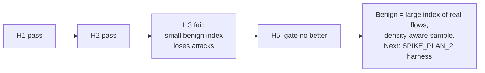
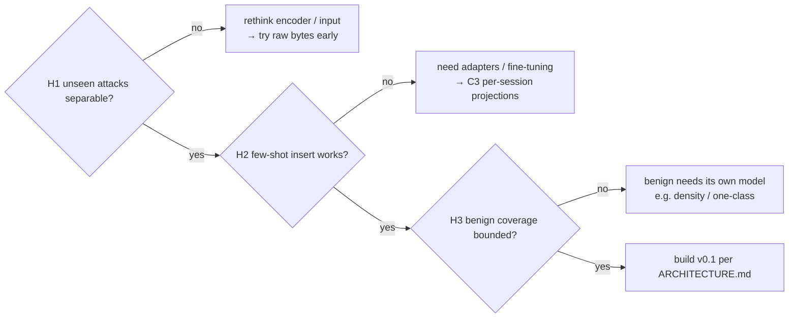

# Spike plan: does the approach work at all?

**Status (2026-11-16): H1–H3 and H5 run; H4 parked. Details in [`experiments.md`](experiments.md).** Follow-up: [`SPIKE_PLAN_2.md`](SPIKE_PLAN_2.md) (update logic, benign gate) and [`SPIKE_PLAN_3.md`](SPIKE_PLAN_3.md) (parked).

## Outcomes

| # | Result | Verdict |
|---|---|---|
| **H1** | Unseen attack families are far from known data. Median AUROC 0.96 (kNN-raw), 0.93 (XGBoost), 0.91 (Isolation Forest). Mean attack recall at 1% false alarms: 0.70 vs. 0.28 vs. 0.14. Bot fails for every method. | **Pass** (original CSVs; not repeated on the corrected data) |
| **H2** | 5 inserted examples name a new class as well as retraining XGBoost (0.47 vs. 0.47; 0.62 vs. 0.59 at 50). With no examples, kNN flags 82% of unseen families vs. 42% for XGBoost. Benign false alarms unchanged. | **Pass** (corrected CIC-IDS2017) |
| **H3** | A bounded benign index loses detection: 20k entries catch 68% of attacks, the full 512k catch 86%. K-center does *not* beat random. False alarms stay about 1% because the threshold is calibrated to it. | **Fail as stated** |
| **H4** | The learned encoder never beat standardised raw features (H1, H2; also in the old repo). | **Parked until raw bytes** |
| **H5** | One-class gates (AE 0.47, VAE 0.58) catch fewer attacks than the kNN benign index (0.68 at 20k, 0.86 full). XGBoost benign-vs-rest catches all known attacks but 47% of unseen ones. | **A benign gate does not beat the kNN index** |

Before building the system in [`ARCHITECTURE.md`](ARCHITECTURE.md), we test the four bets it depends on. Each test is a small script on data we already have; nothing from C4/C6–C10 gets built.

## The bets

| # | Bet | Test | Go if |
|---|---|---|---|
| **H1** | **Unknown attacks land far from everything known.** The open-set idea depends entirely on this. | Leave one attack out: for each attack X, train without X. Score held-out benign and X by distance to their k nearest neighbours. Report AUROC (X vs. benign) and the share of X flagged at 1% benign FPR. | Median AUROC ≳ 0.9 across attack families |
| **H2** | **A few examples teach a new class, with no retraining.** | Same setup: insert k ∈ {1, 5, 10, 50} examples of X into the index. Measure recall on X and benign FPR. | k = 5–10 gives usable recall without raising benign FPR |
| **H3** | **A bounded index can cover benign.** | Index Mon/Tue benign and test on Wed–Fri benign. Plot benign FPR against index size, comparing k-center coverage selection with random selection. | ≤ 1% FPR at a size that fits in memory; coverage beats random |
| **H4** | **A learned encoder is worth having.** | Run H1–H3 on three spaces: (a) standardised raw features, (b) a supervised encoder, (c) a self-supervised encoder. | (b) or (c) clearly beats (a) |

All tests use **chronological splits** (no random within-session splits).

**Baselines**, under the same protocol:
- **XGBoost:** max class probability as the confidence score; retrained with the k examples for H2.
- **Isolation Forest:** fit on benign only, anomaly score.

## Decision flow

## Decisions after H1/H2 (2026-11-15)

- **Drop Isolation Forest** from further spikes: it was the weakest method everywhere (H1 and H2).
- **Drop the learned-encoder kNN** until we move to raw bytes. On flow features it never beat raw features, in two datasets (H1, H2). H4 is parked, not answered; it is only meaningful on bytes.
- **Compare only kNN-raw vs. XGBoost** from H3 on.
- **Hold out more than one unseen family at a time** (e.g. 2–3 held out together). One unseen attack is too easy, because the index only has to separate it from benign and known attacks.
- **Attack families are the unit.** Sub-attacks (Hulk, Slowloris, FTP-/SSH-Patator, the three web attacks…) are merged into one label per family. This is already how `data_improved.py` maps them (`FAMILY`).
  - **Consequence:** variant coverage inside a family can't be tested any more, and H2's DoS/brute-force "naming ceiling" will show up as plain low recall for the family.

## Decisions after H3/H5 (2026-11-16)

- **Benign is a large index of real flows**, not a small coverage coreset or a one-class gate. This is the hardest constraint on size and latency, which is why [`SPIKE_PLAN_3.md`](SPIKE_PLAN_3.md) (capped flat vs. ANN) is parked for later.
- **Every result reports the full confusion matrix.**
- Isolation Forest, the encoder kNN and BFS-NID are not compared any more.

## Practicalities
- **Data:** CIC-IDS2017 MachineLearningCVE CSVs first (quick). If H1 passes, re-check on the corrected CIC-IDS2017, because artefact flows could inflate or hide separability.
- **Code:** scripts in `spikes/`. Results, with one table and one plot per bet, go in `experiments.md`.
- **Not covered:** raw bytes (v1). If H1 or H4 fails on flow features, that's the signal to try bytes earlier.
