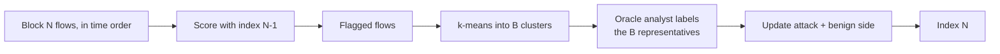
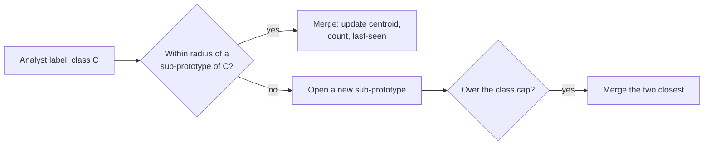
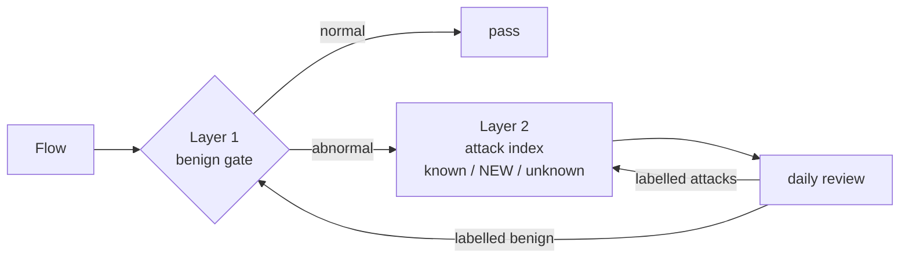

# Spike plan 2: index update logic and the benign gate

**Status (2026-11-16): the first pass is done (A0–A3b, B1–B4, H5/H5b). Results and full confusion matrices: [`experiments.md`](experiments.md) (H5, H5b, H6 entries) and `spikes/results/h6/REPORT.md`.**

Follows [`SPIKE_PLAN.md`](SPIKE_PLAN.md). Two questions:

- **(a)** How should the index change over time for benign and for attacks?
- **(b)** Should a one-class benign gate (VAE or similar) sit in front of the attack index?

## Summary of findings

| Question | Answer so far |
|---|---|
| Does updating the index from analyst labels work? | **Yes.** From a frozen index (names nothing), labels lift ddos to 83% named and portscan to 24–82%. Known attacks are not damaged; false alarms do not rise. |
| Does age-based deletion work (A2)? | **No.** DoS naming on the held-out known-attack check falls from 0.89 to 0.00–0.09. |
| Do sub-prototypes (A3b) work? | **Partly.** No forgetting, near-zero misnaming at a tight radius, and 250–340 attack entries instead of 4–6k. But lower naming recall. The radius is the trade-off; no setting wins on both. |
| Best benign rule? | **B3** (density-aware sample): 0.9% benign false alarms vs. 1.2% for random (B1). Recency weighting (B2) gives nothing. |
| Does a VAE gate in front of the attack index work (B4)? | **No.** It passes known attacks as normal (brute force 99% → 0% named; web 0% flagged), and about 1,000 attack flows per run leak into its training pool. It is 200× smaller and 5× faster. |
| Does a benign gate beat the kNN benign index (H5)? | **No.** VAE 0.58, AE 0.47 vs. kNN 0.68 (20k) and 0.86 (full) attack recall at 1% false alarms. XGBoost: all known attacks, 47% of unseen ones. |
| Still unsolved | Bot (never flagged), infiltration (36 flows, almost never named), threshold drift (2.3–2.7% false alarms in the busiest hours). |

## (a) Index update logic

### Decisions (2026-11-16)

- **Training block:** Mon–Wed (24 capture hours). Known at the start: brute force, DoS, heartbleed (first 60% in time of each; the last 40% is a held-out probe scored every block).
- **Replay:** Thu and Fri in **1-hour blocks** (20 blocks), test-then-train. The 8-hour blocks first proposed were dropped: they give only 8 replay blocks and most attacks fall in a single block. New in replay: web, infiltration, portscan (a variant), bot, ddos.
- **Analyst budget:** B = 100 and 500 labels per block, **representatives only** (one label = one exemplar; no label propagation).
- **No audits:** one fixed threshold set on held-out training benign.
- **Caps:** 2,000 exemplars per class (k-center) for A1/A2; 100 sub-prototypes per class for A3/A3b; benign index 100k entries. A larger index with approximate search is parked in [`SPIKE_PLAN_3.md`](SPIKE_PLAN_3.md).
- **Every result reports the full confusion matrix** (true class × predicted: benign, each family, unknown).

### Test protocol

- **Drift proxy:** attack families stay merged (one label each). The dataset's own timeline provides new families and variants over time.
- **Metrics per block:** benign false alarms; share flagged and share named per family; misnamed attack flows; labels used; index size; attack flows that entered the benign pool; held-out known-attack probe (forgetting).

### Attack side

| ID | Approach | Status | Result |
|---|---|---|---|
| **A0** | Frozen | Run | Flags 87–100% of new families but names none. DDoS is named DoS 42% of the time. |
| **A1** | Append-only, ≤2,000 exemplars per class (k-center) | Run | Best naming recall (portscan 0.82 at B = 500), but 6–8% of attack flows misnamed. |
| **A2** | A1 + retire exemplars with no hit for 3 blocks (20 anchors kept) | Run | **Forgets DoS** (0.89 → 0.00). No gain elsewhere. |
| **A3** | Sub-prototypes, kNN vote + radius check | Run, **failed** | The vote lets benign neighbours outvote few centroids; wider radii made it worse. |
| **A3b** | Sub-prototypes, nearest prototype inside its radius and nearer than the nearest benign entry | Run | See summary. Designed after A3 failed, so numbers are optimistic. |
| **A4** | Continuous, tiered (provisional → confirmed) | Not run | – |
| **A5** | Continuous auto write-back, no analyst | Not run | – |

### Benign side

| ID | Rule | Status | Result |
|---|---|---|---|
| B1 | Random 100k sample of the confirmed/assumed-benign pool | Run | 1.2% benign false alarms |
| B2 | Recency-weighted sample (half-life 6 blocks) | Run | Same as B1 |
| **B3** | Density-aware: k-means (2,000 clusters), real flows drawn with weight ∝ size^-0.5 | Run | **0.9%**; lower in almost every block |
| B4 | VAE gate, fine-tuned each block; no benign index | Run | See (b). Fails as layer 1 |

**Pool rule:** confirmed benign from the analyst, plus 3,000 unflagged flows per block as "assumed benign". Contamination (attack flows that entered the pool): 74–105 per run for B1–B3; about 1,000 for B4.

## (b) VAE / dual-model approach

- **H5 / H5b (done):** the gates compared were the kNN benign index, a VAE, an AE, and XGBoost benign-vs-rest. Known and unseen attacks scored together under one threshold: XGBoost catches 100% of known and 47% of unseen; the full kNN index catches 85–86% of both; the AE/VAE are worse than the 20k kNN index. Bot is missed by all.
- **B4 in the replay (done):** the VAE passes brute force and DoS probe flows (0% and 6–7% named) and web attacks (0% flagged), so layer 2 never sees them.
- **Not tested:** routing gate-passed flows through the attack index too, and keeping gate-passed flows out of the VAE's training pool. Deep SVDD, outlier exposure and Isolation Forest are dropped.

## What was reused from the old repo (`NID/Exoeriment-1`)

I read `index.py`, `lifecycle.py`, the structure of `continual.py` and `experiments.md` on `exp5-continual-learning`. For `exp-2`, `exp3` and `exp4` I looked only at the commit titles, not the diffs; `exp5` includes their work.

| Old repo | Used? |
|---|---|
| `index.py`: PINNED vs WRITEBACK tag, timestamps, TTL eviction, rebuild on delete | Rebuild-on-delete is used (FAISS Flat cannot delete). TTL eviction is **not**: A2 shows it forgets. |
| `index.py`: automatic write-back of confident predictions | Not used. A5 (no analyst) not run. |
| `continual.py`: replay with session tags, append-only label space, forgetting matrix, per-session benign false alarms | Ideas used in the harness (held-out probe, per-block false alarms). |
| `lifecycle.py`: MLflow staging → production | **Not needed for now** (no MLflow). |
| Closed-set sessions, learned encoder | Not used. The encoder never beat raw features. |
| EXP-01–04 lessons | Used: correct imbalance once, dedupe before splitting, small classes (36 flows) can't support a test. |

## Next

1. **Threshold re-calibration** over time without audits (the busiest hours reach 2–3% false alarms).
2. **Per-prototype radii** from each prototype's own spread, and medoids instead of means (A3c); label propagation within clusters.
3. **Layer-1 rework:** gate-passed flows still reach the attack index; keep them out of the VAE's pool.
4. **Why infiltration is almost never named:** in the first look (seed 0), labels were given but later flows sit closer to DoS exemplars than to the earlier infiltration flows. See the H6 follow-up in `experiments.md`.
5. **A4 / A5** (continuous variants), if the daily-only story is not enough.
6. [`SPIKE_PLAN_3.md`](SPIKE_PLAN_3.md): capped flat index vs. a large index with approximate search.
