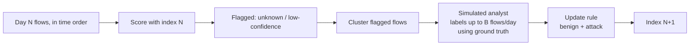
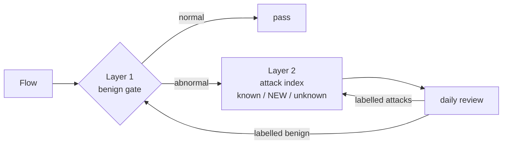

# Spike plan 2: index update logic and the benign gate

**Status: draft for discussion. Nothing here is built or run.**

Follows [`SPIKE_PLAN.md`](SPIKE_PLAN.md) (H1–H3, results in [`experiments.md`](experiments.md)). Two open questions:

- **(a)** How should the index change over time, daily and continuously, for benign and for attacks?
- **(b)** Should a one-class benign gate (VAE or similar) sit in front of the attack index?

## What H1–H3 say about the design

| Finding | Consequence |
|---|---|
| H3: a 20k benign index catches 68% of attacks, the full 512k catches 86%. Random selection beats k-center. | Benign coverage is the weak point. Fixed benign indexes lose attacks. |
| H2: 5 inserted examples name a new class about as well as retraining. | Attack side: insertion works. The question is how to *choose and age* examples. |
| H2: first-in-time examples cover one variant. | Variants are the drift signal. Use them to test attack-signature drift. |
| H1/H2: the learned encoder never beat raw features. | Keep raw features until the raw-byte stage. |

## (a) Index update logic

### Common test protocol (one harness for every approach)

- **Time unit:** CIC-IDS2017 has only 5 days. Cut it into 8-hour blocks (about 15 "days") so there are enough update steps. State this in every result.
- **Drift proxy:** attack families stay merged (one label each). **Variants inside a family arrive in time order** (Slowloris → Hulk, FTP → SSH-Patator, …). That is the signature evolution the index must absorb.
- **Analyst budget B:** labels per day, e.g. 10 / 50 / 200. The oracle labels cluster representatives, not random flows.
- **Metrics, per day:**
  - benign false-alarm rate
  - recall and *naming* recall per family
  - the forgetting matrix (the old repo's `R[i][j]`: score on day j after update i)
  - labels used and index size
  - contamination: attacks that entered the benign pool

### Approaches to compare

| ID | Approach | Idea | Main risk |
|---|---|---|---|
| **A0** | Frozen | No update. Reference. | – |
| **A1** | Daily batch, append-only | Each day, add labelled examples. Cap per class using within-class k-center. | Grows; old variants dominate. |
| **A2** | Daily batch, aged | A1 plus recency weights. Exemplars with no hits for N days are retired. Keep a small anchor set per class so nothing is forgotten completely. | Retiring a rare-but-returning attack. |
| **A3** | Daily batch, sub-prototypes | When recent members of a class sit far from its exemplars, open a new sub-prototype rather than moving the old one. | Prototype count creeps up. |
| **A4** | Continuous, tiered | Within the day, flagged flows go to a *provisional* tier (cluster live, quarantined, expires unless confirmed). The analyst confirms at end of day, and confirmed flows move into the core tier. | Provisional tier can steer decisions wrongly if used for naming. |
| **A5** | Continuous, auto write-back | The old repo's approach: confident predictions are added automatically, with no analyst. | Self-reinforcing mistakes. Included as a negative baseline. |

**Benign side, compared under the same harness:**

| ID | Rule |
|---|---|
| B1 | Pool of all confirmed benign so far; random sample to the size cap (H3 says random ≥ k-center). |
| B2 | Recency-weighted reservoir: newer days over-represented. |
| B3 | Density-aware centroids (k-means) over the pool, rebuilt daily. |
| B4 | A parametric model fine-tuned daily with replay (see (b)). |

**Pool rule:** only analyst-confirmed benign, plus a sampled share of unflagged flows labelled "assumed benign". Test the effect of the assumed share, because it is the contamination risk.

## (b) VAE / dual-model approach

**H5: does a gate beat the benign kNN index?** Reuse the H3 split (Mon/Tue train, Wed–Fri test) and compare:

| Gate | Notes |
|---|---|
| kNN benign index (20k / full) | H3 numbers: baseline. |
| VAE / autoencoder, benign only | Reconstruction error as the score. |
| XGBoost benign-vs-rest | Supervised gate. H1 predicts it misses unseen families. |

Deep SVDD, outlier exposure and Isolation Forest are dropped for now.

**Metrics:**
- Attack recall per family at 1% benign false alarms on Wed–Fri, against the H3 table.
- Share of traffic passed (this is how much layer 2 saves).
- End-to-end: gate → kNN attack index, with the same families held out.

**Expected trouble:** bot looks like benign in these features, so it may pass any gate. If it does, that is a feature problem (bytes or host context), not a gate problem. Gate threshold and attacks near the benign boundary are the same trade-off as H3, and the gate may not be better.

## What to reuse from the old repo (`NID/Exoeriment-1`)

I read `index.py`, `lifecycle.py`, the structure of `continual.py` and `experiments.md` on `exp5-continual-learning`. For `exp-2`, `exp3` and `exp4` I looked only at the commit titles, not the diffs; `exp5` includes their work.

| Old repo | Verdict for this project |
|---|---|
| `index.py`: PINNED vs WRITEBACK source tag, per-row timestamp, TTL eviction, cap by oldest, rebuild on delete (Flat FAISS can't remove) | **Reuse the data model.** Pinned = confirmed core, write-back = provisional tier. Wall-clock TTL becomes day-index aging. |
| `index.py`: automatic write-back of confident attack predictions | **Don't reuse as is.** No analyst, and errors reinforce themselves (A5 tests it). |
| `continual.py`: replay buffer tagged with session, append-only label space, forgetting matrix, per-session benign false alarm rate | **Reuse the evaluation ideas** for the harness above. |
| `lifecycle.py`: MLflow staging → production, `promote_if_better` | **Not needed for now** (no MLflow). The shadow → live idea stays in C9 as a plain design note. |
| Closed-set, random-ish sessions, learned encoder | **Don't reuse.** Our results: the learned encoder never beat raw features, and its kNN prior added nothing. |
| EXP-01–04 lessons | Correct imbalance once, not twice; dedupe before splitting; tune one benign offset on held-out data; rare classes (36 rows) can't support a test. |

## Decisions for you

1. **Time unit:** is 8-hour blocks acceptable, or do you want something else?
2. **Analyst budget:** which values of B (labels per day) to sweep?
3. **Run order:** (a) harness first, with the benign gate deferred, or H5 first?
4. **Approaches:** drop or add any of A0–A5 and B1–B4?
