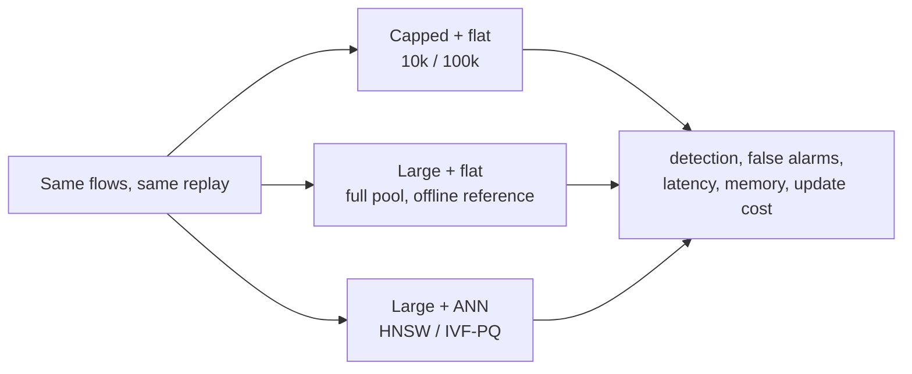

# Spike plan 3 (later): capped flat index vs. large index with approximate search

**Status: parked. Run after the daily-update harness ([`SPIKE_PLAN_2.md`](SPIKE_PLAN_2.md)).**

## Question

Does it pay to keep a **small, capped index with exact (flat) search**, or a **very large (or uncapped) index with approximate nearest-neighbour (ANN) search**?

- H3 showed benign coverage is the weak point: the 512k index caught 86% of attacks, a 20k index only 68%.
- Exact search over 500k+ entries is too slow for streaming traffic. ANN may give the large index at flat-index speed, but only if its approximation does not change the results.

## Variants

| ID | Index | Search | Role |
|---|---|---|---|
| F-small | 10k–100k entries (capped) | Flat | Harness default |
| F-full | Whole pool, about 1M+ benign, all attacks | Flat | Exact reference. Offline only. |
| H | Same large pool | HNSW (a few M / efSearch settings) | Candidate for production |
| I | Same large pool | IVF-PQ (a few nlist / nprobe settings) | Lower memory |

## Measurements

| What | Why |
|---|---|
| ANN recall@10 vs. exact neighbours | Does ANN return the same neighbours? |
| **Novelty score error** (approximate vs. exact mean distance) | The alarm threshold depends on absolute distances; approximate neighbours bias them upward. |
| Benign false alarms and attack recall, with the **full confusion matrix** | Does the end result change? |
| Query latency (p50 / p99) and throughput | Streaming budget. |
| Memory | Fit on one host. |
| **Update cost** | Daily inserts, plus removals when ageing out exemplars. HNSW does not delete cleanly (the old repo rebuilt the index on delete). |

## Decide

- If HNSW matches F-full within noise at far lower latency, use a large index with ANN and drop the benign cap.
- If the threshold needs re-calibrating on ANN scores, include that in the pipeline.
- If updates (deletes) are too costly, use periodic rebuilds.

## Notes

- Test again once the raw-byte encoder exists. Embeddings of 4,096+ dimensions change the ANN trade-offs.
- Every result reports the full confusion matrix.
