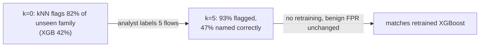

# Experiments log

One entry per experiment: **what we tried → result → why we think so → next**. Plan: [`SPIKE_PLAN.md`](SPIKE_PLAN.md).  Follow-up plans: [`SPIKE_PLAN_2.md`](SPIKE_PLAN_2.md), [`SPIKE_PLAN_3.md`](SPIKE_PLAN_3.md) (parked). Design: [`ARCHITECTURE.md`](ARCHITECTURE.md).

| Entry | Question | One-line result |
|---|---|---|
| H1 | Are unseen attack families far from known data? | Yes (median AUROC 0.96); bot fails. |
| H2 | Do a few labelled examples teach a new class without retraining? | Yes; 5 examples match retrained XGBoost. |
| H3 | Can a bounded index cover benign? | No as stated: 20k catches 68% of attacks, full 512k catches 86%; k-center loses to random. |
| H5 | Does a benign gate (AE/VAE/XGBoost) beat the benign kNN index? | No. |
| H5b | The same gates with known and unseen attacks together | XGBoost: all known, 47% unseen. Full kNN: 85–86% of both. |
| H6 (A0–A2) | Daily-update replay, frozen vs. append-only vs. ageing | Updating works; ageing forgets DoS. |
| H6 follow-up | Why is infiltration never named? | Labels were given; later flows sit nearer DoS exemplars. |
| H6 (A3 / A3b) | Sub-prototypes instead of ageing | No forgetting, near-zero misnaming, tiny index; lower naming recall; radius is the trade-off. |
| H6 (B1–B4) | Benign rules with A1 and A3b | B3 (density-aware) lowers false alarms (0.9% vs. 1.2%); a VAE gate hides known attacks. |

Every result from H5 onwards reports full confusion matrices (inline, or in `spikes/results/h6/REPORT.md`).


---

## H1 · Do unseen attack families land far from everything known?  (2026-11-15, 2 seeds)

**Tried:** `spikes/h1_unknown_separability.py`. Leave one attack family out on CIC-IDS2017 (MachineLearningCVE CSVs, deduplicated, `Destination Port` dropped).
- **Splits:** chronological within each day-file.
  - Train = first 60%, minus the held-out family X.
  - Val = benign rows at 60–70%, used only to set the threshold.
  - Test = benign rows in the last 30%, plus *all* rows of X.
- **Training sample sizes:** 150k benign, ≤ 10k rows per known attack class.
- **Alarm rule:**
  - kNN methods: novel (mean distance to the 10 nearest neighbours > τ) **or** the kNN vote says attack.
  - XGBoost: 1 − P(benign) > τ.
  - Isolation Forest: anomaly score > τ.
- **Threshold:** τ is set on val benign for 1% FPR.

**Result:** mean of 2 seeds; the seed std of AUROC is ≤ 0.02 everywhere.

| held-out family (n) | AUROC kNN-raw | AUROC kNN-enc | AUROC XGB | AUROC IForest | **TPR @1% kNN-raw** | TPR kNN-enc | TPR XGB | TPR IForest |
|---|---|---|---|---|---|---|---|---|
| bot (1,416) | 0.60 | 0.61 | **0.84** | 0.79 | 0.03 | 0.00 | 0.00 | 0.00 |
| bruteforce (9,150) | 0.95 | 0.95 | 0.90 | 0.79 | 0.45 | 0.42 | 0.03 | 0.00 |
| ddos (10k) | 0.99 | 0.99 | 0.96 | 0.91 | 0.86 | 0.64 | 0.29 | 0.00 |
| dos (10k) | 0.98 | 0.98 | 0.92 | 0.92 | 0.81 | 0.64 | 0.13 | 0.02 |
| heartbleed (11) | 1.00 | 1.00 | 0.98 | 1.00 | 1.00 | 0.91 | 0.64 | 0.73 |
| infiltration (36) | 0.97 | 0.93 | 0.84 | 0.96 | 0.86 | 0.22 | 0.00 | 0.33 |
| portscan (1,850) | 0.96 | 0.96 | 0.94 | 0.91 | 0.64 | 0.57 | 0.22 | 0.05 |
| web (2,143) | 0.48 * | 0.94 | 0.99 | 0.86 | 0.92 | 0.92 | 0.91 | 0.00 |
| **median AUROC / mean TPR** | **0.96** | 0.96 | 0.93 | 0.91 | **0.70** | 0.54 | 0.28 | 0.14 |

The real benign FPR on test is 1.5–1.7% for the kNN methods and about 1.3% for XGB, against the 1% target set on val.

\* Raw-feature kNN puts held-out web attacks *next to known attacks*, so the novelty score misses them. The kNN vote still flags 92% of them as an attack.

```
mean TPR on unseen families at ~1% benign FPR
kNN raw   ██████████████      0.70
kNN enc   ███████████         0.54
XGBoost   ██████              0.28
IForest   ███                 0.14
```

**Why:**
- **H1 mostly passes.** The median AUROC is 0.96, and 6 of 8 families are ≥ 0.93. An unseen attack is caught either because it is far from everything known, or because it sits near a known attack (web); both raise an alarm.
- **Ranking well is not the same as catching at low FPR.** Several families score AUROC 0.95+ with TPR of only 45–65%. Most of each family is separable, but a chunk sits inside the benign cloud.
- **Bot fails for everything except XGB's ranking** (0.84 AUROC, still 0% TPR). Bot flows look like benign traffic in these 77 flow features. This is a likely candidate for raw bytes or host/time context.
- **The closed-set classifier misses unknowns.** XGB ranks well but catches only 28% at the operating point. That is the gap the retrieval approach is meant to fill.
- **The learned encoder adds nothing over raw features** (early H4 signal), except for web. It is worse at the operating point, which suggests SupCon tightens known classes but compresses the benign region, so unknowns land closer to benign.
- **The threshold drifts:** a 1% FPR set on the 60–70% slice becomes 1.5–1.7% later in the day. Calibration will need refreshing (C5/C10).

**Caveats:**
- Heartbleed (11) and Infiltration (36) are tiny, so their numbers are anecdotal.
- These are artefact-laden CSVs, not the corrected re-extraction.
- One k (10); no tuning of the encoder or the kNN score.

**Next:**
- H2: few-shot insertion of the held-out family (k = 1/5/10/50), starting from this same setup.
- Re-check H1 on the corrected CIC-IDS2017.
- H4 needs a better encoder candidate (self-supervised, or a loss that keeps benign spread out) before we can call it.

Raw: `spikes/results/h1/seed{0,1}/`.

---

## H2 · Can a few labelled examples teach a new class, with no retraining?  (2026-11-15, 2 seeds, **corrected CIC-IDS2017**)

**Tried:** `spikes/h2_fewshot_insert.py` on the corrected CIC-IDS2017 (Engelen et al., CNS 2022).
- **Data handling** (`spikes/data_improved.py`):
  - Rows sorted by real timestamp; "Attempted" rows dropped.
  - "Infiltration - Portscan" counted as portscan.
  - Identifier columns dropped (IPs, ports, Flow ID, Timestamp).
  - Deduplicated: 1.71M rows, 82 features.
- **Splits:**
  - Benign: by position within the day.
  - Known attacks: by time *within their own class*, since each attack is a single time window.
- **Procedure:**
  - Leave one family out, then take the **first k rows of the held-out family in time** as the analyst's labels, for k ∈ {0, 1, 5, 10, 50}.
  - kNN: insert the shots into the index as "NEW"; the encoder is frozen.
  - XGBoost: **retrained** with the shots.

**Result** (mean over families and seeds; benign FPR does not move with k):

| k | recall NEW: kNN-raw | kNN-enc | XGB (retrained) | detect (any alarm): kNN-raw | kNN-enc | XGB | IForest |
|---|---|---|---|---|---|---|---|
| 0 | 0 | 0 | 0 | **0.82** | 0.63 | 0.42 | 0.17 |
| 1 | 0.05 | 0.02 | 0.04 | **0.82** | 0.63 | 0.68 | 0.17 |
| 5 | **0.47** | 0.34 | 0.47 | **0.93** | 0.74 | 0.83 | 0.17 |
| 10 | **0.47** | 0.44 | 0.44 | **0.93** | 0.77 | 0.82 | 0.11 |
| 50 | **0.62** | 0.60 | 0.59 | **0.91** | 0.75 | 0.85 | 0.12 |

- Benign FPR: kNN-raw 1.4%, kNN-enc 1.1%, XGB 1.0%, IForest 0.7%.
- Known attacks predicted as NEW: about 0 for all methods.

Recall of NEW by family at k = 10 (kNN-raw): bot 0.90, web 0.76, portscan 0.64, bruteforce 0.57, ddos 0.45, dos **0.01**. Heartbleed (6 test rows) and Infiltration (18) are too small to read.



**Why:**
- **H2 passes for the mechanism.** Five inserted examples give the same NEW-class recall as fully retraining XGBoost (0.47 vs 0.47). There is no encoder update, no damage to known classes, and no rise in benign FPR. Bot goes from 0% to 90% recall with 10 shots.
- **The recall ceiling is about variants, not the method.** The first k flows in time all come from one variant:
  - **DoS:** the first flows are Slowloris; the test set is mostly Hulk, so recall is 0.01.
  - **Brute force:** the shots are all FTP-Patator, and the 0.57 recall is exactly the FTP share of the test set.
  - **Portscan:** Thursday's infiltration scan vs. Friday's.

  The other variants are still **flagged** (detect 0.9+), just not named. In the real system the analyst labels them the next day. The daily loop (C7/C8) handles this, and H2 can't show it in a single step.
- **H1 replicates on the corrected data:** with no shots, kNN-raw flags 82% of unseen families vs. 42% for XGB.
- **The learned encoder is again no better than raw features** (H4 signal, now on two datasets).

**Caveats:**
- Shots are "first in time", which is realistic but makes results depend on variant order.
- Small families (heartbleed, infiltration, web) have tiny test sets.
- One analyst step only; multi-day labelling isn't simulated.

**Next:**
- Simulate the daily loop: each day, label k flows sampled from *flagged clusters* rather than the first k. This should lift DoS and brute-force naming.
- Then H3 (benign coverage).
- H4 needs a better encoder candidate.

Raw: `spikes/results/h2/seed{0,1}/`.

---

## H3 · Can a bounded index cover benign traffic?  (2026-11-16, 2 seeds, corrected CIC-IDS2017)

**Tried:** `spikes/h3_benign_coverage.py`. Benign only, kNN-raw, novelty score = mean distance to the 10 nearest index entries.
- **Pool:** Mon+Tue benign (512k candidates after an 80/20 time split; the last 20% is held out to calibrate the threshold).
- **Test:** Wed, Thu, Fri benign, scored per day (50k each).
- **Selection:** random vs. greedy k-center (farthest-first, over a 200k-flow candidate subsample), 500 to 20k entries, plus the full 512k index as a ceiling.
- **Threshold:** τ is the 99th percentile of calibration scores.
- **First version flaw:** it measured only benign FPR, which is about 1% at every size because τ is calibrated to it. The real cost of a small index is a higher τ that misses attacks. I added the share of attack flows (all families, Tue–Fri, 3k per family, no hold-out) scoring above τ.

**Result** (mean of 2 seeds):

| index size | τ (random) | benign FPR Wed/Thu/Fri (random) | attack TPR, mean over 8 families: random | k-center |
|---|---|---|---|---|
| 500 | 12.7 | 0.8–0.9% | 0.23 | 0.26 |
| 2,000 | 8.9 | 1.0–1.2% | 0.32 | 0.34 |
| 5,000 | 7.0 | 1.0–1.3% | 0.49 | 0.42 |
| 10,000 | 6.0 | 1.0–1.3% | 0.60 | 0.42 |
| 20,000 | 4.9 | 1.0–1.4% | **0.68** | 0.63 |
| 512k (full) | 2.5 | 1.1–1.6% | **0.86** | – |

- Benign FPR stays at about 1% at every size and on all three days, so there is no day-to-day drift.
- At 20k random, the families the small index loses most are DoS (0.09 vs. 0.95 full), bot (0.06 vs. 0.06, which is lost at every size) and portscan (0.88 vs. 0.97).

**Why:**
- **H3 fails as stated.** Coverage buys detection, not false-alarm control. A small index gives a large τ, and attacks that sit moderately far from benign slip under it. At 20k entries we keep 0.68 of what the full index detects (0.86).
- **k-center does not beat random.** It is slightly better at 500–2k, and worse from 5k up, because it spends entries on outlier flows and leaves dense benign regions thin. The farthest-first rule is the wrong objective when the threshold is a quantile of the score distribution.
- **Alarm quality depends on a dense benign region near the attacks**, not on covering the extremes.

**Caveats:**
- The novelty channel only. The real system also votes against known-attack exemplars, so known classes don't depend on τ.
- The threshold is set on Mon/Tue, so a Wed–Fri shift would show up as a change in FPR. None appeared.
- Two seeds, one k (10), one dataset.

**Next:**
- Try a density-aware selection, e.g. k-means centroids, or k-center with the farthest 1–5% trimmed.
- Check whether a hybrid fixes it: a smaller coverage index for benign plus a trained one-class model for the benign boundary.
- Index size vs. query latency also matters; 512k flat search is too slow for streaming without an ANN index (HNSW).

Raw: `spikes/results/h3/seed{0,1}/`.

---

## H5 · Does a benign gate (AE / VAE / XGBoost) beat the benign kNN index?  (2026-11-16, 2 seeds, corrected CIC-IDS2017)

**Tried:** `spikes/h5_benign_gate.py`, on the H3 split (Mon/Tue benign for training, Wed–Fri test). τ is the 99th percentile of held-out benign scores for each gate. Attack flows are Tue–Fri, up to 3,000 per family.
- **kNN benign index:** 20k entries and the full 512k (H3 numbers, re-measured).
- **AE and VAE:** MLP 82→128→64→16, trained 20 epochs on benign only. Score is reconstruction error.
- **XGBoost:** benign-vs-rest, trained without the evaluated family each time (leave-one-family-out).

**Result** (mean of 2 seeds; benign FPR is 1–2% for every gate on every day, so no gate changes the false-alarm load):

| gate | mean attack TPR @ 1% FPR | mean AUROC |
|---|---|---|
| kNN full (512k entries) | **0.86** | **0.99** |
| kNN 20k | 0.68 | 0.98 |
| VAE | 0.58 | 0.95 |
| XGBoost (unseen family) | 0.49 | 0.97 |
| AE | 0.47 | 0.95 |

| TPR by family | bot | brute force | ddos | dos | portscan | web | heartbleed* | infiltration* |
|---|---|---|---|---|---|---|---|---|
| kNN full | 0.06 | 1.00 | 1.00 | 0.95 | 0.97 | 0.87 | 1.00 | 1.00 |
| kNN 20k | 0.06 | 0.57 | 1.00 | 0.09 | 0.89 | 0.87 | 1.00 | 0.96 |
| VAE | 0.06 | 0.21 | 1.00 | 0.32 | 0.93 | 0.21 | 1.00 | 0.94 |
| AE | 0.06 | 0.00 | 0.64 | 0.12 | 0.93 | 0.06 | 1.00 | 0.94 |
| XGBoost | 0.16 | 0.15 | 1.00 | 0.97 | 0.17 | 0.10 | 1.00 | 0.40 |

\* 11 and 36 test flows.

**Why:**
- **H5 fails: a compact model does not beat the exemplar index.** The VAE reaches 0.58 and the AE 0.47, below the 20k kNN index (0.68) and far below the full index (0.86).
- **The ranking is fine, the operating point is not.** AUROC is 0.95 or higher for every gate, but at 1% false alarms the AE/VAE miss families like brute force and web. A single reconstruction-error threshold overlaps with benign for these families.
- **XGBoost is uneven:** 0.97 on DoS but 0.17 on portscan and 0.10 on web. A supervised gate generalises from the families it saw, as H1 predicted.
- **Bot is missed by everything** (0.06–0.16).
- **What actually helps is storing benign flows.** The full kNN index wins, so the useful structure is local (fine-grained neighbourhoods of normal flows), which a 16-dimensional bottleneck smooths away.

**Caveats:**
- One untuned architecture and 20 epochs; a larger or differently-regularised VAE may do better.
- The mean TPR includes tiny families (heartbleed 11, infiltration 36, web 104 flows).
- The full kNN index has 512k entries, which is slow without an approximate index (HNSW).
- The end-to-end test (gate → attack index) was not run.

**Next:**
- Decide the benign strategy, probably an exemplar index (full pool, or the biggest size the latency budget allows) rather than a gate.
- Daily update harness in `SPIKE_PLAN_2.md` (a), which now matters more, since the benign index must stay large and current.

Raw: `spikes/results/h5/seed{0,1}/`.

---

## H5b · Benign gate with known and unseen attacks together  (2026-11-16, 2 seeds, corrected CIC-IDS2017)

**Tried:** `spikes/h5b_known_and_unseen.py`. Same data and split as H5, but known and unseen attacks are scored together under **one threshold** per gate (1% benign false alarms).
- **Folds:** 4 folds, each with 2 unseen families (bot+web, dos+portscan, ddos+bruteforce, heartbleed+infiltration) and the other 6 known. The pairings are arbitrary.
- **Known attacks:** XGBoost trains on the first 60% in time; the test uses the later 40%.
- **Unseen attacks:** never trained on; all rows are tested.
- **Gates:** kNN benign index (20k and full), AE, VAE (benign only), XGBoost benign-vs-rest (trained on known attacks).

**Result** (mean of 4 folds × 2 seeds; all gates have about 1% benign false alarms):

| gate | known attacks caught | unseen attacks caught | all 8 families (macro) |
|---|---|---|---|
| XGBoost | **1.00** | 0.47 | 0.87 |
| kNN full (512k) | 0.85 | **0.86** | 0.85 |
| kNN 20k | 0.68 | 0.68 | 0.68 |
| VAE | 0.59 | 0.58 | 0.59 |
| AE | 0.47 | 0.47 | 0.47 |

Unseen attacks caught by fold (XGBoost / kNN full): bot+web 0.15 / 0.46, ddos+bruteforce 0.54 / 1.00, dos+portscan 0.50 / 0.96, heartbleed+infiltration 0.70 / 1.00.

**Why:**
- **The two gates are complementary.** XGBoost catches every known attack but only 47% of unseen ones. The full kNN index catches 85–86% of both, but loses 15% of known attacks that XGBoost gets.
- **Unsupervised gates treat known and unseen alike**, because they never see attack labels. That is why the AE, VAE and kNN known and unseen columns match.
- **The "all" column depends on the mix.** It averages over 8 families, 6 known and 2 unseen. XGBoost looks best there only because most families are known; it would look worse if unseen attacks were more common.
- **Bot + web is the hard fold:** no gate catches more than 46% of the unseen families.

**Caveats:**
- Each gate has its own 1% threshold, so combining two gates would raise false alarms (up to about 2%). That wasn't measured.
- Pairings are arbitrary and several families are tiny (heartbleed 11, infiltration 36, web 104).
- One untuned AE/VAE.

**Next:**
- Test a combined gate: XGBoost for known attacks plus the full kNN novelty score for unseen ones, with one false-alarm budget.
- Daily update harness (`SPIKE_PLAN_2.md` (a)).

Raw: `spikes/results/h5b/seed{0,1}/`.

---

## H6 · Daily update harness: replay Thu+Fri in 1-hour blocks  (2026-11-16, 2 seeds, corrected CIC-IDS2017)

**Tried:** `spikes/h6_daily_harness.py` (report: `spikes/h6_report.py`, `spikes/results/h6/REPORT.md`). Plan: [`SPIKE_PLAN_2.md`](SPIKE_PLAN_2.md) (a).
- **Training block:** Mon–Wed. Known at the start: brute force, DoS, heartbleed (first 60% in time of each). The last 40% is a **probe set** of known attacks, scored against the current index every block.
- **Replay:** Thu and Fri in 1-hour blocks (20 blocks), test-then-train: score the block, then update. All flows, natural class mix. New in replay: web, infiltration, portscan, bot, ddos.
- **Index:** kNN-raw, k = 10. Benign ≤ 100k entries, attacks ≤ 2,000 per class (k-center). One fixed threshold (99th percentile of held-out Mon–Wed benign), no audits.
- **Analyst:** flagged flows are clustered with k-means into B clusters; the oracle labels the B representatives only (B = 100 or 500). 3,000 unflagged flows per block are added to the benign pool as "assumed benign".
- **Approaches:** A0 frozen. A1 append-only with caps. A2 = A1 + retire exemplars with no neighbour hit for 3 blocks (20 anchors per class kept). Benign rule B1 random from pool, B2 recency-weighted (half-life 6 blocks).

**Result** (mean of 2 seeds). Cells are *share flagged / share named correctly* over the whole replay; benign FPR is about 1.2% for every config.

| config | web | infiltration | portscan | bot | ddos | labels/block |
|---|---|---|---|---|---|---|
| A0 frozen | 0.87 / 0.00 | 0.97 / 0.00 | 0.91 / 0.00 | 0.06 / 0.00 | 1.00 / 0.00 | 0 |
| A1, B1, B=100 | 0.87 / 0.15 | 0.97 / 0.00 | 0.90 / 0.45 | 0.06 / 0.00 | 1.00 / 0.83 | 79 |
| A1, B1, B=500 | 0.87 / 0.17 | 0.97 / 0.00 | 0.95 / **0.82** | 0.06 / 0.00 | 1.00 / 0.83 | 241 |
| A1, B2, B=100 | 0.87 / 0.08 | 0.97 / 0.00 | 0.94 / 0.77 | 0.06 / 0.00 | 1.00 / 0.83 | 78 |
| A1, B2, B=500 | 0.87 / 0.17 | 0.97 / 0.00 | 0.94 / 0.81 | 0.06 / 0.00 | 1.00 / 0.83 | 238 |
| A2, B1, B=100 | 0.87 / 0.15 | 0.97 / 0.00 | 0.94 / 0.41 | 0.06 / 0.00 | 1.00 / 0.83 | 79 |
| A2, B1, B=500 | 0.87 / 0.17 | 0.97 / 0.00 | 0.94 / 0.81 | 0.06 / 0.00 | 1.00 / 0.83 | 240 |
| A2, B2, B=100 | 0.87 / 0.08 | 0.97 / 0.00 | 0.90 / 0.37 | 0.06 / 0.00 | 1.00 / 0.83 | 78 |
| A2, B2, B=500 | 0.87 / 0.17 | 0.97 / 0.00 | 0.90 / 0.78 | 0.06 / 0.00 | 1.00 / 0.83 | 237 |

**Known-attack probe, share named correctly, first block → last block:**

| config | brute force | DoS | heartbleed (4 flows) |
|---|---|---|---|
| A0, A1 (all variants) | 0.99 → 0.99 | 0.89 → 0.89 (0.90 at B=500) | 0.75 → 0.75 |
| A2, B1, B=100 | 0.99 → 0.99 | 0.89 → **0.00** | 0.75 → 0.75 |
| A2, B1, B=500 | 0.99 → 0.99 | 0.89 → **0.09** | 0.75 → 0.75 |
| A2, B2, B=100 / 500 | 0.99 → 0.99 | 0.89 → **0.00** | 0.75 → 0.75 |

**Why:**
- **Updating works.** From the frozen index, the analyst's labels lift ddos from 0% to 83% named, portscan from 0% to 45–82%, and web to 15–17%. Known attacks are not damaged (A1 probe unchanged), and false alarms stay flat.
- **A frozen index still flags most attacks** (web, infiltration, portscan, ddos, 87–100%), but names none of them. DDoS gets named DoS 42% of the time, so it is wrongly labelled as a known attack.
- **A bigger budget helps only where labels are the bottleneck.** B = 500 lifts portscan (0.45 → 0.82 for A1/B1) and nothing else. DDoS is capped at 0.83 because its first hour (about 17% of its flows) is scored before any label exists.
- **Ageing hurts.** A2 forgets DoS on the probe (0.89 → 0.00 at B = 100, 0.09 at B = 500), because DoS never recurs in Thu/Fri and its exemplars time out, leaving 20 anchors per class. The anchors are not enough to keep the name. No approach gained from ageing here.
- **B1 vs B2 is inconclusive.** Differences (e.g. portscan 0.45 vs 0.77 for A1 at B = 100, the reverse for A2) are within what 2 seeds can show.
- **Bot is invisible** (6% flagged; the same finding as H1/H3/H5). Infiltration is flagged at 97% but **never named**, in any config. I did not investigate why.
- **Benign pool contamination:** 74–120 attack flows entered the benign pool per run (about 0.1–0.2% of the assumed-benign additions). I expect most are bot, but I did not check.

**Caveats:**
- Only 20 blocks, and most families appear in one or two of them. A family seen once can only be named *after* its first block, so most "named" rates have a built-in ceiling.
- Web (104 flows), infiltration (37) and heartbleed (4 in the probe) are tiny.
- The threshold is fixed, so FPR is what it is (1.2%); no drift handling was tested.
- No recurrence of known attacks in the replay, so the probe set stands in for it.
- 2 seeds. Representatives-only labelling is the weakest labelling mode, so these are lower bounds for naming.

**Next:**
- Investigate why infiltration is never named (cluster purity, the flagged portscan crowding the 500 representatives).
- Replace age-based retirement with a rule that keeps a few exemplars per variant (A3: sub-prototypes), since A2 shows plain ageing forgets.
- Try label propagation within clusters and a threshold re-calibration, then A4/A5.

**Confusion matrices for every config** (true class × predicted; "unknown" = flagged but no known class; mean of 2 seeds, rounded; replay, then the known-attack probe at the first and last block):

<details><summary>All 9 configs</summary>

### A0

**Replay (Thu+Fri), true class x predicted, flows:**

| true \ pred | n | benign | bruteforce | dos | heartbleed | web | infiltration | portscan | bot | ddos | unknown |
|---|---|---|---|---|---|---|---|---|---|---|---|
| benign | 500426 | 494374 | 24 | 78 | 4 | 0 | 0 | 0 | 0 | 0 | 5946 |
| bruteforce | 0 | 0 | 0 | 0 | 0 | 0 | 0 | 0 | 0 | 0 | 0 |
| dos | 0 | 0 | 0 | 0 | 0 | 0 | 0 | 0 | 0 | 0 | 0 |
| heartbleed | 0 | 0 | 0 | 0 | 0 | 0 | 0 | 0 | 0 | 0 | 0 |
| web | 104 | 14 | 0 | 0 | 0 | 0 | 0 | 0 | 0 | 0 | 90 |
| infiltration | 37 | 1 | 0 | 14 | 0 | 0 | 0 | 0 | 0 | 0 | 22 |
| portscan | 7698 | 659 | 30 | 76 | 0 | 0 | 0 | 0 | 0 | 0 | 6933 |
| bot | 736 | 692 | 0 | 0 | 0 | 0 | 0 | 0 | 0 | 0 | 44 |
| ddos | 95144 | 0 | 0 | 39785 | 0 | 0 | 0 | 0 | 0 | 0 | 55359 |

**Known-attack probe (held-out last 40% of Mon-Wed attacks), first block:**

| true \ pred | n | benign | bruteforce | dos | heartbleed | web | infiltration | portscan | bot | ddos | unknown |
|---|---|---|---|---|---|---|---|---|---|---|---|
| benign | 0 | 0 | 0 | 0 | 0 | 0 | 0 | 0 | 0 | 0 | 0 |
| bruteforce | 2773 | 18 | 2754 | 0 | 0 | 0 | 0 | 0 | 0 | 0 | 1 |
| dos | 3000 | 165 | 0 | 2683 | 0 | 0 | 0 | 0 | 0 | 0 | 152 |
| heartbleed | 4 | 0 | 0 | 0 | 3 | 0 | 0 | 0 | 0 | 0 | 1 |
| web | 0 | 0 | 0 | 0 | 0 | 0 | 0 | 0 | 0 | 0 | 0 |
| infiltration | 0 | 0 | 0 | 0 | 0 | 0 | 0 | 0 | 0 | 0 | 0 |
| portscan | 0 | 0 | 0 | 0 | 0 | 0 | 0 | 0 | 0 | 0 | 0 |
| bot | 0 | 0 | 0 | 0 | 0 | 0 | 0 | 0 | 0 | 0 | 0 |
| ddos | 0 | 0 | 0 | 0 | 0 | 0 | 0 | 0 | 0 | 0 | 0 |

**Known-attack probe, last block:**

| true \ pred | n | benign | bruteforce | dos | heartbleed | web | infiltration | portscan | bot | ddos | unknown |
|---|---|---|---|---|---|---|---|---|---|---|---|
| benign | 0 | 0 | 0 | 0 | 0 | 0 | 0 | 0 | 0 | 0 | 0 |
| bruteforce | 2773 | 18 | 2754 | 0 | 0 | 0 | 0 | 0 | 0 | 0 | 1 |
| dos | 3000 | 165 | 0 | 2683 | 0 | 0 | 0 | 0 | 0 | 0 | 152 |
| heartbleed | 4 | 0 | 0 | 0 | 3 | 0 | 0 | 0 | 0 | 0 | 1 |
| web | 0 | 0 | 0 | 0 | 0 | 0 | 0 | 0 | 0 | 0 | 0 |
| infiltration | 0 | 0 | 0 | 0 | 0 | 0 | 0 | 0 | 0 | 0 | 0 |
| portscan | 0 | 0 | 0 | 0 | 0 | 0 | 0 | 0 | 0 | 0 | 0 |
| bot | 0 | 0 | 0 | 0 | 0 | 0 | 0 | 0 | 0 | 0 | 0 |
| ddos | 0 | 0 | 0 | 0 | 0 | 0 | 0 | 0 | 0 | 0 | 0 |

### A1_B1_B100

**Replay (Thu+Fri), true class x predicted, flows:**

| true \ pred | n | benign | bruteforce | dos | heartbleed | web | infiltration | portscan | bot | ddos | unknown |
|---|---|---|---|---|---|---|---|---|---|---|---|
| benign | 500424 | 494380 | 26 | 76 | 6 | 2 | 0 | 198 | 0 | 0 | 5736 |
| bruteforce | 0 | 0 | 0 | 0 | 0 | 0 | 0 | 0 | 0 | 0 | 0 |
| dos | 0 | 0 | 0 | 0 | 0 | 0 | 0 | 0 | 0 | 0 | 0 |
| heartbleed | 0 | 0 | 0 | 0 | 0 | 0 | 0 | 0 | 0 | 0 | 0 |
| web | 104 | 14 | 0 | 0 | 0 | 16 | 0 | 0 | 0 | 0 | 74 |
| infiltration | 36 | 1 | 0 | 14 | 0 | 0 | 0 | 0 | 0 | 0 | 21 |
| portscan | 7698 | 765 | 30 | 32 | 0 | 0 | 0 | 3441 | 0 | 0 | 3430 |
| bot | 736 | 692 | 0 | 0 | 0 | 0 | 0 | 0 | 0 | 0 | 44 |
| ddos | 95144 | 0 | 0 | 5982 | 0 | 0 | 0 | 84 | 0 | 79251 | 9827 |

**Known-attack probe (held-out last 40% of Mon-Wed attacks), first block:**

| true \ pred | n | benign | bruteforce | dos | heartbleed | web | infiltration | portscan | bot | ddos | unknown |
|---|---|---|---|---|---|---|---|---|---|---|---|
| benign | 0 | 0 | 0 | 0 | 0 | 0 | 0 | 0 | 0 | 0 | 0 |
| bruteforce | 2773 | 18 | 2754 | 0 | 0 | 0 | 0 | 0 | 0 | 0 | 1 |
| dos | 3000 | 165 | 0 | 2683 | 0 | 0 | 0 | 0 | 0 | 0 | 152 |
| heartbleed | 4 | 0 | 0 | 0 | 3 | 0 | 0 | 0 | 0 | 0 | 1 |
| web | 0 | 0 | 0 | 0 | 0 | 0 | 0 | 0 | 0 | 0 | 0 |
| infiltration | 0 | 0 | 0 | 0 | 0 | 0 | 0 | 0 | 0 | 0 | 0 |
| portscan | 0 | 0 | 0 | 0 | 0 | 0 | 0 | 0 | 0 | 0 | 0 |
| bot | 0 | 0 | 0 | 0 | 0 | 0 | 0 | 0 | 0 | 0 | 0 |
| ddos | 0 | 0 | 0 | 0 | 0 | 0 | 0 | 0 | 0 | 0 | 0 |

**Known-attack probe, last block:**

| true \ pred | n | benign | bruteforce | dos | heartbleed | web | infiltration | portscan | bot | ddos | unknown |
|---|---|---|---|---|---|---|---|---|---|---|---|
| benign | 0 | 0 | 0 | 0 | 0 | 0 | 0 | 0 | 0 | 0 | 0 |
| bruteforce | 2773 | 18 | 2754 | 0 | 0 | 0 | 0 | 0 | 0 | 0 | 1 |
| dos | 3001 | 166 | 0 | 2683 | 0 | 0 | 0 | 0 | 0 | 0 | 152 |
| heartbleed | 4 | 0 | 0 | 0 | 3 | 0 | 0 | 0 | 0 | 0 | 1 |
| web | 0 | 0 | 0 | 0 | 0 | 0 | 0 | 0 | 0 | 0 | 0 |
| infiltration | 0 | 0 | 0 | 0 | 0 | 0 | 0 | 0 | 0 | 0 | 0 |
| portscan | 0 | 0 | 0 | 0 | 0 | 0 | 0 | 0 | 0 | 0 | 0 |
| bot | 0 | 0 | 0 | 0 | 0 | 0 | 0 | 0 | 0 | 0 | 0 |
| ddos | 0 | 0 | 0 | 0 | 0 | 0 | 0 | 0 | 0 | 0 | 0 |

### A1_B1_B500

**Replay (Thu+Fri), true class x predicted, flows:**

| true \ pred | n | benign | bruteforce | dos | heartbleed | web | infiltration | portscan | bot | ddos | unknown |
|---|---|---|---|---|---|---|---|---|---|---|---|
| benign | 500425 | 494595 | 26 | 81 | 3 | 11 | 0 | 314 | 0 | 0 | 5395 |
| bruteforce | 0 | 0 | 0 | 0 | 0 | 0 | 0 | 0 | 0 | 0 | 0 |
| dos | 0 | 0 | 0 | 0 | 0 | 0 | 0 | 0 | 0 | 0 | 0 |
| heartbleed | 0 | 0 | 0 | 0 | 0 | 0 | 0 | 0 | 0 | 0 | 0 |
| web | 104 | 14 | 0 | 0 | 0 | 18 | 0 | 0 | 0 | 0 | 72 |
| infiltration | 36 | 1 | 0 | 13 | 0 | 0 | 0 | 0 | 0 | 0 | 22 |
| portscan | 7699 | 398 | 30 | 22 | 0 | 0 | 0 | 6305 | 0 | 0 | 944 |
| bot | 736 | 692 | 0 | 0 | 0 | 0 | 0 | 0 | 0 | 0 | 44 |
| ddos | 95144 | 0 | 0 | 5107 | 0 | 0 | 0 | 3219 | 0 | 79144 | 7674 |

**Known-attack probe (held-out last 40% of Mon-Wed attacks), first block:**

| true \ pred | n | benign | bruteforce | dos | heartbleed | web | infiltration | portscan | bot | ddos | unknown |
|---|---|---|---|---|---|---|---|---|---|---|---|
| benign | 0 | 0 | 0 | 0 | 0 | 0 | 0 | 0 | 0 | 0 | 0 |
| bruteforce | 2773 | 18 | 2754 | 0 | 0 | 0 | 0 | 0 | 0 | 0 | 1 |
| dos | 3000 | 165 | 0 | 2683 | 0 | 0 | 0 | 0 | 0 | 0 | 152 |
| heartbleed | 4 | 0 | 0 | 0 | 3 | 0 | 0 | 0 | 0 | 0 | 1 |
| web | 0 | 0 | 0 | 0 | 0 | 0 | 0 | 0 | 0 | 0 | 0 |
| infiltration | 0 | 0 | 0 | 0 | 0 | 0 | 0 | 0 | 0 | 0 | 0 |
| portscan | 0 | 0 | 0 | 0 | 0 | 0 | 0 | 0 | 0 | 0 | 0 |
| bot | 0 | 0 | 0 | 0 | 0 | 0 | 0 | 0 | 0 | 0 | 0 |
| ddos | 0 | 0 | 0 | 0 | 0 | 0 | 0 | 0 | 0 | 0 | 0 |

**Known-attack probe, last block:**

| true \ pred | n | benign | bruteforce | dos | heartbleed | web | infiltration | portscan | bot | ddos | unknown |
|---|---|---|---|---|---|---|---|---|---|---|---|
| benign | 0 | 0 | 0 | 0 | 0 | 0 | 0 | 0 | 0 | 0 | 0 |
| bruteforce | 2773 | 18 | 2754 | 0 | 0 | 0 | 0 | 0 | 0 | 0 | 1 |
| dos | 3000 | 159 | 0 | 2685 | 0 | 0 | 0 | 0 | 0 | 0 | 156 |
| heartbleed | 4 | 0 | 0 | 0 | 3 | 0 | 0 | 0 | 0 | 0 | 1 |
| web | 0 | 0 | 0 | 0 | 0 | 0 | 0 | 0 | 0 | 0 | 0 |
| infiltration | 0 | 0 | 0 | 0 | 0 | 0 | 0 | 0 | 0 | 0 | 0 |
| portscan | 0 | 0 | 0 | 0 | 0 | 0 | 0 | 0 | 0 | 0 | 0 |
| bot | 0 | 0 | 0 | 0 | 0 | 0 | 0 | 0 | 0 | 0 | 0 |
| ddos | 0 | 0 | 0 | 0 | 0 | 0 | 0 | 0 | 0 | 0 | 0 |

### A1_B2_B100

**Replay (Thu+Fri), true class x predicted, flows:**

| true \ pred | n | benign | bruteforce | dos | heartbleed | web | infiltration | portscan | bot | ddos | unknown |
|---|---|---|---|---|---|---|---|---|---|---|---|
| benign | 500425 | 494552 | 24 | 83 | 3 | 4 | 0 | 218 | 0 | 0 | 5541 |
| bruteforce | 0 | 0 | 0 | 0 | 0 | 0 | 0 | 0 | 0 | 0 | 0 |
| dos | 0 | 0 | 0 | 0 | 0 | 0 | 0 | 0 | 0 | 0 | 0 |
| heartbleed | 0 | 0 | 0 | 0 | 0 | 0 | 0 | 0 | 0 | 0 | 0 |
| web | 104 | 14 | 0 | 0 | 0 | 8 | 0 | 0 | 0 | 0 | 82 |
| infiltration | 36 | 1 | 0 | 13 | 0 | 0 | 0 | 0 | 0 | 0 | 22 |
| portscan | 7697 | 482 | 31 | 44 | 0 | 0 | 0 | 5922 | 0 | 0 | 1218 |
| bot | 736 | 692 | 0 | 0 | 0 | 0 | 0 | 0 | 0 | 0 | 44 |
| ddos | 95144 | 0 | 0 | 6356 | 0 | 0 | 0 | 0 | 0 | 79243 | 9545 |

**Known-attack probe (held-out last 40% of Mon-Wed attacks), first block:**

| true \ pred | n | benign | bruteforce | dos | heartbleed | web | infiltration | portscan | bot | ddos | unknown |
|---|---|---|---|---|---|---|---|---|---|---|---|
| benign | 0 | 0 | 0 | 0 | 0 | 0 | 0 | 0 | 0 | 0 | 0 |
| bruteforce | 2773 | 18 | 2754 | 0 | 0 | 0 | 0 | 0 | 0 | 0 | 1 |
| dos | 3000 | 165 | 0 | 2683 | 0 | 0 | 0 | 0 | 0 | 0 | 152 |
| heartbleed | 4 | 0 | 0 | 0 | 3 | 0 | 0 | 0 | 0 | 0 | 1 |
| web | 0 | 0 | 0 | 0 | 0 | 0 | 0 | 0 | 0 | 0 | 0 |
| infiltration | 0 | 0 | 0 | 0 | 0 | 0 | 0 | 0 | 0 | 0 | 0 |
| portscan | 0 | 0 | 0 | 0 | 0 | 0 | 0 | 0 | 0 | 0 | 0 |
| bot | 0 | 0 | 0 | 0 | 0 | 0 | 0 | 0 | 0 | 0 | 0 |
| ddos | 0 | 0 | 0 | 0 | 0 | 0 | 0 | 0 | 0 | 0 | 0 |

**Known-attack probe, last block:**

| true \ pred | n | benign | bruteforce | dos | heartbleed | web | infiltration | portscan | bot | ddos | unknown |
|---|---|---|---|---|---|---|---|---|---|---|---|
| benign | 0 | 0 | 0 | 0 | 0 | 0 | 0 | 0 | 0 | 0 | 0 |
| bruteforce | 2773 | 18 | 2754 | 0 | 0 | 0 | 0 | 0 | 0 | 0 | 1 |
| dos | 3000 | 164 | 0 | 2684 | 0 | 0 | 0 | 0 | 0 | 0 | 152 |
| heartbleed | 4 | 0 | 0 | 0 | 3 | 0 | 0 | 0 | 0 | 0 | 1 |
| web | 0 | 0 | 0 | 0 | 0 | 0 | 0 | 0 | 0 | 0 | 0 |
| infiltration | 0 | 0 | 0 | 0 | 0 | 0 | 0 | 0 | 0 | 0 | 0 |
| portscan | 0 | 0 | 0 | 0 | 0 | 0 | 0 | 0 | 0 | 0 | 0 |
| bot | 0 | 0 | 0 | 0 | 0 | 0 | 0 | 0 | 0 | 0 | 0 |
| ddos | 0 | 0 | 0 | 0 | 0 | 0 | 0 | 0 | 0 | 0 | 0 |

### A1_B2_B500

**Replay (Thu+Fri), true class x predicted, flows:**

| true \ pred | n | benign | bruteforce | dos | heartbleed | web | infiltration | portscan | bot | ddos | unknown |
|---|---|---|---|---|---|---|---|---|---|---|---|
| benign | 500424 | 494798 | 24 | 76 | 2 | 14 | 0 | 18 | 0 | 0 | 5492 |
| bruteforce | 0 | 0 | 0 | 0 | 0 | 0 | 0 | 0 | 0 | 0 | 0 |
| dos | 0 | 0 | 0 | 0 | 0 | 0 | 0 | 0 | 0 | 0 | 0 |
| heartbleed | 0 | 0 | 0 | 0 | 0 | 0 | 0 | 0 | 0 | 0 | 0 |
| web | 104 | 14 | 0 | 0 | 0 | 18 | 0 | 0 | 0 | 0 | 72 |
| infiltration | 36 | 1 | 0 | 14 | 0 | 0 | 0 | 0 | 0 | 0 | 21 |
| portscan | 7697 | 490 | 29 | 21 | 0 | 0 | 0 | 6240 | 0 | 0 | 917 |
| bot | 736 | 692 | 0 | 0 | 0 | 0 | 0 | 0 | 0 | 0 | 44 |
| ddos | 95145 | 0 | 0 | 5086 | 0 | 0 | 0 | 3264 | 0 | 79095 | 7700 |

**Known-attack probe (held-out last 40% of Mon-Wed attacks), first block:**

| true \ pred | n | benign | bruteforce | dos | heartbleed | web | infiltration | portscan | bot | ddos | unknown |
|---|---|---|---|---|---|---|---|---|---|---|---|
| benign | 0 | 0 | 0 | 0 | 0 | 0 | 0 | 0 | 0 | 0 | 0 |
| bruteforce | 2773 | 18 | 2754 | 0 | 0 | 0 | 0 | 0 | 0 | 0 | 1 |
| dos | 3000 | 165 | 0 | 2683 | 0 | 0 | 0 | 0 | 0 | 0 | 152 |
| heartbleed | 4 | 0 | 0 | 0 | 3 | 0 | 0 | 0 | 0 | 0 | 1 |
| web | 0 | 0 | 0 | 0 | 0 | 0 | 0 | 0 | 0 | 0 | 0 |
| infiltration | 0 | 0 | 0 | 0 | 0 | 0 | 0 | 0 | 0 | 0 | 0 |
| portscan | 0 | 0 | 0 | 0 | 0 | 0 | 0 | 0 | 0 | 0 | 0 |
| bot | 0 | 0 | 0 | 0 | 0 | 0 | 0 | 0 | 0 | 0 | 0 |
| ddos | 0 | 0 | 0 | 0 | 0 | 0 | 0 | 0 | 0 | 0 | 0 |

**Known-attack probe, last block:**

| true \ pred | n | benign | bruteforce | dos | heartbleed | web | infiltration | portscan | bot | ddos | unknown |
|---|---|---|---|---|---|---|---|---|---|---|---|
| benign | 0 | 0 | 0 | 0 | 0 | 0 | 0 | 0 | 0 | 0 | 0 |
| bruteforce | 2773 | 18 | 2754 | 0 | 0 | 0 | 0 | 0 | 0 | 0 | 1 |
| dos | 3001 | 166 | 0 | 2685 | 0 | 0 | 0 | 0 | 0 | 0 | 150 |
| heartbleed | 4 | 0 | 0 | 0 | 3 | 0 | 0 | 0 | 0 | 0 | 1 |
| web | 0 | 0 | 0 | 0 | 0 | 0 | 0 | 0 | 0 | 0 | 0 |
| infiltration | 0 | 0 | 0 | 0 | 0 | 0 | 0 | 0 | 0 | 0 | 0 |
| portscan | 0 | 0 | 0 | 0 | 0 | 0 | 0 | 0 | 0 | 0 | 0 |
| bot | 0 | 0 | 0 | 0 | 0 | 0 | 0 | 0 | 0 | 0 | 0 |
| ddos | 0 | 0 | 0 | 0 | 0 | 0 | 0 | 0 | 0 | 0 | 0 |

### A2_B1_B100

**Replay (Thu+Fri), true class x predicted, flows:**

| true \ pred | n | benign | bruteforce | dos | heartbleed | web | infiltration | portscan | bot | ddos | unknown |
|---|---|---|---|---|---|---|---|---|---|---|---|
| benign | 500426 | 494420 | 18 | 24 | 4 | 11 | 0 | 66 | 0 | 0 | 5883 |
| bruteforce | 0 | 0 | 0 | 0 | 0 | 0 | 0 | 0 | 0 | 0 | 0 |
| dos | 0 | 0 | 0 | 0 | 0 | 0 | 0 | 0 | 0 | 0 | 0 |
| heartbleed | 0 | 0 | 0 | 0 | 0 | 0 | 0 | 0 | 0 | 0 | 0 |
| web | 104 | 14 | 0 | 0 | 0 | 16 | 0 | 0 | 0 | 0 | 74 |
| infiltration | 36 | 1 | 0 | 0 | 0 | 0 | 0 | 0 | 0 | 0 | 35 |
| portscan | 7698 | 428 | 20 | 0 | 0 | 0 | 0 | 3144 | 0 | 0 | 4106 |
| bot | 736 | 692 | 0 | 0 | 0 | 0 | 0 | 0 | 0 | 0 | 44 |
| ddos | 95144 | 0 | 0 | 0 | 0 | 0 | 0 | 43 | 0 | 79277 | 15824 |

**Known-attack probe (held-out last 40% of Mon-Wed attacks), first block:**

| true \ pred | n | benign | bruteforce | dos | heartbleed | web | infiltration | portscan | bot | ddos | unknown |
|---|---|---|---|---|---|---|---|---|---|---|---|
| benign | 0 | 0 | 0 | 0 | 0 | 0 | 0 | 0 | 0 | 0 | 0 |
| bruteforce | 2773 | 18 | 2754 | 0 | 0 | 0 | 0 | 0 | 0 | 0 | 1 |
| dos | 3000 | 165 | 0 | 2683 | 0 | 0 | 0 | 0 | 0 | 0 | 152 |
| heartbleed | 4 | 0 | 0 | 0 | 3 | 0 | 0 | 0 | 0 | 0 | 1 |
| web | 0 | 0 | 0 | 0 | 0 | 0 | 0 | 0 | 0 | 0 | 0 |
| infiltration | 0 | 0 | 0 | 0 | 0 | 0 | 0 | 0 | 0 | 0 | 0 |
| portscan | 0 | 0 | 0 | 0 | 0 | 0 | 0 | 0 | 0 | 0 | 0 |
| bot | 0 | 0 | 0 | 0 | 0 | 0 | 0 | 0 | 0 | 0 | 0 |
| ddos | 0 | 0 | 0 | 0 | 0 | 0 | 0 | 0 | 0 | 0 | 0 |

**Known-attack probe, last block:**

| true \ pred | n | benign | bruteforce | dos | heartbleed | web | infiltration | portscan | bot | ddos | unknown |
|---|---|---|---|---|---|---|---|---|---|---|---|
| benign | 0 | 0 | 0 | 0 | 0 | 0 | 0 | 0 | 0 | 0 | 0 |
| bruteforce | 2773 | 26 | 2745 | 0 | 0 | 0 | 0 | 0 | 0 | 0 | 2 |
| dos | 3001 | 2434 | 0 | 1 | 0 | 0 | 0 | 0 | 0 | 0 | 566 |
| heartbleed | 4 | 0 | 0 | 0 | 3 | 0 | 0 | 0 | 0 | 0 | 1 |
| web | 0 | 0 | 0 | 0 | 0 | 0 | 0 | 0 | 0 | 0 | 0 |
| infiltration | 0 | 0 | 0 | 0 | 0 | 0 | 0 | 0 | 0 | 0 | 0 |
| portscan | 0 | 0 | 0 | 0 | 0 | 0 | 0 | 0 | 0 | 0 | 0 |
| bot | 0 | 0 | 0 | 0 | 0 | 0 | 0 | 0 | 0 | 0 | 0 |
| ddos | 0 | 0 | 0 | 0 | 0 | 0 | 0 | 0 | 0 | 0 | 0 |

### A2_B1_B500

**Replay (Thu+Fri), true class x predicted, flows:**

| true \ pred | n | benign | bruteforce | dos | heartbleed | web | infiltration | portscan | bot | ddos | unknown |
|---|---|---|---|---|---|---|---|---|---|---|---|
| benign | 500426 | 494588 | 18 | 31 | 3 | 12 | 0 | 340 | 0 | 0 | 5434 |
| bruteforce | 0 | 0 | 0 | 0 | 0 | 0 | 0 | 0 | 0 | 0 | 0 |
| dos | 0 | 0 | 0 | 0 | 0 | 0 | 0 | 0 | 0 | 0 | 0 |
| heartbleed | 0 | 0 | 0 | 0 | 0 | 0 | 0 | 0 | 0 | 0 | 0 |
| web | 104 | 14 | 0 | 0 | 0 | 18 | 0 | 0 | 0 | 0 | 72 |
| infiltration | 36 | 1 | 0 | 0 | 0 | 0 | 0 | 0 | 0 | 0 | 35 |
| portscan | 7697 | 452 | 24 | 0 | 0 | 0 | 0 | 6214 | 0 | 0 | 1007 |
| bot | 736 | 692 | 0 | 0 | 0 | 0 | 0 | 0 | 0 | 0 | 44 |
| ddos | 95144 | 0 | 0 | 0 | 0 | 0 | 0 | 2368 | 0 | 79132 | 13644 |

**Known-attack probe (held-out last 40% of Mon-Wed attacks), first block:**

| true \ pred | n | benign | bruteforce | dos | heartbleed | web | infiltration | portscan | bot | ddos | unknown |
|---|---|---|---|---|---|---|---|---|---|---|---|
| benign | 0 | 0 | 0 | 0 | 0 | 0 | 0 | 0 | 0 | 0 | 0 |
| bruteforce | 2773 | 18 | 2754 | 0 | 0 | 0 | 0 | 0 | 0 | 0 | 1 |
| dos | 3000 | 165 | 0 | 2683 | 0 | 0 | 0 | 0 | 0 | 0 | 152 |
| heartbleed | 4 | 0 | 0 | 0 | 3 | 0 | 0 | 0 | 0 | 0 | 1 |
| web | 0 | 0 | 0 | 0 | 0 | 0 | 0 | 0 | 0 | 0 | 0 |
| infiltration | 0 | 0 | 0 | 0 | 0 | 0 | 0 | 0 | 0 | 0 | 0 |
| portscan | 0 | 0 | 0 | 0 | 0 | 0 | 0 | 0 | 0 | 0 | 0 |
| bot | 0 | 0 | 0 | 0 | 0 | 0 | 0 | 0 | 0 | 0 | 0 |
| ddos | 0 | 0 | 0 | 0 | 0 | 0 | 0 | 0 | 0 | 0 | 0 |

**Known-attack probe, last block:**

| true \ pred | n | benign | bruteforce | dos | heartbleed | web | infiltration | portscan | bot | ddos | unknown |
|---|---|---|---|---|---|---|---|---|---|---|---|
| benign | 0 | 0 | 0 | 0 | 0 | 0 | 0 | 0 | 0 | 0 | 0 |
| bruteforce | 2773 | 29 | 2741 | 0 | 0 | 0 | 0 | 0 | 0 | 0 | 3 |
| dos | 2998 | 2214 | 0 | 256 | 0 | 0 | 0 | 42 | 0 | 10 | 476 |
| heartbleed | 4 | 0 | 0 | 0 | 3 | 0 | 0 | 0 | 0 | 0 | 1 |
| web | 0 | 0 | 0 | 0 | 0 | 0 | 0 | 0 | 0 | 0 | 0 |
| infiltration | 0 | 0 | 0 | 0 | 0 | 0 | 0 | 0 | 0 | 0 | 0 |
| portscan | 0 | 0 | 0 | 0 | 0 | 0 | 0 | 0 | 0 | 0 | 0 |
| bot | 0 | 0 | 0 | 0 | 0 | 0 | 0 | 0 | 0 | 0 | 0 |
| ddos | 0 | 0 | 0 | 0 | 0 | 0 | 0 | 0 | 0 | 0 | 0 |

### A2_B2_B100

**Replay (Thu+Fri), true class x predicted, flows:**

| true \ pred | n | benign | bruteforce | dos | heartbleed | web | infiltration | portscan | bot | ddos | unknown |
|---|---|---|---|---|---|---|---|---|---|---|---|
| benign | 500425 | 494608 | 18 | 27 | 7 | 2 | 0 | 32 | 0 | 0 | 5731 |
| bruteforce | 0 | 0 | 0 | 0 | 0 | 0 | 0 | 0 | 0 | 0 | 0 |
| dos | 0 | 0 | 0 | 0 | 0 | 0 | 0 | 0 | 0 | 0 | 0 |
| heartbleed | 0 | 0 | 0 | 0 | 0 | 0 | 0 | 0 | 0 | 0 | 0 |
| web | 104 | 14 | 0 | 0 | 0 | 8 | 0 | 0 | 0 | 0 | 82 |
| infiltration | 36 | 1 | 0 | 0 | 0 | 0 | 0 | 0 | 0 | 0 | 35 |
| portscan | 7698 | 770 | 24 | 0 | 0 | 0 | 0 | 2842 | 0 | 0 | 4062 |
| bot | 736 | 692 | 0 | 0 | 0 | 0 | 0 | 0 | 0 | 0 | 44 |
| ddos | 95144 | 0 | 0 | 0 | 0 | 0 | 0 | 0 | 0 | 79277 | 15867 |

**Known-attack probe (held-out last 40% of Mon-Wed attacks), first block:**

| true \ pred | n | benign | bruteforce | dos | heartbleed | web | infiltration | portscan | bot | ddos | unknown |
|---|---|---|---|---|---|---|---|---|---|---|---|
| benign | 0 | 0 | 0 | 0 | 0 | 0 | 0 | 0 | 0 | 0 | 0 |
| bruteforce | 2773 | 18 | 2754 | 0 | 0 | 0 | 0 | 0 | 0 | 0 | 1 |
| dos | 3000 | 165 | 0 | 2683 | 0 | 0 | 0 | 0 | 0 | 0 | 152 |
| heartbleed | 4 | 0 | 0 | 0 | 3 | 0 | 0 | 0 | 0 | 0 | 1 |
| web | 0 | 0 | 0 | 0 | 0 | 0 | 0 | 0 | 0 | 0 | 0 |
| infiltration | 0 | 0 | 0 | 0 | 0 | 0 | 0 | 0 | 0 | 0 | 0 |
| portscan | 0 | 0 | 0 | 0 | 0 | 0 | 0 | 0 | 0 | 0 | 0 |
| bot | 0 | 0 | 0 | 0 | 0 | 0 | 0 | 0 | 0 | 0 | 0 |
| ddos | 0 | 0 | 0 | 0 | 0 | 0 | 0 | 0 | 0 | 0 | 0 |

**Known-attack probe, last block:**

| true \ pred | n | benign | bruteforce | dos | heartbleed | web | infiltration | portscan | bot | ddos | unknown |
|---|---|---|---|---|---|---|---|---|---|---|---|
| benign | 0 | 0 | 0 | 0 | 0 | 0 | 0 | 0 | 0 | 0 | 0 |
| bruteforce | 2773 | 30 | 2741 | 0 | 0 | 0 | 0 | 0 | 0 | 0 | 2 |
| dos | 3000 | 2452 | 0 | 1 | 0 | 0 | 0 | 0 | 0 | 0 | 547 |
| heartbleed | 4 | 0 | 0 | 0 | 3 | 0 | 0 | 0 | 0 | 0 | 1 |
| web | 0 | 0 | 0 | 0 | 0 | 0 | 0 | 0 | 0 | 0 | 0 |
| infiltration | 0 | 0 | 0 | 0 | 0 | 0 | 0 | 0 | 0 | 0 | 0 |
| portscan | 0 | 0 | 0 | 0 | 0 | 0 | 0 | 0 | 0 | 0 | 0 |
| bot | 0 | 0 | 0 | 0 | 0 | 0 | 0 | 0 | 0 | 0 | 0 |
| ddos | 0 | 0 | 0 | 0 | 0 | 0 | 0 | 0 | 0 | 0 | 0 |

### A2_B2_B500

**Replay (Thu+Fri), true class x predicted, flows:**

| true \ pred | n | benign | bruteforce | dos | heartbleed | web | infiltration | portscan | bot | ddos | unknown |
|---|---|---|---|---|---|---|---|---|---|---|---|
| benign | 500424 | 494993 | 18 | 27 | 2 | 9 | 0 | 313 | 0 | 0 | 5062 |
| bruteforce | 0 | 0 | 0 | 0 | 0 | 0 | 0 | 0 | 0 | 0 | 0 |
| dos | 0 | 0 | 0 | 0 | 0 | 0 | 0 | 0 | 0 | 0 | 0 |
| heartbleed | 0 | 0 | 0 | 0 | 0 | 0 | 0 | 0 | 0 | 0 | 0 |
| web | 104 | 14 | 0 | 0 | 0 | 18 | 0 | 0 | 0 | 0 | 72 |
| infiltration | 36 | 1 | 0 | 0 | 0 | 0 | 0 | 0 | 0 | 0 | 35 |
| portscan | 7698 | 766 | 20 | 0 | 0 | 0 | 0 | 5978 | 0 | 0 | 934 |
| bot | 736 | 692 | 0 | 0 | 0 | 0 | 0 | 0 | 0 | 0 | 44 |
| ddos | 95144 | 0 | 0 | 0 | 0 | 0 | 0 | 3280 | 0 | 79144 | 12720 |

**Known-attack probe (held-out last 40% of Mon-Wed attacks), first block:**

| true \ pred | n | benign | bruteforce | dos | heartbleed | web | infiltration | portscan | bot | ddos | unknown |
|---|---|---|---|---|---|---|---|---|---|---|---|
| benign | 0 | 0 | 0 | 0 | 0 | 0 | 0 | 0 | 0 | 0 | 0 |
| bruteforce | 2773 | 18 | 2754 | 0 | 0 | 0 | 0 | 0 | 0 | 0 | 1 |
| dos | 3000 | 165 | 0 | 2683 | 0 | 0 | 0 | 0 | 0 | 0 | 152 |
| heartbleed | 4 | 0 | 0 | 0 | 3 | 0 | 0 | 0 | 0 | 0 | 1 |
| web | 0 | 0 | 0 | 0 | 0 | 0 | 0 | 0 | 0 | 0 | 0 |
| infiltration | 0 | 0 | 0 | 0 | 0 | 0 | 0 | 0 | 0 | 0 | 0 |
| portscan | 0 | 0 | 0 | 0 | 0 | 0 | 0 | 0 | 0 | 0 | 0 |
| bot | 0 | 0 | 0 | 0 | 0 | 0 | 0 | 0 | 0 | 0 | 0 |
| ddos | 0 | 0 | 0 | 0 | 0 | 0 | 0 | 0 | 0 | 0 | 0 |

**Known-attack probe, last block:**

| true \ pred | n | benign | bruteforce | dos | heartbleed | web | infiltration | portscan | bot | ddos | unknown |
|---|---|---|---|---|---|---|---|---|---|---|---|
| benign | 0 | 0 | 0 | 0 | 0 | 0 | 0 | 0 | 0 | 0 | 0 |
| bruteforce | 2773 | 27 | 2744 | 0 | 0 | 0 | 0 | 0 | 0 | 0 | 2 |
| dos | 3000 | 2473 | 0 | 1 | 0 | 0 | 0 | 76 | 0 | 10 | 440 |
| heartbleed | 4 | 0 | 0 | 0 | 3 | 0 | 0 | 0 | 0 | 0 | 1 |
| web | 0 | 0 | 0 | 0 | 0 | 0 | 0 | 0 | 0 | 0 | 0 |
| infiltration | 0 | 0 | 0 | 0 | 0 | 0 | 0 | 0 | 0 | 0 | 0 |
| portscan | 0 | 0 | 0 | 0 | 0 | 0 | 0 | 0 | 0 | 0 | 0 |
| bot | 0 | 0 | 0 | 0 | 0 | 0 | 0 | 0 | 0 | 0 | 0 |
| ddos | 0 | 0 | 0 | 0 | 0 | 0 | 0 | 0 | 0 | 0 | 0 |

</details>

Raw: `spikes/results/h6/seed{0,1}/<config>/`.

---

## H6 follow-up · Why is infiltration never named?  (2026-11-16, seed 0, A1 / B1)

**Tried:** `spikes/diag_infiltration.py`. Re-ran A1/B1 for B = 100 and 500 through the infiltration hours and logged the clusters, the analyst's choices and the geometry. (`h6_daily_harness.py` gained an optional diagnostics hook; results are unchanged.)

**Result:**
- **Infiltration is not a labelling failure.** 19 infiltration flows arrive in hour 3-17. The analyst labelled 5 (B = 100) or 9 (B = 500) of them as infiltration, so exemplars were inserted.
- **It is a naming failure.** In hour 3-18, 17 more infiltration flows arrive, and 13–14 of them are named **DoS** (a known class) and the rest "unknown". None is named infiltration.
- **Geometry (B = 500 run):** the later infiltration flows sit at a median distance of **7.05** from the 19 earlier infiltration flows, but **6.34** from the nearest DoS exemplars. Only 3 of 17 are closer to an earlier infiltration flow than to a DoS exemplar. All 17 are closer to infiltration than to portscan (the portscan flows sit at 14.8). All are far from the benign index (7.9) and above the alarm threshold (3.6), so they are flagged.

**Why:** infiltration (36 flows over about 1.4 hours) is not a compact cluster in these features. Each flow looks different from the others, so a handful of labelled examples don't cover the next ones. The kNN vote then goes to the nearest class, which happens to be DoS. The vote ignores how far the nearest exemplars are, so a far-away "DoS" label is as confident as a near one.

**Caveats:**
- One seed and the A1/B1 configs only; the cause (distinct sub-behaviours inside infiltration) is a hypothesis I did not test directly.
- Only 36 flows.

**Next:**
- Name a flow only if its nearest same-class exemplar is within a per-class radius, otherwise call it "unknown". That would turn the 13–14 misnamed flows into "unknown" (flagged and routed to review).
- That is part of the sub-prototype approach (A3).

---

## H6 · A3: sub-prototypes instead of ageing  (2026-11-16, 2 seeds)

**Tried:** the same replay as H6 (`spikes/h6_daily_harness.py`), with the attack side stored as **sub-prototypes** (up to 100 per class; each a centroid with a radius and a count). A label merges into the nearest same-class prototype if within its radius, otherwise opens a new one. When a class goes over its cap, its two closest prototypes merge. Nothing is aged out. Benign rule B1, B = 100 and 500. The radius floor is `r × τ` for r = 0.5, 1.0, 2.0 (τ = 3.58).
- **A3 (first version):** the kNN vote over the 10 nearest entries, then a radius check on the nearest same-class prototype.
- **A3b (second version, after A3 failed):** a prototype claims a flow if the flow is inside its radius and closer than the nearest benign entry. No vote.

A3b was a second attempt on the same replay, so treat it as exploratory.

**Result** (mean of 2 seeds; share flagged / share named; benign FPR is 1.2% for every config). "Misnamed" = attack flows given the wrong attack family:

| config | web | infiltration | portscan | ddos | misnamed | DoS probe (first → last) | heartbleed probe | attack index size |
|---|---|---|---|---|---|---|---|---|
| A0 frozen | 0.87 / 0.00 | 0.97 / 0.00 | 0.91 / 0.00 | 1.00 / 0.00 | 38.5% | 0.89 → 0.89 | 0.75 | 4,007 |
| A1 append-only, B=100 | 0.87 / 0.15 | 0.97 / 0.00 | 0.90 / 0.45 | 1.00 / 0.83 | 5.9% | 0.89 → 0.89 | 0.75 | 4,357 |
| A1 append-only, B=500 | 0.87 / 0.17 | 0.97 / 0.00 | 0.95 / **0.82** | 1.00 / 0.83 | 8.1% | 0.89 → 0.90 | 0.75 | 5,924 |
| A2 ageing, B=100 | 0.87 / 0.15 | 0.97 / 0.00 | 0.94 / 0.41 | 1.00 / 0.83 | 0.1% | 0.89 → **0.00** | 0.75 | 329 |
| A3 (v1), B=100, r=0.5 | 0.87 / 0.00 | 0.97 / 0.00 | 0.90 / 0.14 | 1.00 / 0.61 | 0.1% | 0.88 → 0.88 | 0.00 | 273 |
| A3 (v1), B=500, r=0.5 | 0.87 / 0.13 | 0.97 / 0.00 | 0.87 / 0.13 | 1.00 / 0.83 | 0.0% | 0.88 → 0.88 | 0.00 | 332 |
| A3b, B=100, r=0.5 | 0.87 / 0.12 | 0.97 / 0.00 | 0.93 / 0.18 | 1.00 / 0.82 | 0.1% | 0.89 → 0.89 | 0.00 | 274 |
| A3b, B=500, r=0.5 | 0.87 / 0.14 | 0.97 / 0.00 | 0.90 / 0.17 | 1.00 / 0.83 | 0.1% | 0.89 → 0.89 | 0.00 | 338 |
| A3b, B=100, r=1.0 | 0.87 / 0.17 | 0.97 / 0.00 | 0.91 / 0.33 | 1.00 / 0.83 | 3.2% | 0.89 → 0.89 | 0.00 | 262 |
| A3b, B=500, r=1.0 | 0.87 / 0.17 | 0.97 / 0.03 | 0.87 / 0.31 | 1.00 / 0.83 | 3.2% | 0.89 → 0.89 | 0.00 | 288 |
| A3b, B=100, r=2.0 | 0.87 / 0.17 | 0.97 / 0.00 | 0.90 / **0.75** | 1.00 / 0.68 | 14.0% | 0.89 → 0.89 | 0.25 | 240 |
| A3b, B=500, r=2.0 | 0.87 / 0.17 | 0.97 / **0.24** | 0.91 / **0.76** | 1.00 / 0.66 | 21.9% | 0.89 → 0.89 | 0.25 | 253 |

A3 (v1) at r = 1.0 and 2.0 was worse still: portscan 0.03–0.04, ddos 0.29–0.30 (r = 1.0) and 0.00 (r = 2.0), web 0.00; the rows are in the matrices below.

**Why:**
- **Sub-prototypes fix the forgetting and the misnaming at a tiny index.** With A3b the DoS held-out check stays at 0.89 (A2 drops to 0.00), and misnaming is 0.1% at r = 0.5 (A1: 6–8%). The attack index is 250–340 entries against 4,400–5,900 for append-only.
- **The cost is naming recall, and the radius is the trade-off.** At r = 0.5 portscan is named 0.17–0.18 (A1 gets 0.45–0.82); at r = 2.0 it recovers to 0.75, but DDoS falls from 0.83 to 0.66–0.68 and misnaming rises to 14–22%. At B = 500 and r = 2.0 the confusion matrix shows about 20,000 DDoS flows (21%) named **portscan**, because large radii make portscan prototypes claim neighbouring attacks. No setting beats append-only on both naming and misnaming: A1 with B = 500 still has the best portscan naming.
- **The first A3 failed because of the vote.** A class stored as a few centroids gets outvoted by the benign entries around it, so wider radii made naming worse. A3b replaces the vote with a nearest-prototype-in-radius rule.
- **Heartbleed is lost** (probe 0.00 at r ≤ 1) but it is 4 flows. **Infiltration** is only named at r = 2.0 with B = 500 (0.24), where misnaming is also highest.
- **Bot** is still unflagged (0.06), as before.

**Caveats:**
- A3b was designed after seeing A3 fail on this same replay, and the radius was swept on the test data, so the numbers are optimistic for A3b. 2 seeds; tiny classes (heartbleed, infiltration, web).
- One prototype cap (100) and one radius rule; no per-class radius, no centroid-vs-medoid comparison, no ageing weights.

**Next:**
- Per-class or per-prototype radii (from each prototype's own spread) instead of one floor.
- Medoids instead of mean centroids (A3c), and the benign medoid comparison (B3).
- Label propagation within clusters and threshold re-calibration.

**Confusion matrices for every A3 / A3b config** (replay, then the known-attack probe at first and last block; mean of 2 seeds, rounded). All other configs are in `spikes/results/h6/REPORT.md`.

<details><summary>A3 and A3b configs</summary>

### A3_B1_B100_r0.5

**Replay (Thu+Fri), true class x predicted, flows:**

| true \ pred | n | benign | bruteforce | dos | heartbleed | web | infiltration | portscan | bot | ddos | unknown |
|---|---|---|---|---|---|---|---|---|---|---|---|
| benign | 500425 | 494439 | 1 | 0 | 0 | 0 | 0 | 0 | 0 | 0 | 5985 |
| bruteforce | 0 | 0 | 0 | 0 | 0 | 0 | 0 | 0 | 0 | 0 | 0 |
| dos | 0 | 0 | 0 | 0 | 0 | 0 | 0 | 0 | 0 | 0 | 0 |
| heartbleed | 0 | 0 | 0 | 0 | 0 | 0 | 0 | 0 | 0 | 0 | 0 |
| web | 104 | 14 | 0 | 0 | 0 | 0 | 0 | 0 | 0 | 0 | 90 |
| infiltration | 36 | 1 | 0 | 0 | 0 | 0 | 0 | 0 | 0 | 0 | 35 |
| portscan | 7698 | 740 | 0 | 0 | 0 | 0 | 0 | 1064 | 0 | 0 | 5894 |
| bot | 736 | 692 | 0 | 0 | 0 | 0 | 0 | 0 | 0 | 0 | 44 |
| ddos | 95144 | 0 | 0 | 0 | 0 | 0 | 0 | 72 | 0 | 58054 | 37018 |

**Known-attack probe (held-out last 40% of Mon-Wed attacks), first block:**

| true \ pred | n | benign | bruteforce | dos | heartbleed | web | infiltration | portscan | bot | ddos | unknown |
|---|---|---|---|---|---|---|---|---|---|---|---|
| benign | 0 | 0 | 0 | 0 | 0 | 0 | 0 | 0 | 0 | 0 | 0 |
| bruteforce | 2773 | 22 | 2741 | 0 | 0 | 0 | 0 | 0 | 0 | 0 | 10 |
| dos | 3001 | 167 | 0 | 2650 | 0 | 0 | 0 | 0 | 0 | 0 | 184 |
| heartbleed | 4 | 0 | 0 | 0 | 0 | 0 | 0 | 0 | 0 | 0 | 4 |
| web | 0 | 0 | 0 | 0 | 0 | 0 | 0 | 0 | 0 | 0 | 0 |
| infiltration | 0 | 0 | 0 | 0 | 0 | 0 | 0 | 0 | 0 | 0 | 0 |
| portscan | 0 | 0 | 0 | 0 | 0 | 0 | 0 | 0 | 0 | 0 | 0 |
| bot | 0 | 0 | 0 | 0 | 0 | 0 | 0 | 0 | 0 | 0 | 0 |
| ddos | 0 | 0 | 0 | 0 | 0 | 0 | 0 | 0 | 0 | 0 | 0 |

**Known-attack probe, last block:**

| true \ pred | n | benign | bruteforce | dos | heartbleed | web | infiltration | portscan | bot | ddos | unknown |
|---|---|---|---|---|---|---|---|---|---|---|---|
| benign | 0 | 0 | 0 | 0 | 0 | 0 | 0 | 0 | 0 | 0 | 0 |
| bruteforce | 2773 | 22 | 2741 | 0 | 0 | 0 | 0 | 0 | 0 | 0 | 10 |
| dos | 3001 | 165 | 0 | 2650 | 0 | 0 | 0 | 0 | 0 | 0 | 186 |
| heartbleed | 4 | 0 | 0 | 0 | 0 | 0 | 0 | 0 | 0 | 0 | 4 |
| web | 0 | 0 | 0 | 0 | 0 | 0 | 0 | 0 | 0 | 0 | 0 |
| infiltration | 0 | 0 | 0 | 0 | 0 | 0 | 0 | 0 | 0 | 0 | 0 |
| portscan | 0 | 0 | 0 | 0 | 0 | 0 | 0 | 0 | 0 | 0 | 0 |
| bot | 0 | 0 | 0 | 0 | 0 | 0 | 0 | 0 | 0 | 0 | 0 |
| ddos | 0 | 0 | 0 | 0 | 0 | 0 | 0 | 0 | 0 | 0 | 0 |

### A3_B1_B100_r1.0

**Replay (Thu+Fri), true class x predicted, flows:**

| true \ pred | n | benign | bruteforce | dos | heartbleed | web | infiltration | portscan | bot | ddos | unknown |
|---|---|---|---|---|---|---|---|---|---|---|---|
| benign | 500425 | 494439 | 3 | 7 | 0 | 0 | 0 | 0 | 0 | 0 | 5976 |
| bruteforce | 0 | 0 | 0 | 0 | 0 | 0 | 0 | 0 | 0 | 0 | 0 |
| dos | 0 | 0 | 0 | 0 | 0 | 0 | 0 | 0 | 0 | 0 | 0 |
| heartbleed | 0 | 0 | 0 | 0 | 0 | 0 | 0 | 0 | 0 | 0 | 0 |
| web | 104 | 14 | 0 | 0 | 0 | 0 | 0 | 0 | 0 | 0 | 90 |
| infiltration | 36 | 1 | 0 | 0 | 0 | 0 | 0 | 0 | 0 | 0 | 35 |
| portscan | 7698 | 1196 | 10 | 12 | 0 | 0 | 0 | 230 | 0 | 0 | 6250 |
| bot | 736 | 692 | 0 | 0 | 0 | 0 | 0 | 0 | 0 | 0 | 44 |
| ddos | 95144 | 0 | 0 | 0 | 0 | 0 | 0 | 91 | 0 | 28408 | 66645 |

**Known-attack probe (held-out last 40% of Mon-Wed attacks), first block:**

| true \ pred | n | benign | bruteforce | dos | heartbleed | web | infiltration | portscan | bot | ddos | unknown |
|---|---|---|---|---|---|---|---|---|---|---|---|
| benign | 0 | 0 | 0 | 0 | 0 | 0 | 0 | 0 | 0 | 0 | 0 |
| bruteforce | 2773 | 22 | 2748 | 0 | 0 | 0 | 0 | 0 | 0 | 0 | 3 |
| dos | 3000 | 167 | 0 | 2660 | 0 | 0 | 0 | 0 | 0 | 0 | 173 |
| heartbleed | 4 | 0 | 0 | 0 | 0 | 0 | 0 | 0 | 0 | 0 | 4 |
| web | 0 | 0 | 0 | 0 | 0 | 0 | 0 | 0 | 0 | 0 | 0 |
| infiltration | 0 | 0 | 0 | 0 | 0 | 0 | 0 | 0 | 0 | 0 | 0 |
| portscan | 0 | 0 | 0 | 0 | 0 | 0 | 0 | 0 | 0 | 0 | 0 |
| bot | 0 | 0 | 0 | 0 | 0 | 0 | 0 | 0 | 0 | 0 | 0 |
| ddos | 0 | 0 | 0 | 0 | 0 | 0 | 0 | 0 | 0 | 0 | 0 |

**Known-attack probe, last block:**

| true \ pred | n | benign | bruteforce | dos | heartbleed | web | infiltration | portscan | bot | ddos | unknown |
|---|---|---|---|---|---|---|---|---|---|---|---|
| benign | 0 | 0 | 0 | 0 | 0 | 0 | 0 | 0 | 0 | 0 | 0 |
| bruteforce | 2773 | 22 | 2748 | 0 | 0 | 0 | 0 | 0 | 0 | 0 | 3 |
| dos | 3000 | 160 | 0 | 2658 | 0 | 0 | 0 | 0 | 0 | 0 | 182 |
| heartbleed | 4 | 0 | 0 | 0 | 0 | 0 | 0 | 0 | 0 | 0 | 4 |
| web | 0 | 0 | 0 | 0 | 0 | 0 | 0 | 0 | 0 | 0 | 0 |
| infiltration | 0 | 0 | 0 | 0 | 0 | 0 | 0 | 0 | 0 | 0 | 0 |
| portscan | 0 | 0 | 0 | 0 | 0 | 0 | 0 | 0 | 0 | 0 | 0 |
| bot | 0 | 0 | 0 | 0 | 0 | 0 | 0 | 0 | 0 | 0 | 0 |
| ddos | 0 | 0 | 0 | 0 | 0 | 0 | 0 | 0 | 0 | 0 | 0 |

### A3_B1_B100_r2.0

**Replay (Thu+Fri), true class x predicted, flows:**

| true \ pred | n | benign | bruteforce | dos | heartbleed | web | infiltration | portscan | bot | ddos | unknown |
|---|---|---|---|---|---|---|---|---|---|---|---|
| benign | 500424 | 494432 | 8 | 8 | 0 | 0 | 0 | 0 | 0 | 0 | 5976 |
| bruteforce | 0 | 0 | 0 | 0 | 0 | 0 | 0 | 0 | 0 | 0 | 0 |
| dos | 0 | 0 | 0 | 0 | 0 | 0 | 0 | 0 | 0 | 0 | 0 |
| heartbleed | 0 | 0 | 0 | 0 | 0 | 0 | 0 | 0 | 0 | 0 | 0 |
| web | 104 | 14 | 0 | 0 | 0 | 0 | 0 | 0 | 0 | 0 | 90 |
| infiltration | 36 | 1 | 0 | 0 | 0 | 0 | 0 | 0 | 0 | 0 | 35 |
| portscan | 7698 | 1142 | 10 | 40 | 0 | 0 | 0 | 196 | 0 | 0 | 6310 |
| bot | 736 | 692 | 0 | 0 | 0 | 0 | 0 | 0 | 0 | 0 | 44 |
| ddos | 95143 | 0 | 0 | 3030 | 0 | 0 | 0 | 0 | 0 | 12 | 92101 |

**Known-attack probe (held-out last 40% of Mon-Wed attacks), first block:**

| true \ pred | n | benign | bruteforce | dos | heartbleed | web | infiltration | portscan | bot | ddos | unknown |
|---|---|---|---|---|---|---|---|---|---|---|---|
| benign | 0 | 0 | 0 | 0 | 0 | 0 | 0 | 0 | 0 | 0 | 0 |
| bruteforce | 2773 | 22 | 2750 | 0 | 0 | 0 | 0 | 0 | 0 | 0 | 1 |
| dos | 2999 | 167 | 0 | 2660 | 0 | 0 | 0 | 0 | 0 | 0 | 172 |
| heartbleed | 4 | 0 | 0 | 0 | 1 | 0 | 0 | 0 | 0 | 0 | 3 |
| web | 0 | 0 | 0 | 0 | 0 | 0 | 0 | 0 | 0 | 0 | 0 |
| infiltration | 0 | 0 | 0 | 0 | 0 | 0 | 0 | 0 | 0 | 0 | 0 |
| portscan | 0 | 0 | 0 | 0 | 0 | 0 | 0 | 0 | 0 | 0 | 0 |
| bot | 0 | 0 | 0 | 0 | 0 | 0 | 0 | 0 | 0 | 0 | 0 |
| ddos | 0 | 0 | 0 | 0 | 0 | 0 | 0 | 0 | 0 | 0 | 0 |

**Known-attack probe, last block:**

| true \ pred | n | benign | bruteforce | dos | heartbleed | web | infiltration | portscan | bot | ddos | unknown |
|---|---|---|---|---|---|---|---|---|---|---|---|
| benign | 0 | 0 | 0 | 0 | 0 | 0 | 0 | 0 | 0 | 0 | 0 |
| bruteforce | 2773 | 22 | 2750 | 0 | 0 | 0 | 0 | 0 | 0 | 0 | 1 |
| dos | 3000 | 160 | 0 | 2660 | 0 | 0 | 0 | 0 | 0 | 0 | 180 |
| heartbleed | 4 | 0 | 0 | 0 | 1 | 0 | 0 | 0 | 0 | 0 | 3 |
| web | 0 | 0 | 0 | 0 | 0 | 0 | 0 | 0 | 0 | 0 | 0 |
| infiltration | 0 | 0 | 0 | 0 | 0 | 0 | 0 | 0 | 0 | 0 | 0 |
| portscan | 0 | 0 | 0 | 0 | 0 | 0 | 0 | 0 | 0 | 0 | 0 |
| bot | 0 | 0 | 0 | 0 | 0 | 0 | 0 | 0 | 0 | 0 | 0 |
| ddos | 0 | 0 | 0 | 0 | 0 | 0 | 0 | 0 | 0 | 0 | 0 |

### A3_B1_B500_r0.5

**Replay (Thu+Fri), true class x predicted, flows:**

| true \ pred | n | benign | bruteforce | dos | heartbleed | web | infiltration | portscan | bot | ddos | unknown |
|---|---|---|---|---|---|---|---|---|---|---|---|
| benign | 500425 | 494550 | 1 | 0 | 0 | 0 | 0 | 0 | 0 | 0 | 5874 |
| bruteforce | 0 | 0 | 0 | 0 | 0 | 0 | 0 | 0 | 0 | 0 | 0 |
| dos | 0 | 0 | 0 | 0 | 0 | 0 | 0 | 0 | 0 | 0 | 0 |
| heartbleed | 0 | 0 | 0 | 0 | 0 | 0 | 0 | 0 | 0 | 0 | 0 |
| web | 104 | 14 | 0 | 0 | 0 | 14 | 0 | 0 | 0 | 0 | 76 |
| infiltration | 36 | 1 | 0 | 0 | 0 | 0 | 0 | 0 | 0 | 0 | 35 |
| portscan | 7698 | 974 | 0 | 0 | 0 | 0 | 0 | 1026 | 0 | 0 | 5698 |
| bot | 736 | 692 | 0 | 0 | 0 | 0 | 0 | 0 | 0 | 0 | 44 |
| ddos | 95144 | 0 | 0 | 0 | 0 | 0 | 0 | 34 | 0 | 78678 | 16432 |

**Known-attack probe (held-out last 40% of Mon-Wed attacks), first block:**

| true \ pred | n | benign | bruteforce | dos | heartbleed | web | infiltration | portscan | bot | ddos | unknown |
|---|---|---|---|---|---|---|---|---|---|---|---|
| benign | 0 | 0 | 0 | 0 | 0 | 0 | 0 | 0 | 0 | 0 | 0 |
| bruteforce | 2773 | 22 | 2741 | 0 | 0 | 0 | 0 | 0 | 0 | 0 | 10 |
| dos | 3001 | 167 | 0 | 2650 | 0 | 0 | 0 | 0 | 0 | 0 | 184 |
| heartbleed | 4 | 0 | 0 | 0 | 0 | 0 | 0 | 0 | 0 | 0 | 4 |
| web | 0 | 0 | 0 | 0 | 0 | 0 | 0 | 0 | 0 | 0 | 0 |
| infiltration | 0 | 0 | 0 | 0 | 0 | 0 | 0 | 0 | 0 | 0 | 0 |
| portscan | 0 | 0 | 0 | 0 | 0 | 0 | 0 | 0 | 0 | 0 | 0 |
| bot | 0 | 0 | 0 | 0 | 0 | 0 | 0 | 0 | 0 | 0 | 0 |
| ddos | 0 | 0 | 0 | 0 | 0 | 0 | 0 | 0 | 0 | 0 | 0 |

**Known-attack probe, last block:**

| true \ pred | n | benign | bruteforce | dos | heartbleed | web | infiltration | portscan | bot | ddos | unknown |
|---|---|---|---|---|---|---|---|---|---|---|---|
| benign | 0 | 0 | 0 | 0 | 0 | 0 | 0 | 0 | 0 | 0 | 0 |
| bruteforce | 2773 | 22 | 2741 | 0 | 0 | 0 | 0 | 0 | 0 | 0 | 10 |
| dos | 3000 | 164 | 0 | 2651 | 0 | 0 | 0 | 0 | 0 | 0 | 185 |
| heartbleed | 4 | 0 | 0 | 0 | 0 | 0 | 0 | 0 | 0 | 0 | 4 |
| web | 0 | 0 | 0 | 0 | 0 | 0 | 0 | 0 | 0 | 0 | 0 |
| infiltration | 0 | 0 | 0 | 0 | 0 | 0 | 0 | 0 | 0 | 0 | 0 |
| portscan | 0 | 0 | 0 | 0 | 0 | 0 | 0 | 0 | 0 | 0 | 0 |
| bot | 0 | 0 | 0 | 0 | 0 | 0 | 0 | 0 | 0 | 0 | 0 |
| ddos | 0 | 0 | 0 | 0 | 0 | 0 | 0 | 0 | 0 | 0 | 0 |

### A3_B1_B500_r1.0

**Replay (Thu+Fri), true class x predicted, flows:**

| true \ pred | n | benign | bruteforce | dos | heartbleed | web | infiltration | portscan | bot | ddos | unknown |
|---|---|---|---|---|---|---|---|---|---|---|---|
| benign | 500424 | 494566 | 2 | 4 | 0 | 0 | 0 | 0 | 0 | 0 | 5852 |
| bruteforce | 0 | 0 | 0 | 0 | 0 | 0 | 0 | 0 | 0 | 0 | 0 |
| dos | 0 | 0 | 0 | 0 | 0 | 0 | 0 | 0 | 0 | 0 | 0 |
| heartbleed | 0 | 0 | 0 | 0 | 0 | 0 | 0 | 0 | 0 | 0 | 0 |
| web | 104 | 14 | 0 | 0 | 0 | 0 | 0 | 0 | 0 | 0 | 90 |
| infiltration | 36 | 1 | 0 | 0 | 0 | 0 | 0 | 0 | 0 | 0 | 35 |
| portscan | 7698 | 1336 | 10 | 25 | 0 | 0 | 0 | 323 | 0 | 0 | 6004 |
| bot | 736 | 692 | 0 | 0 | 0 | 0 | 0 | 0 | 0 | 0 | 44 |
| ddos | 95145 | 0 | 0 | 0 | 0 | 0 | 0 | 1759 | 0 | 28064 | 65322 |

**Known-attack probe (held-out last 40% of Mon-Wed attacks), first block:**

| true \ pred | n | benign | bruteforce | dos | heartbleed | web | infiltration | portscan | bot | ddos | unknown |
|---|---|---|---|---|---|---|---|---|---|---|---|
| benign | 0 | 0 | 0 | 0 | 0 | 0 | 0 | 0 | 0 | 0 | 0 |
| bruteforce | 2773 | 22 | 2748 | 0 | 0 | 0 | 0 | 0 | 0 | 0 | 3 |
| dos | 3000 | 167 | 0 | 2660 | 0 | 0 | 0 | 0 | 0 | 0 | 173 |
| heartbleed | 4 | 0 | 0 | 0 | 0 | 0 | 0 | 0 | 0 | 0 | 4 |
| web | 0 | 0 | 0 | 0 | 0 | 0 | 0 | 0 | 0 | 0 | 0 |
| infiltration | 0 | 0 | 0 | 0 | 0 | 0 | 0 | 0 | 0 | 0 | 0 |
| portscan | 0 | 0 | 0 | 0 | 0 | 0 | 0 | 0 | 0 | 0 | 0 |
| bot | 0 | 0 | 0 | 0 | 0 | 0 | 0 | 0 | 0 | 0 | 0 |
| ddos | 0 | 0 | 0 | 0 | 0 | 0 | 0 | 0 | 0 | 0 | 0 |

**Known-attack probe, last block:**

| true \ pred | n | benign | bruteforce | dos | heartbleed | web | infiltration | portscan | bot | ddos | unknown |
|---|---|---|---|---|---|---|---|---|---|---|---|
| benign | 0 | 0 | 0 | 0 | 0 | 0 | 0 | 0 | 0 | 0 | 0 |
| bruteforce | 2773 | 22 | 2748 | 0 | 0 | 0 | 0 | 0 | 0 | 0 | 3 |
| dos | 3000 | 163 | 0 | 2659 | 0 | 0 | 0 | 0 | 0 | 0 | 178 |
| heartbleed | 4 | 0 | 0 | 0 | 0 | 0 | 0 | 0 | 0 | 0 | 4 |
| web | 0 | 0 | 0 | 0 | 0 | 0 | 0 | 0 | 0 | 0 | 0 |
| infiltration | 0 | 0 | 0 | 0 | 0 | 0 | 0 | 0 | 0 | 0 | 0 |
| portscan | 0 | 0 | 0 | 0 | 0 | 0 | 0 | 0 | 0 | 0 | 0 |
| bot | 0 | 0 | 0 | 0 | 0 | 0 | 0 | 0 | 0 | 0 | 0 |
| ddos | 0 | 0 | 0 | 0 | 0 | 0 | 0 | 0 | 0 | 0 | 0 |

### A3_B1_B500_r2.0

**Replay (Thu+Fri), true class x predicted, flows:**

| true \ pred | n | benign | bruteforce | dos | heartbleed | web | infiltration | portscan | bot | ddos | unknown |
|---|---|---|---|---|---|---|---|---|---|---|---|
| benign | 500426 | 494557 | 8 | 6 | 0 | 0 | 0 | 0 | 0 | 0 | 5855 |
| bruteforce | 0 | 0 | 0 | 0 | 0 | 0 | 0 | 0 | 0 | 0 | 0 |
| dos | 0 | 0 | 0 | 0 | 0 | 0 | 0 | 0 | 0 | 0 | 0 |
| heartbleed | 0 | 0 | 0 | 0 | 0 | 0 | 0 | 0 | 0 | 0 | 0 |
| web | 104 | 14 | 0 | 0 | 0 | 0 | 0 | 0 | 0 | 0 | 90 |
| infiltration | 36 | 1 | 0 | 0 | 0 | 0 | 0 | 0 | 0 | 0 | 35 |
| portscan | 7699 | 1264 | 10 | 38 | 0 | 0 | 0 | 330 | 0 | 0 | 6057 |
| bot | 736 | 692 | 0 | 0 | 0 | 0 | 0 | 0 | 0 | 0 | 44 |
| ddos | 95144 | 0 | 0 | 3468 | 0 | 0 | 0 | 92 | 0 | 0 | 91584 |

**Known-attack probe (held-out last 40% of Mon-Wed attacks), first block:**

| true \ pred | n | benign | bruteforce | dos | heartbleed | web | infiltration | portscan | bot | ddos | unknown |
|---|---|---|---|---|---|---|---|---|---|---|---|
| benign | 0 | 0 | 0 | 0 | 0 | 0 | 0 | 0 | 0 | 0 | 0 |
| bruteforce | 2773 | 22 | 2750 | 0 | 0 | 0 | 0 | 0 | 0 | 0 | 1 |
| dos | 2999 | 167 | 0 | 2660 | 0 | 0 | 0 | 0 | 0 | 0 | 172 |
| heartbleed | 4 | 0 | 0 | 0 | 1 | 0 | 0 | 0 | 0 | 0 | 3 |
| web | 0 | 0 | 0 | 0 | 0 | 0 | 0 | 0 | 0 | 0 | 0 |
| infiltration | 0 | 0 | 0 | 0 | 0 | 0 | 0 | 0 | 0 | 0 | 0 |
| portscan | 0 | 0 | 0 | 0 | 0 | 0 | 0 | 0 | 0 | 0 | 0 |
| bot | 0 | 0 | 0 | 0 | 0 | 0 | 0 | 0 | 0 | 0 | 0 |
| ddos | 0 | 0 | 0 | 0 | 0 | 0 | 0 | 0 | 0 | 0 | 0 |

**Known-attack probe, last block:**

| true \ pred | n | benign | bruteforce | dos | heartbleed | web | infiltration | portscan | bot | ddos | unknown |
|---|---|---|---|---|---|---|---|---|---|---|---|
| benign | 0 | 0 | 0 | 0 | 0 | 0 | 0 | 0 | 0 | 0 | 0 |
| bruteforce | 2773 | 22 | 2750 | 0 | 0 | 0 | 0 | 0 | 0 | 0 | 1 |
| dos | 2999 | 158 | 0 | 2658 | 0 | 0 | 0 | 0 | 0 | 0 | 183 |
| heartbleed | 4 | 0 | 0 | 0 | 1 | 0 | 0 | 0 | 0 | 0 | 3 |
| web | 0 | 0 | 0 | 0 | 0 | 0 | 0 | 0 | 0 | 0 | 0 |
| infiltration | 0 | 0 | 0 | 0 | 0 | 0 | 0 | 0 | 0 | 0 | 0 |
| portscan | 0 | 0 | 0 | 0 | 0 | 0 | 0 | 0 | 0 | 0 | 0 |
| bot | 0 | 0 | 0 | 0 | 0 | 0 | 0 | 0 | 0 | 0 | 0 |
| ddos | 0 | 0 | 0 | 0 | 0 | 0 | 0 | 0 | 0 | 0 | 0 |

### A3b_B1_B100_r0.5

**Replay (Thu+Fri), true class x predicted, flows:**

| true \ pred | n | benign | bruteforce | dos | heartbleed | web | infiltration | portscan | bot | ddos | unknown |
|---|---|---|---|---|---|---|---|---|---|---|---|
| benign | 500425 | 494447 | 1 | 1 | 0 | 0 | 0 | 0 | 0 | 0 | 5976 |
| bruteforce | 0 | 0 | 0 | 0 | 0 | 0 | 0 | 0 | 0 | 0 | 0 |
| dos | 0 | 0 | 0 | 0 | 0 | 0 | 0 | 0 | 0 | 0 | 0 |
| heartbleed | 0 | 0 | 0 | 0 | 0 | 0 | 0 | 0 | 0 | 0 | 0 |
| web | 104 | 14 | 0 | 0 | 0 | 12 | 0 | 0 | 0 | 0 | 78 |
| infiltration | 36 | 1 | 0 | 3 | 0 | 0 | 0 | 0 | 0 | 0 | 32 |
| portscan | 7699 | 534 | 0 | 0 | 0 | 0 | 0 | 1423 | 0 | 0 | 5742 |
| bot | 736 | 692 | 0 | 0 | 0 | 0 | 0 | 0 | 0 | 0 | 44 |
| ddos | 95144 | 0 | 0 | 0 | 0 | 0 | 0 | 111 | 0 | 77618 | 17415 |

**Known-attack probe (held-out last 40% of Mon-Wed attacks), first block:**

| true \ pred | n | benign | bruteforce | dos | heartbleed | web | infiltration | portscan | bot | ddos | unknown |
|---|---|---|---|---|---|---|---|---|---|---|---|
| benign | 0 | 0 | 0 | 0 | 0 | 0 | 0 | 0 | 0 | 0 | 0 |
| bruteforce | 2773 | 26 | 2744 | 0 | 0 | 0 | 0 | 0 | 0 | 0 | 3 |
| dos | 3000 | 174 | 0 | 2660 | 0 | 0 | 0 | 0 | 0 | 0 | 166 |
| heartbleed | 4 | 0 | 0 | 0 | 0 | 0 | 0 | 0 | 0 | 0 | 4 |
| web | 0 | 0 | 0 | 0 | 0 | 0 | 0 | 0 | 0 | 0 | 0 |
| infiltration | 0 | 0 | 0 | 0 | 0 | 0 | 0 | 0 | 0 | 0 | 0 |
| portscan | 0 | 0 | 0 | 0 | 0 | 0 | 0 | 0 | 0 | 0 | 0 |
| bot | 0 | 0 | 0 | 0 | 0 | 0 | 0 | 0 | 0 | 0 | 0 |
| ddos | 0 | 0 | 0 | 0 | 0 | 0 | 0 | 0 | 0 | 0 | 0 |

**Known-attack probe, last block:**

| true \ pred | n | benign | bruteforce | dos | heartbleed | web | infiltration | portscan | bot | ddos | unknown |
|---|---|---|---|---|---|---|---|---|---|---|---|
| benign | 0 | 0 | 0 | 0 | 0 | 0 | 0 | 0 | 0 | 0 | 0 |
| bruteforce | 2773 | 26 | 2744 | 0 | 0 | 0 | 0 | 0 | 0 | 0 | 3 |
| dos | 3000 | 164 | 0 | 2660 | 0 | 0 | 0 | 0 | 0 | 0 | 176 |
| heartbleed | 4 | 0 | 0 | 0 | 0 | 0 | 0 | 0 | 0 | 0 | 4 |
| web | 0 | 0 | 0 | 0 | 0 | 0 | 0 | 0 | 0 | 0 | 0 |
| infiltration | 0 | 0 | 0 | 0 | 0 | 0 | 0 | 0 | 0 | 0 | 0 |
| portscan | 0 | 0 | 0 | 0 | 0 | 0 | 0 | 0 | 0 | 0 | 0 |
| bot | 0 | 0 | 0 | 0 | 0 | 0 | 0 | 0 | 0 | 0 | 0 |
| ddos | 0 | 0 | 0 | 0 | 0 | 0 | 0 | 0 | 0 | 0 | 0 |

### A3b_B1_B100_r1.0

**Replay (Thu+Fri), true class x predicted, flows:**

| true \ pred | n | benign | bruteforce | dos | heartbleed | web | infiltration | portscan | bot | ddos | unknown |
|---|---|---|---|---|---|---|---|---|---|---|---|
| benign | 500425 | 494399 | 4 | 8 | 0 | 0 | 0 | 2 | 0 | 0 | 6012 |
| bruteforce | 0 | 0 | 0 | 0 | 0 | 0 | 0 | 0 | 0 | 0 | 0 |
| dos | 0 | 0 | 0 | 0 | 0 | 0 | 0 | 0 | 0 | 0 | 0 |
| heartbleed | 0 | 0 | 0 | 0 | 0 | 0 | 0 | 0 | 0 | 0 | 0 |
| web | 104 | 14 | 0 | 0 | 0 | 18 | 0 | 0 | 0 | 0 | 72 |
| infiltration | 36 | 1 | 0 | 2 | 0 | 0 | 0 | 0 | 0 | 0 | 33 |
| portscan | 7698 | 657 | 12 | 10 | 0 | 0 | 0 | 2514 | 0 | 0 | 4505 |
| bot | 736 | 692 | 0 | 0 | 0 | 0 | 0 | 0 | 0 | 0 | 44 |
| ddos | 95144 | 0 | 0 | 0 | 0 | 0 | 0 | 3266 | 0 | 78992 | 12886 |

**Known-attack probe (held-out last 40% of Mon-Wed attacks), first block:**

| true \ pred | n | benign | bruteforce | dos | heartbleed | web | infiltration | portscan | bot | ddos | unknown |
|---|---|---|---|---|---|---|---|---|---|---|---|
| benign | 0 | 0 | 0 | 0 | 0 | 0 | 0 | 0 | 0 | 0 | 0 |
| bruteforce | 2773 | 18 | 2752 | 0 | 0 | 0 | 0 | 0 | 0 | 0 | 3 |
| dos | 3000 | 166 | 0 | 2672 | 0 | 0 | 0 | 0 | 0 | 0 | 162 |
| heartbleed | 4 | 0 | 0 | 0 | 0 | 0 | 0 | 0 | 0 | 0 | 4 |
| web | 0 | 0 | 0 | 0 | 0 | 0 | 0 | 0 | 0 | 0 | 0 |
| infiltration | 0 | 0 | 0 | 0 | 0 | 0 | 0 | 0 | 0 | 0 | 0 |
| portscan | 0 | 0 | 0 | 0 | 0 | 0 | 0 | 0 | 0 | 0 | 0 |
| bot | 0 | 0 | 0 | 0 | 0 | 0 | 0 | 0 | 0 | 0 | 0 |
| ddos | 0 | 0 | 0 | 0 | 0 | 0 | 0 | 0 | 0 | 0 | 0 |

**Known-attack probe, last block:**

| true \ pred | n | benign | bruteforce | dos | heartbleed | web | infiltration | portscan | bot | ddos | unknown |
|---|---|---|---|---|---|---|---|---|---|---|---|
| benign | 0 | 0 | 0 | 0 | 0 | 0 | 0 | 0 | 0 | 0 | 0 |
| bruteforce | 2773 | 18 | 2752 | 0 | 0 | 0 | 0 | 0 | 0 | 0 | 3 |
| dos | 3000 | 172 | 0 | 2672 | 0 | 0 | 0 | 0 | 0 | 0 | 156 |
| heartbleed | 4 | 0 | 0 | 0 | 0 | 0 | 0 | 0 | 0 | 0 | 4 |
| web | 0 | 0 | 0 | 0 | 0 | 0 | 0 | 0 | 0 | 0 | 0 |
| infiltration | 0 | 0 | 0 | 0 | 0 | 0 | 0 | 0 | 0 | 0 | 0 |
| portscan | 0 | 0 | 0 | 0 | 0 | 0 | 0 | 0 | 0 | 0 | 0 |
| bot | 0 | 0 | 0 | 0 | 0 | 0 | 0 | 0 | 0 | 0 | 0 |
| ddos | 0 | 0 | 0 | 0 | 0 | 0 | 0 | 0 | 0 | 0 | 0 |

### A3b_B1_B100_r2.0

**Replay (Thu+Fri), true class x predicted, flows:**

| true \ pred | n | benign | bruteforce | dos | heartbleed | web | infiltration | portscan | bot | ddos | unknown |
|---|---|---|---|---|---|---|---|---|---|---|---|
| benign | 500425 | 494408 | 11 | 18 | 0 | 0 | 0 | 344 | 0 | 0 | 5644 |
| bruteforce | 0 | 0 | 0 | 0 | 0 | 0 | 0 | 0 | 0 | 0 | 0 |
| dos | 0 | 0 | 0 | 0 | 0 | 0 | 0 | 0 | 0 | 0 | 0 |
| heartbleed | 0 | 0 | 0 | 0 | 0 | 0 | 0 | 0 | 0 | 0 | 0 |
| web | 104 | 14 | 0 | 0 | 0 | 18 | 0 | 0 | 0 | 0 | 72 |
| infiltration | 36 | 1 | 0 | 3 | 0 | 0 | 0 | 0 | 0 | 0 | 32 |
| portscan | 7698 | 795 | 22 | 13 | 0 | 0 | 0 | 5762 | 0 | 0 | 1106 |
| bot | 736 | 692 | 0 | 0 | 0 | 0 | 0 | 0 | 0 | 0 | 44 |
| ddos | 95146 | 0 | 0 | 1512 | 0 | 0 | 0 | 12932 | 0 | 64236 | 16466 |

**Known-attack probe (held-out last 40% of Mon-Wed attacks), first block:**

| true \ pred | n | benign | bruteforce | dos | heartbleed | web | infiltration | portscan | bot | ddos | unknown |
|---|---|---|---|---|---|---|---|---|---|---|---|
| benign | 0 | 0 | 0 | 0 | 0 | 0 | 0 | 0 | 0 | 0 | 0 |
| bruteforce | 2773 | 18 | 2752 | 0 | 0 | 0 | 0 | 0 | 0 | 0 | 3 |
| dos | 3000 | 166 | 0 | 2674 | 0 | 0 | 0 | 0 | 0 | 0 | 160 |
| heartbleed | 4 | 0 | 0 | 0 | 1 | 0 | 0 | 0 | 0 | 0 | 3 |
| web | 0 | 0 | 0 | 0 | 0 | 0 | 0 | 0 | 0 | 0 | 0 |
| infiltration | 0 | 0 | 0 | 0 | 0 | 0 | 0 | 0 | 0 | 0 | 0 |
| portscan | 0 | 0 | 0 | 0 | 0 | 0 | 0 | 0 | 0 | 0 | 0 |
| bot | 0 | 0 | 0 | 0 | 0 | 0 | 0 | 0 | 0 | 0 | 0 |
| ddos | 0 | 0 | 0 | 0 | 0 | 0 | 0 | 0 | 0 | 0 | 0 |

**Known-attack probe, last block:**

| true \ pred | n | benign | bruteforce | dos | heartbleed | web | infiltration | portscan | bot | ddos | unknown |
|---|---|---|---|---|---|---|---|---|---|---|---|
| benign | 0 | 0 | 0 | 0 | 0 | 0 | 0 | 0 | 0 | 0 | 0 |
| bruteforce | 2773 | 18 | 2752 | 0 | 0 | 0 | 0 | 0 | 0 | 0 | 3 |
| dos | 3000 | 156 | 0 | 2677 | 0 | 0 | 0 | 0 | 0 | 0 | 167 |
| heartbleed | 4 | 0 | 0 | 0 | 1 | 0 | 0 | 0 | 0 | 0 | 3 |
| web | 0 | 0 | 0 | 0 | 0 | 0 | 0 | 0 | 0 | 0 | 0 |
| infiltration | 0 | 0 | 0 | 0 | 0 | 0 | 0 | 0 | 0 | 0 | 0 |
| portscan | 0 | 0 | 0 | 0 | 0 | 0 | 0 | 0 | 0 | 0 | 0 |
| bot | 0 | 0 | 0 | 0 | 0 | 0 | 0 | 0 | 0 | 0 | 0 |
| ddos | 0 | 0 | 0 | 0 | 0 | 0 | 0 | 0 | 0 | 0 | 0 |

### A3b_B1_B500_r0.5

**Replay (Thu+Fri), true class x predicted, flows:**

| true \ pred | n | benign | bruteforce | dos | heartbleed | web | infiltration | portscan | bot | ddos | unknown |
|---|---|---|---|---|---|---|---|---|---|---|---|
| benign | 500425 | 494584 | 1 | 1 | 0 | 0 | 0 | 0 | 0 | 0 | 5839 |
| bruteforce | 0 | 0 | 0 | 0 | 0 | 0 | 0 | 0 | 0 | 0 | 0 |
| dos | 0 | 0 | 0 | 0 | 0 | 0 | 0 | 0 | 0 | 0 | 0 |
| heartbleed | 0 | 0 | 0 | 0 | 0 | 0 | 0 | 0 | 0 | 0 | 0 |
| web | 104 | 14 | 0 | 0 | 0 | 14 | 0 | 0 | 0 | 0 | 76 |
| infiltration | 36 | 1 | 0 | 3 | 0 | 0 | 0 | 0 | 0 | 0 | 32 |
| portscan | 7698 | 758 | 0 | 0 | 0 | 0 | 0 | 1312 | 0 | 0 | 5628 |
| bot | 736 | 692 | 0 | 0 | 0 | 0 | 0 | 0 | 0 | 0 | 44 |
| ddos | 95144 | 10 | 0 | 0 | 0 | 0 | 0 | 88 | 0 | 78718 | 16328 |

**Known-attack probe (held-out last 40% of Mon-Wed attacks), first block:**

| true \ pred | n | benign | bruteforce | dos | heartbleed | web | infiltration | portscan | bot | ddos | unknown |
|---|---|---|---|---|---|---|---|---|---|---|---|
| benign | 0 | 0 | 0 | 0 | 0 | 0 | 0 | 0 | 0 | 0 | 0 |
| bruteforce | 2773 | 26 | 2744 | 0 | 0 | 0 | 0 | 0 | 0 | 0 | 3 |
| dos | 3000 | 174 | 0 | 2660 | 0 | 0 | 0 | 0 | 0 | 0 | 166 |
| heartbleed | 4 | 0 | 0 | 0 | 0 | 0 | 0 | 0 | 0 | 0 | 4 |
| web | 0 | 0 | 0 | 0 | 0 | 0 | 0 | 0 | 0 | 0 | 0 |
| infiltration | 0 | 0 | 0 | 0 | 0 | 0 | 0 | 0 | 0 | 0 | 0 |
| portscan | 0 | 0 | 0 | 0 | 0 | 0 | 0 | 0 | 0 | 0 | 0 |
| bot | 0 | 0 | 0 | 0 | 0 | 0 | 0 | 0 | 0 | 0 | 0 |
| ddos | 0 | 0 | 0 | 0 | 0 | 0 | 0 | 0 | 0 | 0 | 0 |

**Known-attack probe, last block:**

| true \ pred | n | benign | bruteforce | dos | heartbleed | web | infiltration | portscan | bot | ddos | unknown |
|---|---|---|---|---|---|---|---|---|---|---|---|
| benign | 0 | 0 | 0 | 0 | 0 | 0 | 0 | 0 | 0 | 0 | 0 |
| bruteforce | 2773 | 26 | 2744 | 0 | 0 | 0 | 0 | 0 | 0 | 0 | 3 |
| dos | 2999 | 177 | 0 | 2660 | 0 | 0 | 0 | 0 | 0 | 0 | 162 |
| heartbleed | 4 | 0 | 0 | 0 | 0 | 0 | 0 | 0 | 0 | 0 | 4 |
| web | 0 | 0 | 0 | 0 | 0 | 0 | 0 | 0 | 0 | 0 | 0 |
| infiltration | 0 | 0 | 0 | 0 | 0 | 0 | 0 | 0 | 0 | 0 | 0 |
| portscan | 0 | 0 | 0 | 0 | 0 | 0 | 0 | 0 | 0 | 0 | 0 |
| bot | 0 | 0 | 0 | 0 | 0 | 0 | 0 | 0 | 0 | 0 | 0 |
| ddos | 0 | 0 | 0 | 0 | 0 | 0 | 0 | 0 | 0 | 0 | 0 |

### A3b_B1_B500_r1.0

**Replay (Thu+Fri), true class x predicted, flows:**

| true \ pred | n | benign | bruteforce | dos | heartbleed | web | infiltration | portscan | bot | ddos | unknown |
|---|---|---|---|---|---|---|---|---|---|---|---|
| benign | 500426 | 494511 | 5 | 6 | 0 | 0 | 3 | 3 | 0 | 0 | 5898 |
| bruteforce | 0 | 0 | 0 | 0 | 0 | 0 | 0 | 0 | 0 | 0 | 0 |
| dos | 0 | 0 | 0 | 0 | 0 | 0 | 0 | 0 | 0 | 0 | 0 |
| heartbleed | 0 | 0 | 0 | 0 | 0 | 0 | 0 | 0 | 0 | 0 | 0 |
| web | 104 | 14 | 0 | 0 | 0 | 18 | 0 | 0 | 0 | 0 | 72 |
| infiltration | 36 | 1 | 0 | 0 | 0 | 0 | 1 | 0 | 0 | 0 | 34 |
| portscan | 7699 | 1017 | 12 | 10 | 0 | 0 | 0 | 2376 | 0 | 0 | 4284 |
| bot | 736 | 692 | 0 | 0 | 0 | 0 | 0 | 0 | 0 | 0 | 44 |
| ddos | 95144 | 0 | 0 | 0 | 0 | 0 | 0 | 3292 | 0 | 78996 | 12856 |

**Known-attack probe (held-out last 40% of Mon-Wed attacks), first block:**

| true \ pred | n | benign | bruteforce | dos | heartbleed | web | infiltration | portscan | bot | ddos | unknown |
|---|---|---|---|---|---|---|---|---|---|---|---|
| benign | 0 | 0 | 0 | 0 | 0 | 0 | 0 | 0 | 0 | 0 | 0 |
| bruteforce | 2773 | 18 | 2752 | 0 | 0 | 0 | 0 | 0 | 0 | 0 | 3 |
| dos | 3000 | 166 | 0 | 2672 | 0 | 0 | 0 | 0 | 0 | 0 | 162 |
| heartbleed | 4 | 0 | 0 | 0 | 0 | 0 | 0 | 0 | 0 | 0 | 4 |
| web | 0 | 0 | 0 | 0 | 0 | 0 | 0 | 0 | 0 | 0 | 0 |
| infiltration | 0 | 0 | 0 | 0 | 0 | 0 | 0 | 0 | 0 | 0 | 0 |
| portscan | 0 | 0 | 0 | 0 | 0 | 0 | 0 | 0 | 0 | 0 | 0 |
| bot | 0 | 0 | 0 | 0 | 0 | 0 | 0 | 0 | 0 | 0 | 0 |
| ddos | 0 | 0 | 0 | 0 | 0 | 0 | 0 | 0 | 0 | 0 | 0 |

**Known-attack probe, last block:**

| true \ pred | n | benign | bruteforce | dos | heartbleed | web | infiltration | portscan | bot | ddos | unknown |
|---|---|---|---|---|---|---|---|---|---|---|---|
| benign | 0 | 0 | 0 | 0 | 0 | 0 | 0 | 0 | 0 | 0 | 0 |
| bruteforce | 2773 | 18 | 2752 | 0 | 0 | 0 | 0 | 0 | 0 | 0 | 3 |
| dos | 3000 | 162 | 0 | 2672 | 0 | 0 | 0 | 0 | 0 | 0 | 166 |
| heartbleed | 4 | 0 | 0 | 0 | 0 | 0 | 0 | 0 | 0 | 0 | 4 |
| web | 0 | 0 | 0 | 0 | 0 | 0 | 0 | 0 | 0 | 0 | 0 |
| infiltration | 0 | 0 | 0 | 0 | 0 | 0 | 0 | 0 | 0 | 0 | 0 |
| portscan | 0 | 0 | 0 | 0 | 0 | 0 | 0 | 0 | 0 | 0 | 0 |
| bot | 0 | 0 | 0 | 0 | 0 | 0 | 0 | 0 | 0 | 0 | 0 |
| ddos | 0 | 0 | 0 | 0 | 0 | 0 | 0 | 0 | 0 | 0 | 0 |

### A3b_B1_B500_r2.0

**Replay (Thu+Fri), true class x predicted, flows:**

| true \ pred | n | benign | bruteforce | dos | heartbleed | web | infiltration | portscan | bot | ddos | unknown |
|---|---|---|---|---|---|---|---|---|---|---|---|
| benign | 500424 | 494594 | 10 | 18 | 0 | 0 | 8 | 26 | 0 | 0 | 5768 |
| bruteforce | 0 | 0 | 0 | 0 | 0 | 0 | 0 | 0 | 0 | 0 | 0 |
| dos | 0 | 0 | 0 | 0 | 0 | 0 | 0 | 0 | 0 | 0 | 0 |
| heartbleed | 0 | 0 | 0 | 0 | 0 | 0 | 0 | 0 | 0 | 0 | 0 |
| web | 104 | 14 | 0 | 0 | 0 | 18 | 0 | 0 | 0 | 0 | 72 |
| infiltration | 36 | 1 | 0 | 1 | 0 | 0 | 8 | 0 | 0 | 0 | 26 |
| portscan | 7698 | 688 | 22 | 13 | 0 | 0 | 0 | 5844 | 0 | 0 | 1131 |
| bot | 736 | 692 | 0 | 0 | 0 | 0 | 0 | 0 | 0 | 0 | 44 |
| ddos | 95143 | 0 | 0 | 2842 | 0 | 0 | 0 | 19792 | 0 | 62603 | 9906 |

**Known-attack probe (held-out last 40% of Mon-Wed attacks), first block:**

| true \ pred | n | benign | bruteforce | dos | heartbleed | web | infiltration | portscan | bot | ddos | unknown |
|---|---|---|---|---|---|---|---|---|---|---|---|
| benign | 0 | 0 | 0 | 0 | 0 | 0 | 0 | 0 | 0 | 0 | 0 |
| bruteforce | 2773 | 18 | 2752 | 0 | 0 | 0 | 0 | 0 | 0 | 0 | 3 |
| dos | 3000 | 166 | 0 | 2674 | 0 | 0 | 0 | 0 | 0 | 0 | 160 |
| heartbleed | 4 | 0 | 0 | 0 | 1 | 0 | 0 | 0 | 0 | 0 | 3 |
| web | 0 | 0 | 0 | 0 | 0 | 0 | 0 | 0 | 0 | 0 | 0 |
| infiltration | 0 | 0 | 0 | 0 | 0 | 0 | 0 | 0 | 0 | 0 | 0 |
| portscan | 0 | 0 | 0 | 0 | 0 | 0 | 0 | 0 | 0 | 0 | 0 |
| bot | 0 | 0 | 0 | 0 | 0 | 0 | 0 | 0 | 0 | 0 | 0 |
| ddos | 0 | 0 | 0 | 0 | 0 | 0 | 0 | 0 | 0 | 0 | 0 |

**Known-attack probe, last block:**

| true \ pred | n | benign | bruteforce | dos | heartbleed | web | infiltration | portscan | bot | ddos | unknown |
|---|---|---|---|---|---|---|---|---|---|---|---|
| benign | 0 | 0 | 0 | 0 | 0 | 0 | 0 | 0 | 0 | 0 | 0 |
| bruteforce | 2773 | 18 | 2753 | 0 | 0 | 0 | 0 | 0 | 0 | 0 | 2 |
| dos | 3000 | 158 | 0 | 2674 | 0 | 0 | 0 | 0 | 0 | 0 | 168 |
| heartbleed | 4 | 0 | 0 | 0 | 1 | 0 | 0 | 0 | 0 | 0 | 3 |
| web | 0 | 0 | 0 | 0 | 0 | 0 | 0 | 0 | 0 | 0 | 0 |
| infiltration | 0 | 0 | 0 | 0 | 0 | 0 | 0 | 0 | 0 | 0 | 0 |
| portscan | 0 | 0 | 0 | 0 | 0 | 0 | 0 | 0 | 0 | 0 | 0 |
| bot | 0 | 0 | 0 | 0 | 0 | 0 | 0 | 0 | 0 | 0 | 0 |
| ddos | 0 | 0 | 0 | 0 | 0 | 0 | 0 | 0 | 0 | 0 | 0 |

</details>

---

## H6 · Benign rules B1–B4, with A1 and A3b  (2026-11-16, 2 seeds, corrected CIC-IDS2017)

**Tried:** the H6 replay (Thu+Fri, 1-hour blocks, same settings) with four ways to represent benign traffic, each paired with the append-only attack index (A1) and the sub-prototype index (A3b, radius floor 1× τ). B = 100 and 500. Script: `spikes/h6_daily_harness.py`; comparison: `spikes/h6_compare.py` → `spikes/results/h6/h6_B_comparison.csv`.
- **B1:** random 100k sample of the benign pool.
- **B2:** sample weighted towards recent flows (half-life 6 blocks).
- **B3 (my definition of "density-aware"):** k-means splits the pool into 2,000 clusters; the 100k entries are real flows drawn with each cluster's weight proportional to size^0.5, which flattens density so rare normal behaviour is better covered. The clustering is fit once; new flows join the nearest cluster.
- **B4 (my definition of the parametric gate):** a VAE trained on benign flows and fine-tuned for one epoch each block on a pool sample. Layer 1: a flow with reconstruction error below the gate threshold is benign. Layer 2: the attack index names only the flows the gate flags (A1: nearest same-class exemplar within a naming bound of 4.5; A3b: inside the prototype radius). There is no benign index. The gate threshold is re-calibrated each block on a fixed held-out benign slice, with no labels.

**Result** (mean of 2 seeds; cells are share flagged / share named; "misnamed" = attack flows given the wrong attack family; "probe" = known attacks held out in time, share named, first block → last block):

| attack | benign | B | benign FPR | worst block | web | infiltration | portscan | bot | ddos | misnamed | probe brute / DoS / heartbleed |
|---|---|---|---|---|---|---|---|---|---|---|---|
| A1 | B1 | 100 | 1.2% | 2.6% | 0.87/0.15 | 0.97/0.00 | 0.90/0.45 | 0.06/0 | 1.00/0.83 | 5.9% | 0.99 / 0.89 / 0.75 |
| A1 | B1 | 500 | 1.2% | 2.6% | 0.87/0.17 | 0.97/0.00 | 0.95/0.82 | 0.06/0 | 1.00/0.83 | 8.1% | 0.99 / 0.90 / 0.75 |
| A1 | B2 | 100 | 1.2% | 2.5% | 0.87/0.08 | 0.97/0.00 | 0.94/0.77 | 0.06/0 | 1.00/0.83 | 6.2% | 0.99 / 0.89 / 0.75 |
| A1 | B2 | 500 | 1.1% | 2.4% | 0.87/0.17 | 0.97/0.00 | 0.94/0.81 | 0.06/0 | 1.00/0.83 | 8.1% | 0.99 / 0.90 / 0.75 |
| A1 | **B3** | 100 | **0.9%** | 2.4% | 0.87/0.16 | 0.96/0.00 | 0.91/0.47 | 0.06/0 | 1.00/0.83 | 6.3% | 0.99 / 0.89 / 0.75 |
| A1 | **B3** | 500 | **0.9%** | 2.4% | 0.87/0.17 | 0.96/0.00 | 0.93/0.81 | 0.06/0 | 1.00/0.83 | 6.2% | 0.99 / 0.89 / 0.75 |
| A1 | B4 | 100 | 1.2% | 2.7% | **0.00**/0.00 | 0.94/0.00 | 0.92/0.78 | 0.06/0 | 0.86/0.70 | 0.0% | **0.00 / 0.06 / 0.00** |
| A1 | B4 | 500 | 1.2% | 2.7% | **0.00**/0.00 | 0.94/0.00 | 0.91/0.79 | 0.06/0 | 0.88/0.73 | 3.0% | **0.00 / 0.07 / 0.00** |
| A3b | B1 | 100 | 1.2% | 2.7% | 0.87/0.17 | 0.97/0.00 | 0.91/0.33 | 0.06/0 | 1.00/0.83 | 3.2% | 0.99 / 0.89 / 0.00 |
| A3b | B1 | 500 | 1.2% | 2.7% | 0.87/0.17 | 0.97/0.03 | 0.87/0.31 | 0.06/0 | 1.00/0.83 | 3.2% | 0.99 / 0.89 / 0.00 |
| A3b | B2 | 100 | 1.2% | 2.7% | 0.87/0.17 | 0.97/0.00 | 0.87/0.29 | 0.06/0 | 1.00/0.83 | 3.2% | 0.99 / 0.89 / 0.00 |
| A3b | B2 | 500 | 1.1% | 2.5% | 0.87/0.17 | 0.97/0.01 | 0.87/0.31 | 0.06/0 | 1.00/0.83 | 3.2% | 0.99 / 0.89 / 0.00 |
| A3b | **B3** | 100 | **1.0%** | 2.4% | 0.87/0.17 | 0.96/0.00 | 0.87/0.26 | 0.06/0 | 1.00/0.83 | 3.2% | 0.99 / 0.89 / 0.00 |
| A3b | **B3** | 500 | **0.9%** | 2.3% | 0.87/0.17 | 0.97/0.03 | 0.84/0.24 | 0.06/0 | 1.00/0.83 | 3.2% | 0.99 / 0.89 / 0.00 |
| A3b | B4 | 100 | 1.2% | 2.7% | **0.00**/0.00 | 0.94/0.00 | 0.92/0.35 | 0.06/0 | 0.86/0.70 | 3.3% | **0.00 / 0.05 / 0.00** |
| A3b | B4 | 500 | 1.2% | 2.7% | **0.00**/0.00 | 0.94/0.03 | 0.91/0.37 | 0.06/0 | 0.88/0.73 | 3.3% | **0.00 / 0.06 / 0.00** |

**Cost of the benign side** (A1 and A3b give the same):

| benign rule | benign representation | time per config | attack flows that entered the benign pool, per run |
|---|---|---|---|
| B1, B2, B3 | 100,000 flows (8.2M floats) | about 26–29 s | 74–105 (B3: about 102–105) |
| B4 | VAE with 40,946 parameters | about 4–6 s | **920–1,007** |

**Benign false alarms per block** (A1, B = 500, mean of 2 seeds; the threshold stays fixed all replay):

| block | benign flows | B1 | B2 | B3 | B4 |
|---|---|---|---|---|---|
| 3-11 | 6 | 0.0% | 0.0% | 0.0% | 0.0% |
| 3-12 | 40666 | 1.1% | 1.0% | 0.7% | 1.2% |
| 3-13 | 29237 | 0.7% | 0.6% | 0.5% | 0.7% |
| 3-14 | 28001 | 0.7% | 0.7% | 0.6% | 0.8% |
| 3-15 | 12276 | 0.8% | 0.9% | 0.6% | 1.0% |
| 3-16 | 32962 | 0.8% | 0.7% | 0.6% | 0.7% |
| 3-17 | 34800 | 1.1% | 1.1% | 0.9% | 1.1% |
| 3-18 | 41829 | 1.7% | 1.7% | 1.5% | 1.7% |
| 3-19 | 31459 | 0.8% | 0.7% | 0.5% | 0.8% |
| 3-20 | 1346 | 2.0% | 2.2% | 1.6% | 2.0% |
| 4-11 | 2 | 0.0% | 0.0% | 0.0% | 50.0% |
| 4-12 | 33316 | 1.3% | 1.4% | 1.0% | 1.4% |
| 4-13 | 46884 | 1.1% | 1.1% | 0.9% | 1.0% |
| 4-14 | 35942 | 0.9% | 0.9% | 0.7% | 1.0% |
| 4-15 | 8235 | 1.0% | 0.7% | 0.7% | 1.5% |
| 4-16 | 27354 | 0.7% | 0.6% | 0.6% | 0.7% |
| 4-17 | 34030 | 0.7% | 0.7% | 0.6% | 0.9% |
| 4-18 | 36020 | 2.3% | 2.2% | 1.9% | 2.3% |
| 4-19 | 25195 | 2.6% | 2.4% | 2.4% | 2.7% |
| 4-20 | 865 | 2.3% | 2.3% | 1.9% | 3.1% |

**Why:**
- **B1 and B2 are the same** within noise, so recency weighting is not worth keeping.
- **B3 lowers false alarms.** It gives 0.9% against 1.2% at the same index size, for both attack designs and both budgets, and it is lower in almost every block (e.g. 1.9% vs 2.3% in hour 4-18). Attack naming is about the same; flagged shares for portscan and infiltration move by up to 0.04 (mostly down), and A3b's portscan naming is lower (0.24–0.26 vs 0.31–0.33 for B1). Spreading the index across normal behaviour, instead of letting the dominant traffic fill it, covers rare normal flows better.
- **All rules share the same false-alarm spikes** in the busiest hours (2.3–2.7% in the DDoS hours 4-18 and 4-19), because the threshold is fixed. Drift handling is not tested.
- **B4 fails as layer 1.** The VAE passes web attacks entirely (0.00 flagged) and DDoS only 86–88% flagged. Known attacks never reach the attack index: brute force goes from 99% named (B1–B3) to 0%, DoS to 6–7%. About 1,000 attack flows per run were treated as "assumed benign" and added to the pool the VAE trains on (10× the other rules), so the gate also learns to accept them.
- **What B4 does well:** it stores 40,946 parameters instead of 8.2M floats, runs in 4–6 s instead of about 27 s (no benign search), and where it flags a flow, A1 names it better: portscan 0.78 vs 0.45 and misnaming 0.0% at B = 100. The attack vote no longer competes with benign neighbours.
- **A1 vs A3b is unchanged by the benign rule.** The differences from the A3 entry (misnaming, portscan naming, heartbleed probe) carry over.

**Caveats:**
- B3 and B4 are my own definitions; a different B3 (e.g. medoids of fewer clusters) or a larger, tuned VAE could behave differently.
- 2 seeds; the B3 gain is 0.3 percentage points of benign FPR, consistent in all four attack-design/budget combinations but not large.
- B4 fine-tunes for one epoch per block and re-calibrates its threshold on a fixed Mon–Wed slice.
- A3b is at a single radius (1× τ) and the A3b design was tuned on this replay (see the A3 entry).

**Next:**
- Make B3 the default benign rule.
- Rework the gate layout for B4: send gate-passed flows through the attack index too, and keep flows the gate passed out of the VAE's training pool. Then repeat the comparison.
- Threshold re-calibration over time (the busiest hours push every rule to 2–3% false alarms).

**Complete confusion matrices for all 16 configs** (replay, then the known-attack probe at the first and last block; true class × predicted, "unknown" = flagged but no known class; mean of 2 seeds, rounded). The remaining configs are in `spikes/results/h6/REPORT.md`.

<details><summary>All 16 configs</summary>

### A1_B1_B100

**Replay (Thu+Fri), true class x predicted, flows:**

| true \ pred | n | benign | bruteforce | dos | heartbleed | web | infiltration | portscan | bot | ddos | unknown |
|---|---|---|---|---|---|---|---|---|---|---|---|
| benign | 500424 | 494380 | 26 | 76 | 6 | 2 | 0 | 198 | 0 | 0 | 5736 |
| bruteforce | 0 | 0 | 0 | 0 | 0 | 0 | 0 | 0 | 0 | 0 | 0 |
| dos | 0 | 0 | 0 | 0 | 0 | 0 | 0 | 0 | 0 | 0 | 0 |
| heartbleed | 0 | 0 | 0 | 0 | 0 | 0 | 0 | 0 | 0 | 0 | 0 |
| web | 104 | 14 | 0 | 0 | 0 | 16 | 0 | 0 | 0 | 0 | 74 |
| infiltration | 36 | 1 | 0 | 14 | 0 | 0 | 0 | 0 | 0 | 0 | 21 |
| portscan | 7698 | 765 | 30 | 32 | 0 | 0 | 0 | 3441 | 0 | 0 | 3430 |
| bot | 736 | 692 | 0 | 0 | 0 | 0 | 0 | 0 | 0 | 0 | 44 |
| ddos | 95144 | 0 | 0 | 5982 | 0 | 0 | 0 | 84 | 0 | 79251 | 9827 |

**Known-attack probe (held-out last 40% of Mon-Wed attacks), first block:**

| true \ pred | n | benign | bruteforce | dos | heartbleed | web | infiltration | portscan | bot | ddos | unknown |
|---|---|---|---|---|---|---|---|---|---|---|---|
| benign | 0 | 0 | 0 | 0 | 0 | 0 | 0 | 0 | 0 | 0 | 0 |
| bruteforce | 2773 | 18 | 2754 | 0 | 0 | 0 | 0 | 0 | 0 | 0 | 1 |
| dos | 3000 | 165 | 0 | 2683 | 0 | 0 | 0 | 0 | 0 | 0 | 152 |
| heartbleed | 4 | 0 | 0 | 0 | 3 | 0 | 0 | 0 | 0 | 0 | 1 |
| web | 0 | 0 | 0 | 0 | 0 | 0 | 0 | 0 | 0 | 0 | 0 |
| infiltration | 0 | 0 | 0 | 0 | 0 | 0 | 0 | 0 | 0 | 0 | 0 |
| portscan | 0 | 0 | 0 | 0 | 0 | 0 | 0 | 0 | 0 | 0 | 0 |
| bot | 0 | 0 | 0 | 0 | 0 | 0 | 0 | 0 | 0 | 0 | 0 |
| ddos | 0 | 0 | 0 | 0 | 0 | 0 | 0 | 0 | 0 | 0 | 0 |

**Known-attack probe, last block:**

| true \ pred | n | benign | bruteforce | dos | heartbleed | web | infiltration | portscan | bot | ddos | unknown |
|---|---|---|---|---|---|---|---|---|---|---|---|
| benign | 0 | 0 | 0 | 0 | 0 | 0 | 0 | 0 | 0 | 0 | 0 |
| bruteforce | 2773 | 18 | 2754 | 0 | 0 | 0 | 0 | 0 | 0 | 0 | 1 |
| dos | 3001 | 166 | 0 | 2683 | 0 | 0 | 0 | 0 | 0 | 0 | 152 |
| heartbleed | 4 | 0 | 0 | 0 | 3 | 0 | 0 | 0 | 0 | 0 | 1 |
| web | 0 | 0 | 0 | 0 | 0 | 0 | 0 | 0 | 0 | 0 | 0 |
| infiltration | 0 | 0 | 0 | 0 | 0 | 0 | 0 | 0 | 0 | 0 | 0 |
| portscan | 0 | 0 | 0 | 0 | 0 | 0 | 0 | 0 | 0 | 0 | 0 |
| bot | 0 | 0 | 0 | 0 | 0 | 0 | 0 | 0 | 0 | 0 | 0 |
| ddos | 0 | 0 | 0 | 0 | 0 | 0 | 0 | 0 | 0 | 0 | 0 |

### A1_B1_B500

**Replay (Thu+Fri), true class x predicted, flows:**

| true \ pred | n | benign | bruteforce | dos | heartbleed | web | infiltration | portscan | bot | ddos | unknown |
|---|---|---|---|---|---|---|---|---|---|---|---|
| benign | 500425 | 494595 | 26 | 81 | 3 | 11 | 0 | 314 | 0 | 0 | 5395 |
| bruteforce | 0 | 0 | 0 | 0 | 0 | 0 | 0 | 0 | 0 | 0 | 0 |
| dos | 0 | 0 | 0 | 0 | 0 | 0 | 0 | 0 | 0 | 0 | 0 |
| heartbleed | 0 | 0 | 0 | 0 | 0 | 0 | 0 | 0 | 0 | 0 | 0 |
| web | 104 | 14 | 0 | 0 | 0 | 18 | 0 | 0 | 0 | 0 | 72 |
| infiltration | 36 | 1 | 0 | 13 | 0 | 0 | 0 | 0 | 0 | 0 | 22 |
| portscan | 7699 | 398 | 30 | 22 | 0 | 0 | 0 | 6305 | 0 | 0 | 944 |
| bot | 736 | 692 | 0 | 0 | 0 | 0 | 0 | 0 | 0 | 0 | 44 |
| ddos | 95144 | 0 | 0 | 5107 | 0 | 0 | 0 | 3219 | 0 | 79144 | 7674 |

**Known-attack probe (held-out last 40% of Mon-Wed attacks), first block:**

| true \ pred | n | benign | bruteforce | dos | heartbleed | web | infiltration | portscan | bot | ddos | unknown |
|---|---|---|---|---|---|---|---|---|---|---|---|
| benign | 0 | 0 | 0 | 0 | 0 | 0 | 0 | 0 | 0 | 0 | 0 |
| bruteforce | 2773 | 18 | 2754 | 0 | 0 | 0 | 0 | 0 | 0 | 0 | 1 |
| dos | 3000 | 165 | 0 | 2683 | 0 | 0 | 0 | 0 | 0 | 0 | 152 |
| heartbleed | 4 | 0 | 0 | 0 | 3 | 0 | 0 | 0 | 0 | 0 | 1 |
| web | 0 | 0 | 0 | 0 | 0 | 0 | 0 | 0 | 0 | 0 | 0 |
| infiltration | 0 | 0 | 0 | 0 | 0 | 0 | 0 | 0 | 0 | 0 | 0 |
| portscan | 0 | 0 | 0 | 0 | 0 | 0 | 0 | 0 | 0 | 0 | 0 |
| bot | 0 | 0 | 0 | 0 | 0 | 0 | 0 | 0 | 0 | 0 | 0 |
| ddos | 0 | 0 | 0 | 0 | 0 | 0 | 0 | 0 | 0 | 0 | 0 |

**Known-attack probe, last block:**

| true \ pred | n | benign | bruteforce | dos | heartbleed | web | infiltration | portscan | bot | ddos | unknown |
|---|---|---|---|---|---|---|---|---|---|---|---|
| benign | 0 | 0 | 0 | 0 | 0 | 0 | 0 | 0 | 0 | 0 | 0 |
| bruteforce | 2773 | 18 | 2754 | 0 | 0 | 0 | 0 | 0 | 0 | 0 | 1 |
| dos | 3000 | 159 | 0 | 2685 | 0 | 0 | 0 | 0 | 0 | 0 | 156 |
| heartbleed | 4 | 0 | 0 | 0 | 3 | 0 | 0 | 0 | 0 | 0 | 1 |
| web | 0 | 0 | 0 | 0 | 0 | 0 | 0 | 0 | 0 | 0 | 0 |
| infiltration | 0 | 0 | 0 | 0 | 0 | 0 | 0 | 0 | 0 | 0 | 0 |
| portscan | 0 | 0 | 0 | 0 | 0 | 0 | 0 | 0 | 0 | 0 | 0 |
| bot | 0 | 0 | 0 | 0 | 0 | 0 | 0 | 0 | 0 | 0 | 0 |
| ddos | 0 | 0 | 0 | 0 | 0 | 0 | 0 | 0 | 0 | 0 | 0 |

### A1_B2_B100

**Replay (Thu+Fri), true class x predicted, flows:**

| true \ pred | n | benign | bruteforce | dos | heartbleed | web | infiltration | portscan | bot | ddos | unknown |
|---|---|---|---|---|---|---|---|---|---|---|---|
| benign | 500425 | 494552 | 24 | 83 | 3 | 4 | 0 | 218 | 0 | 0 | 5541 |
| bruteforce | 0 | 0 | 0 | 0 | 0 | 0 | 0 | 0 | 0 | 0 | 0 |
| dos | 0 | 0 | 0 | 0 | 0 | 0 | 0 | 0 | 0 | 0 | 0 |
| heartbleed | 0 | 0 | 0 | 0 | 0 | 0 | 0 | 0 | 0 | 0 | 0 |
| web | 104 | 14 | 0 | 0 | 0 | 8 | 0 | 0 | 0 | 0 | 82 |
| infiltration | 36 | 1 | 0 | 13 | 0 | 0 | 0 | 0 | 0 | 0 | 22 |
| portscan | 7697 | 482 | 31 | 44 | 0 | 0 | 0 | 5922 | 0 | 0 | 1218 |
| bot | 736 | 692 | 0 | 0 | 0 | 0 | 0 | 0 | 0 | 0 | 44 |
| ddos | 95144 | 0 | 0 | 6356 | 0 | 0 | 0 | 0 | 0 | 79243 | 9545 |

**Known-attack probe (held-out last 40% of Mon-Wed attacks), first block:**

| true \ pred | n | benign | bruteforce | dos | heartbleed | web | infiltration | portscan | bot | ddos | unknown |
|---|---|---|---|---|---|---|---|---|---|---|---|
| benign | 0 | 0 | 0 | 0 | 0 | 0 | 0 | 0 | 0 | 0 | 0 |
| bruteforce | 2773 | 18 | 2754 | 0 | 0 | 0 | 0 | 0 | 0 | 0 | 1 |
| dos | 3000 | 165 | 0 | 2683 | 0 | 0 | 0 | 0 | 0 | 0 | 152 |
| heartbleed | 4 | 0 | 0 | 0 | 3 | 0 | 0 | 0 | 0 | 0 | 1 |
| web | 0 | 0 | 0 | 0 | 0 | 0 | 0 | 0 | 0 | 0 | 0 |
| infiltration | 0 | 0 | 0 | 0 | 0 | 0 | 0 | 0 | 0 | 0 | 0 |
| portscan | 0 | 0 | 0 | 0 | 0 | 0 | 0 | 0 | 0 | 0 | 0 |
| bot | 0 | 0 | 0 | 0 | 0 | 0 | 0 | 0 | 0 | 0 | 0 |
| ddos | 0 | 0 | 0 | 0 | 0 | 0 | 0 | 0 | 0 | 0 | 0 |

**Known-attack probe, last block:**

| true \ pred | n | benign | bruteforce | dos | heartbleed | web | infiltration | portscan | bot | ddos | unknown |
|---|---|---|---|---|---|---|---|---|---|---|---|
| benign | 0 | 0 | 0 | 0 | 0 | 0 | 0 | 0 | 0 | 0 | 0 |
| bruteforce | 2773 | 18 | 2754 | 0 | 0 | 0 | 0 | 0 | 0 | 0 | 1 |
| dos | 3000 | 164 | 0 | 2684 | 0 | 0 | 0 | 0 | 0 | 0 | 152 |
| heartbleed | 4 | 0 | 0 | 0 | 3 | 0 | 0 | 0 | 0 | 0 | 1 |
| web | 0 | 0 | 0 | 0 | 0 | 0 | 0 | 0 | 0 | 0 | 0 |
| infiltration | 0 | 0 | 0 | 0 | 0 | 0 | 0 | 0 | 0 | 0 | 0 |
| portscan | 0 | 0 | 0 | 0 | 0 | 0 | 0 | 0 | 0 | 0 | 0 |
| bot | 0 | 0 | 0 | 0 | 0 | 0 | 0 | 0 | 0 | 0 | 0 |
| ddos | 0 | 0 | 0 | 0 | 0 | 0 | 0 | 0 | 0 | 0 | 0 |

### A1_B2_B500

**Replay (Thu+Fri), true class x predicted, flows:**

| true \ pred | n | benign | bruteforce | dos | heartbleed | web | infiltration | portscan | bot | ddos | unknown |
|---|---|---|---|---|---|---|---|---|---|---|---|
| benign | 500424 | 494798 | 24 | 76 | 2 | 14 | 0 | 18 | 0 | 0 | 5492 |
| bruteforce | 0 | 0 | 0 | 0 | 0 | 0 | 0 | 0 | 0 | 0 | 0 |
| dos | 0 | 0 | 0 | 0 | 0 | 0 | 0 | 0 | 0 | 0 | 0 |
| heartbleed | 0 | 0 | 0 | 0 | 0 | 0 | 0 | 0 | 0 | 0 | 0 |
| web | 104 | 14 | 0 | 0 | 0 | 18 | 0 | 0 | 0 | 0 | 72 |
| infiltration | 36 | 1 | 0 | 14 | 0 | 0 | 0 | 0 | 0 | 0 | 21 |
| portscan | 7697 | 490 | 29 | 21 | 0 | 0 | 0 | 6240 | 0 | 0 | 917 |
| bot | 736 | 692 | 0 | 0 | 0 | 0 | 0 | 0 | 0 | 0 | 44 |
| ddos | 95145 | 0 | 0 | 5086 | 0 | 0 | 0 | 3264 | 0 | 79095 | 7700 |

**Known-attack probe (held-out last 40% of Mon-Wed attacks), first block:**

| true \ pred | n | benign | bruteforce | dos | heartbleed | web | infiltration | portscan | bot | ddos | unknown |
|---|---|---|---|---|---|---|---|---|---|---|---|
| benign | 0 | 0 | 0 | 0 | 0 | 0 | 0 | 0 | 0 | 0 | 0 |
| bruteforce | 2773 | 18 | 2754 | 0 | 0 | 0 | 0 | 0 | 0 | 0 | 1 |
| dos | 3000 | 165 | 0 | 2683 | 0 | 0 | 0 | 0 | 0 | 0 | 152 |
| heartbleed | 4 | 0 | 0 | 0 | 3 | 0 | 0 | 0 | 0 | 0 | 1 |
| web | 0 | 0 | 0 | 0 | 0 | 0 | 0 | 0 | 0 | 0 | 0 |
| infiltration | 0 | 0 | 0 | 0 | 0 | 0 | 0 | 0 | 0 | 0 | 0 |
| portscan | 0 | 0 | 0 | 0 | 0 | 0 | 0 | 0 | 0 | 0 | 0 |
| bot | 0 | 0 | 0 | 0 | 0 | 0 | 0 | 0 | 0 | 0 | 0 |
| ddos | 0 | 0 | 0 | 0 | 0 | 0 | 0 | 0 | 0 | 0 | 0 |

**Known-attack probe, last block:**

| true \ pred | n | benign | bruteforce | dos | heartbleed | web | infiltration | portscan | bot | ddos | unknown |
|---|---|---|---|---|---|---|---|---|---|---|---|
| benign | 0 | 0 | 0 | 0 | 0 | 0 | 0 | 0 | 0 | 0 | 0 |
| bruteforce | 2773 | 18 | 2754 | 0 | 0 | 0 | 0 | 0 | 0 | 0 | 1 |
| dos | 3001 | 166 | 0 | 2685 | 0 | 0 | 0 | 0 | 0 | 0 | 150 |
| heartbleed | 4 | 0 | 0 | 0 | 3 | 0 | 0 | 0 | 0 | 0 | 1 |
| web | 0 | 0 | 0 | 0 | 0 | 0 | 0 | 0 | 0 | 0 | 0 |
| infiltration | 0 | 0 | 0 | 0 | 0 | 0 | 0 | 0 | 0 | 0 | 0 |
| portscan | 0 | 0 | 0 | 0 | 0 | 0 | 0 | 0 | 0 | 0 | 0 |
| bot | 0 | 0 | 0 | 0 | 0 | 0 | 0 | 0 | 0 | 0 | 0 |
| ddos | 0 | 0 | 0 | 0 | 0 | 0 | 0 | 0 | 0 | 0 | 0 |

### A1_B3_B100

**Replay (Thu+Fri), true class x predicted, flows:**

| true \ pred | n | benign | bruteforce | dos | heartbleed | web | infiltration | portscan | bot | ddos | unknown |
|---|---|---|---|---|---|---|---|---|---|---|---|
| benign | 500425 | 495704 | 22 | 55 | 0 | 0 | 0 | 192 | 0 | 0 | 4452 |
| bruteforce | 0 | 0 | 0 | 0 | 0 | 0 | 0 | 0 | 0 | 0 | 0 |
| dos | 0 | 0 | 0 | 0 | 0 | 0 | 0 | 0 | 0 | 0 | 0 |
| heartbleed | 0 | 0 | 0 | 0 | 0 | 0 | 0 | 0 | 0 | 0 | 0 |
| web | 104 | 14 | 0 | 0 | 0 | 17 | 0 | 0 | 0 | 0 | 73 |
| infiltration | 36 | 2 | 0 | 12 | 0 | 0 | 0 | 0 | 0 | 0 | 22 |
| portscan | 7699 | 666 | 30 | 43 | 0 | 0 | 0 | 3604 | 0 | 0 | 3356 |
| bot | 736 | 692 | 0 | 0 | 0 | 0 | 0 | 0 | 0 | 0 | 44 |
| ddos | 95144 | 0 | 0 | 6424 | 0 | 0 | 0 | 14 | 0 | 79236 | 9470 |

**Known-attack probe (held-out last 40% of Mon-Wed attacks), first block:**

| true \ pred | n | benign | bruteforce | dos | heartbleed | web | infiltration | portscan | bot | ddos | unknown |
|---|---|---|---|---|---|---|---|---|---|---|---|
| benign | 0 | 0 | 0 | 0 | 0 | 0 | 0 | 0 | 0 | 0 | 0 |
| bruteforce | 2773 | 18 | 2754 | 0 | 0 | 0 | 0 | 0 | 0 | 0 | 1 |
| dos | 3000 | 165 | 0 | 2683 | 0 | 0 | 0 | 0 | 0 | 0 | 152 |
| heartbleed | 4 | 0 | 0 | 0 | 3 | 0 | 0 | 0 | 0 | 0 | 1 |
| web | 0 | 0 | 0 | 0 | 0 | 0 | 0 | 0 | 0 | 0 | 0 |
| infiltration | 0 | 0 | 0 | 0 | 0 | 0 | 0 | 0 | 0 | 0 | 0 |
| portscan | 0 | 0 | 0 | 0 | 0 | 0 | 0 | 0 | 0 | 0 | 0 |
| bot | 0 | 0 | 0 | 0 | 0 | 0 | 0 | 0 | 0 | 0 | 0 |
| ddos | 0 | 0 | 0 | 0 | 0 | 0 | 0 | 0 | 0 | 0 | 0 |

**Known-attack probe, last block:**

| true \ pred | n | benign | bruteforce | dos | heartbleed | web | infiltration | portscan | bot | ddos | unknown |
|---|---|---|---|---|---|---|---|---|---|---|---|
| benign | 0 | 0 | 0 | 0 | 0 | 0 | 0 | 0 | 0 | 0 | 0 |
| bruteforce | 2773 | 18 | 2754 | 0 | 0 | 0 | 0 | 0 | 0 | 0 | 1 |
| dos | 3000 | 174 | 0 | 2684 | 0 | 0 | 0 | 0 | 0 | 0 | 142 |
| heartbleed | 4 | 0 | 0 | 0 | 3 | 0 | 0 | 0 | 0 | 0 | 1 |
| web | 0 | 0 | 0 | 0 | 0 | 0 | 0 | 0 | 0 | 0 | 0 |
| infiltration | 0 | 0 | 0 | 0 | 0 | 0 | 0 | 0 | 0 | 0 | 0 |
| portscan | 0 | 0 | 0 | 0 | 0 | 0 | 0 | 0 | 0 | 0 | 0 |
| bot | 0 | 0 | 0 | 0 | 0 | 0 | 0 | 0 | 0 | 0 | 0 |
| ddos | 0 | 0 | 0 | 0 | 0 | 0 | 0 | 0 | 0 | 0 | 0 |

### A1_B3_B500

**Replay (Thu+Fri), true class x predicted, flows:**

| true \ pred | n | benign | bruteforce | dos | heartbleed | web | infiltration | portscan | bot | ddos | unknown |
|---|---|---|---|---|---|---|---|---|---|---|---|
| benign | 500426 | 495754 | 23 | 51 | 0 | 3 | 0 | 325 | 0 | 0 | 4270 |
| bruteforce | 0 | 0 | 0 | 0 | 0 | 0 | 0 | 0 | 0 | 0 | 0 |
| dos | 0 | 0 | 0 | 0 | 0 | 0 | 0 | 0 | 0 | 0 | 0 |
| heartbleed | 0 | 0 | 0 | 0 | 0 | 0 | 0 | 0 | 0 | 0 | 0 |
| web | 104 | 14 | 0 | 0 | 0 | 18 | 0 | 0 | 0 | 0 | 72 |
| infiltration | 37 | 2 | 0 | 12 | 0 | 0 | 0 | 0 | 0 | 0 | 23 |
| portscan | 7698 | 552 | 29 | 21 | 0 | 0 | 0 | 6228 | 0 | 0 | 868 |
| bot | 736 | 692 | 0 | 0 | 0 | 0 | 0 | 0 | 0 | 0 | 44 |
| ddos | 95142 | 0 | 0 | 5022 | 0 | 0 | 0 | 1354 | 0 | 79180 | 9586 |

**Known-attack probe (held-out last 40% of Mon-Wed attacks), first block:**

| true \ pred | n | benign | bruteforce | dos | heartbleed | web | infiltration | portscan | bot | ddos | unknown |
|---|---|---|---|---|---|---|---|---|---|---|---|
| benign | 0 | 0 | 0 | 0 | 0 | 0 | 0 | 0 | 0 | 0 | 0 |
| bruteforce | 2773 | 18 | 2754 | 0 | 0 | 0 | 0 | 0 | 0 | 0 | 1 |
| dos | 3000 | 165 | 0 | 2683 | 0 | 0 | 0 | 0 | 0 | 0 | 152 |
| heartbleed | 4 | 0 | 0 | 0 | 3 | 0 | 0 | 0 | 0 | 0 | 1 |
| web | 0 | 0 | 0 | 0 | 0 | 0 | 0 | 0 | 0 | 0 | 0 |
| infiltration | 0 | 0 | 0 | 0 | 0 | 0 | 0 | 0 | 0 | 0 | 0 |
| portscan | 0 | 0 | 0 | 0 | 0 | 0 | 0 | 0 | 0 | 0 | 0 |
| bot | 0 | 0 | 0 | 0 | 0 | 0 | 0 | 0 | 0 | 0 | 0 |
| ddos | 0 | 0 | 0 | 0 | 0 | 0 | 0 | 0 | 0 | 0 | 0 |

**Known-attack probe, last block:**

| true \ pred | n | benign | bruteforce | dos | heartbleed | web | infiltration | portscan | bot | ddos | unknown |
|---|---|---|---|---|---|---|---|---|---|---|---|
| benign | 0 | 0 | 0 | 0 | 0 | 0 | 0 | 0 | 0 | 0 | 0 |
| bruteforce | 2773 | 18 | 2754 | 0 | 0 | 0 | 0 | 0 | 0 | 0 | 1 |
| dos | 3000 | 176 | 0 | 2684 | 0 | 0 | 0 | 0 | 0 | 0 | 140 |
| heartbleed | 4 | 0 | 0 | 0 | 3 | 0 | 0 | 0 | 0 | 0 | 1 |
| web | 0 | 0 | 0 | 0 | 0 | 0 | 0 | 0 | 0 | 0 | 0 |
| infiltration | 0 | 0 | 0 | 0 | 0 | 0 | 0 | 0 | 0 | 0 | 0 |
| portscan | 0 | 0 | 0 | 0 | 0 | 0 | 0 | 0 | 0 | 0 | 0 |
| bot | 0 | 0 | 0 | 0 | 0 | 0 | 0 | 0 | 0 | 0 | 0 |
| ddos | 0 | 0 | 0 | 0 | 0 | 0 | 0 | 0 | 0 | 0 | 0 |

### A1_B4_B100

**Replay (Thu+Fri), true class x predicted, flows:**

| true \ pred | n | benign | bruteforce | dos | heartbleed | web | infiltration | portscan | bot | ddos | unknown |
|---|---|---|---|---|---|---|---|---|---|---|---|
| benign | 500425 | 494323 | 2 | 12 | 0 | 0 | 0 | 14 | 0 | 0 | 6074 |
| bruteforce | 0 | 0 | 0 | 0 | 0 | 0 | 0 | 0 | 0 | 0 | 0 |
| dos | 0 | 0 | 0 | 0 | 0 | 0 | 0 | 0 | 0 | 0 | 0 |
| heartbleed | 0 | 0 | 0 | 0 | 0 | 0 | 0 | 0 | 0 | 0 | 0 |
| web | 104 | 104 | 0 | 0 | 0 | 0 | 0 | 0 | 0 | 0 | 0 |
| infiltration | 36 | 2 | 0 | 1 | 0 | 0 | 0 | 0 | 0 | 0 | 33 |
| portscan | 7697 | 652 | 0 | 17 | 0 | 0 | 0 | 6002 | 0 | 0 | 1026 |
| bot | 736 | 692 | 0 | 0 | 0 | 0 | 0 | 0 | 0 | 0 | 44 |
| ddos | 95143 | 13574 | 0 | 0 | 0 | 0 | 0 | 0 | 0 | 66953 | 14616 |

**Known-attack probe (held-out last 40% of Mon-Wed attacks), first block:**

| true \ pred | n | benign | bruteforce | dos | heartbleed | web | infiltration | portscan | bot | ddos | unknown |
|---|---|---|---|---|---|---|---|---|---|---|---|
| benign | 0 | 0 | 0 | 0 | 0 | 0 | 0 | 0 | 0 | 0 | 0 |
| bruteforce | 2773 | 2770 | 3 | 0 | 0 | 0 | 0 | 0 | 0 | 0 | 0 |
| dos | 3000 | 2788 | 0 | 176 | 0 | 0 | 0 | 0 | 0 | 0 | 36 |
| heartbleed | 4 | 0 | 0 | 0 | 0 | 0 | 0 | 0 | 0 | 0 | 4 |
| web | 0 | 0 | 0 | 0 | 0 | 0 | 0 | 0 | 0 | 0 | 0 |
| infiltration | 0 | 0 | 0 | 0 | 0 | 0 | 0 | 0 | 0 | 0 | 0 |
| portscan | 0 | 0 | 0 | 0 | 0 | 0 | 0 | 0 | 0 | 0 | 0 |
| bot | 0 | 0 | 0 | 0 | 0 | 0 | 0 | 0 | 0 | 0 | 0 |
| ddos | 0 | 0 | 0 | 0 | 0 | 0 | 0 | 0 | 0 | 0 | 0 |

**Known-attack probe, last block:**

| true \ pred | n | benign | bruteforce | dos | heartbleed | web | infiltration | portscan | bot | ddos | unknown |
|---|---|---|---|---|---|---|---|---|---|---|---|
| benign | 0 | 0 | 0 | 0 | 0 | 0 | 0 | 0 | 0 | 0 | 0 |
| bruteforce | 2773 | 2770 | 3 | 0 | 0 | 0 | 0 | 0 | 0 | 0 | 0 |
| dos | 3000 | 2752 | 0 | 194 | 0 | 0 | 0 | 0 | 0 | 0 | 54 |
| heartbleed | 4 | 0 | 0 | 0 | 0 | 0 | 0 | 0 | 0 | 0 | 4 |
| web | 0 | 0 | 0 | 0 | 0 | 0 | 0 | 0 | 0 | 0 | 0 |
| infiltration | 0 | 0 | 0 | 0 | 0 | 0 | 0 | 0 | 0 | 0 | 0 |
| portscan | 0 | 0 | 0 | 0 | 0 | 0 | 0 | 0 | 0 | 0 | 0 |
| bot | 0 | 0 | 0 | 0 | 0 | 0 | 0 | 0 | 0 | 0 | 0 |
| ddos | 0 | 0 | 0 | 0 | 0 | 0 | 0 | 0 | 0 | 0 | 0 |

### A1_B4_B500

**Replay (Thu+Fri), true class x predicted, flows:**

| true \ pred | n | benign | bruteforce | dos | heartbleed | web | infiltration | portscan | bot | ddos | unknown |
|---|---|---|---|---|---|---|---|---|---|---|---|
| benign | 500423 | 494356 | 2 | 12 | 0 | 0 | 0 | 15 | 0 | 0 | 6038 |
| bruteforce | 0 | 0 | 0 | 0 | 0 | 0 | 0 | 0 | 0 | 0 | 0 |
| dos | 0 | 0 | 0 | 0 | 0 | 0 | 0 | 0 | 0 | 0 | 0 |
| heartbleed | 0 | 0 | 0 | 0 | 0 | 0 | 0 | 0 | 0 | 0 | 0 |
| web | 104 | 104 | 0 | 0 | 0 | 0 | 0 | 0 | 0 | 0 | 0 |
| infiltration | 36 | 2 | 0 | 1 | 0 | 0 | 0 | 0 | 0 | 0 | 33 |
| portscan | 7698 | 657 | 0 | 11 | 0 | 0 | 0 | 6090 | 0 | 0 | 940 |
| bot | 736 | 692 | 0 | 0 | 0 | 0 | 0 | 0 | 0 | 0 | 44 |
| ddos | 95143 | 11182 | 0 | 0 | 0 | 0 | 0 | 3117 | 0 | 69396 | 11448 |

**Known-attack probe (held-out last 40% of Mon-Wed attacks), first block:**

| true \ pred | n | benign | bruteforce | dos | heartbleed | web | infiltration | portscan | bot | ddos | unknown |
|---|---|---|---|---|---|---|---|---|---|---|---|
| benign | 0 | 0 | 0 | 0 | 0 | 0 | 0 | 0 | 0 | 0 | 0 |
| bruteforce | 2773 | 2770 | 3 | 0 | 0 | 0 | 0 | 0 | 0 | 0 | 0 |
| dos | 3000 | 2788 | 0 | 176 | 0 | 0 | 0 | 0 | 0 | 0 | 36 |
| heartbleed | 4 | 0 | 0 | 0 | 0 | 0 | 0 | 0 | 0 | 0 | 4 |
| web | 0 | 0 | 0 | 0 | 0 | 0 | 0 | 0 | 0 | 0 | 0 |
| infiltration | 0 | 0 | 0 | 0 | 0 | 0 | 0 | 0 | 0 | 0 | 0 |
| portscan | 0 | 0 | 0 | 0 | 0 | 0 | 0 | 0 | 0 | 0 | 0 |
| bot | 0 | 0 | 0 | 0 | 0 | 0 | 0 | 0 | 0 | 0 | 0 |
| ddos | 0 | 0 | 0 | 0 | 0 | 0 | 0 | 0 | 0 | 0 | 0 |

**Known-attack probe, last block:**

| true \ pred | n | benign | bruteforce | dos | heartbleed | web | infiltration | portscan | bot | ddos | unknown |
|---|---|---|---|---|---|---|---|---|---|---|---|
| benign | 0 | 0 | 0 | 0 | 0 | 0 | 0 | 0 | 0 | 0 | 0 |
| bruteforce | 2773 | 2770 | 3 | 0 | 0 | 0 | 0 | 0 | 0 | 0 | 0 |
| dos | 2999 | 2730 | 0 | 202 | 0 | 0 | 0 | 0 | 0 | 0 | 67 |
| heartbleed | 4 | 0 | 0 | 0 | 0 | 0 | 0 | 0 | 0 | 0 | 4 |
| web | 0 | 0 | 0 | 0 | 0 | 0 | 0 | 0 | 0 | 0 | 0 |
| infiltration | 0 | 0 | 0 | 0 | 0 | 0 | 0 | 0 | 0 | 0 | 0 |
| portscan | 0 | 0 | 0 | 0 | 0 | 0 | 0 | 0 | 0 | 0 | 0 |
| bot | 0 | 0 | 0 | 0 | 0 | 0 | 0 | 0 | 0 | 0 | 0 |
| ddos | 0 | 0 | 0 | 0 | 0 | 0 | 0 | 0 | 0 | 0 | 0 |

### A3b_B1_B100_r1.0

**Replay (Thu+Fri), true class x predicted, flows:**

| true \ pred | n | benign | bruteforce | dos | heartbleed | web | infiltration | portscan | bot | ddos | unknown |
|---|---|---|---|---|---|---|---|---|---|---|---|
| benign | 500425 | 494399 | 4 | 8 | 0 | 0 | 0 | 2 | 0 | 0 | 6012 |
| bruteforce | 0 | 0 | 0 | 0 | 0 | 0 | 0 | 0 | 0 | 0 | 0 |
| dos | 0 | 0 | 0 | 0 | 0 | 0 | 0 | 0 | 0 | 0 | 0 |
| heartbleed | 0 | 0 | 0 | 0 | 0 | 0 | 0 | 0 | 0 | 0 | 0 |
| web | 104 | 14 | 0 | 0 | 0 | 18 | 0 | 0 | 0 | 0 | 72 |
| infiltration | 36 | 1 | 0 | 2 | 0 | 0 | 0 | 0 | 0 | 0 | 33 |
| portscan | 7698 | 657 | 12 | 10 | 0 | 0 | 0 | 2514 | 0 | 0 | 4505 |
| bot | 736 | 692 | 0 | 0 | 0 | 0 | 0 | 0 | 0 | 0 | 44 |
| ddos | 95144 | 0 | 0 | 0 | 0 | 0 | 0 | 3266 | 0 | 78992 | 12886 |

**Known-attack probe (held-out last 40% of Mon-Wed attacks), first block:**

| true \ pred | n | benign | bruteforce | dos | heartbleed | web | infiltration | portscan | bot | ddos | unknown |
|---|---|---|---|---|---|---|---|---|---|---|---|
| benign | 0 | 0 | 0 | 0 | 0 | 0 | 0 | 0 | 0 | 0 | 0 |
| bruteforce | 2773 | 18 | 2752 | 0 | 0 | 0 | 0 | 0 | 0 | 0 | 3 |
| dos | 3000 | 166 | 0 | 2672 | 0 | 0 | 0 | 0 | 0 | 0 | 162 |
| heartbleed | 4 | 0 | 0 | 0 | 0 | 0 | 0 | 0 | 0 | 0 | 4 |
| web | 0 | 0 | 0 | 0 | 0 | 0 | 0 | 0 | 0 | 0 | 0 |
| infiltration | 0 | 0 | 0 | 0 | 0 | 0 | 0 | 0 | 0 | 0 | 0 |
| portscan | 0 | 0 | 0 | 0 | 0 | 0 | 0 | 0 | 0 | 0 | 0 |
| bot | 0 | 0 | 0 | 0 | 0 | 0 | 0 | 0 | 0 | 0 | 0 |
| ddos | 0 | 0 | 0 | 0 | 0 | 0 | 0 | 0 | 0 | 0 | 0 |

**Known-attack probe, last block:**

| true \ pred | n | benign | bruteforce | dos | heartbleed | web | infiltration | portscan | bot | ddos | unknown |
|---|---|---|---|---|---|---|---|---|---|---|---|
| benign | 0 | 0 | 0 | 0 | 0 | 0 | 0 | 0 | 0 | 0 | 0 |
| bruteforce | 2773 | 18 | 2752 | 0 | 0 | 0 | 0 | 0 | 0 | 0 | 3 |
| dos | 3000 | 172 | 0 | 2672 | 0 | 0 | 0 | 0 | 0 | 0 | 156 |
| heartbleed | 4 | 0 | 0 | 0 | 0 | 0 | 0 | 0 | 0 | 0 | 4 |
| web | 0 | 0 | 0 | 0 | 0 | 0 | 0 | 0 | 0 | 0 | 0 |
| infiltration | 0 | 0 | 0 | 0 | 0 | 0 | 0 | 0 | 0 | 0 | 0 |
| portscan | 0 | 0 | 0 | 0 | 0 | 0 | 0 | 0 | 0 | 0 | 0 |
| bot | 0 | 0 | 0 | 0 | 0 | 0 | 0 | 0 | 0 | 0 | 0 |
| ddos | 0 | 0 | 0 | 0 | 0 | 0 | 0 | 0 | 0 | 0 | 0 |

### A3b_B1_B500_r1.0

**Replay (Thu+Fri), true class x predicted, flows:**

| true \ pred | n | benign | bruteforce | dos | heartbleed | web | infiltration | portscan | bot | ddos | unknown |
|---|---|---|---|---|---|---|---|---|---|---|---|
| benign | 500426 | 494511 | 5 | 6 | 0 | 0 | 3 | 3 | 0 | 0 | 5898 |
| bruteforce | 0 | 0 | 0 | 0 | 0 | 0 | 0 | 0 | 0 | 0 | 0 |
| dos | 0 | 0 | 0 | 0 | 0 | 0 | 0 | 0 | 0 | 0 | 0 |
| heartbleed | 0 | 0 | 0 | 0 | 0 | 0 | 0 | 0 | 0 | 0 | 0 |
| web | 104 | 14 | 0 | 0 | 0 | 18 | 0 | 0 | 0 | 0 | 72 |
| infiltration | 36 | 1 | 0 | 0 | 0 | 0 | 1 | 0 | 0 | 0 | 34 |
| portscan | 7699 | 1017 | 12 | 10 | 0 | 0 | 0 | 2376 | 0 | 0 | 4284 |
| bot | 736 | 692 | 0 | 0 | 0 | 0 | 0 | 0 | 0 | 0 | 44 |
| ddos | 95144 | 0 | 0 | 0 | 0 | 0 | 0 | 3292 | 0 | 78996 | 12856 |

**Known-attack probe (held-out last 40% of Mon-Wed attacks), first block:**

| true \ pred | n | benign | bruteforce | dos | heartbleed | web | infiltration | portscan | bot | ddos | unknown |
|---|---|---|---|---|---|---|---|---|---|---|---|
| benign | 0 | 0 | 0 | 0 | 0 | 0 | 0 | 0 | 0 | 0 | 0 |
| bruteforce | 2773 | 18 | 2752 | 0 | 0 | 0 | 0 | 0 | 0 | 0 | 3 |
| dos | 3000 | 166 | 0 | 2672 | 0 | 0 | 0 | 0 | 0 | 0 | 162 |
| heartbleed | 4 | 0 | 0 | 0 | 0 | 0 | 0 | 0 | 0 | 0 | 4 |
| web | 0 | 0 | 0 | 0 | 0 | 0 | 0 | 0 | 0 | 0 | 0 |
| infiltration | 0 | 0 | 0 | 0 | 0 | 0 | 0 | 0 | 0 | 0 | 0 |
| portscan | 0 | 0 | 0 | 0 | 0 | 0 | 0 | 0 | 0 | 0 | 0 |
| bot | 0 | 0 | 0 | 0 | 0 | 0 | 0 | 0 | 0 | 0 | 0 |
| ddos | 0 | 0 | 0 | 0 | 0 | 0 | 0 | 0 | 0 | 0 | 0 |

**Known-attack probe, last block:**

| true \ pred | n | benign | bruteforce | dos | heartbleed | web | infiltration | portscan | bot | ddos | unknown |
|---|---|---|---|---|---|---|---|---|---|---|---|
| benign | 0 | 0 | 0 | 0 | 0 | 0 | 0 | 0 | 0 | 0 | 0 |
| bruteforce | 2773 | 18 | 2752 | 0 | 0 | 0 | 0 | 0 | 0 | 0 | 3 |
| dos | 3000 | 162 | 0 | 2672 | 0 | 0 | 0 | 0 | 0 | 0 | 166 |
| heartbleed | 4 | 0 | 0 | 0 | 0 | 0 | 0 | 0 | 0 | 0 | 4 |
| web | 0 | 0 | 0 | 0 | 0 | 0 | 0 | 0 | 0 | 0 | 0 |
| infiltration | 0 | 0 | 0 | 0 | 0 | 0 | 0 | 0 | 0 | 0 | 0 |
| portscan | 0 | 0 | 0 | 0 | 0 | 0 | 0 | 0 | 0 | 0 | 0 |
| bot | 0 | 0 | 0 | 0 | 0 | 0 | 0 | 0 | 0 | 0 | 0 |
| ddos | 0 | 0 | 0 | 0 | 0 | 0 | 0 | 0 | 0 | 0 | 0 |

### A3b_B2_B100_r1.0

**Replay (Thu+Fri), true class x predicted, flows:**

| true \ pred | n | benign | bruteforce | dos | heartbleed | web | infiltration | portscan | bot | ddos | unknown |
|---|---|---|---|---|---|---|---|---|---|---|---|
| benign | 500426 | 494516 | 2 | 6 | 0 | 0 | 0 | 4 | 0 | 0 | 5898 |
| bruteforce | 0 | 0 | 0 | 0 | 0 | 0 | 0 | 0 | 0 | 0 | 0 |
| dos | 0 | 0 | 0 | 0 | 0 | 0 | 0 | 0 | 0 | 0 | 0 |
| heartbleed | 0 | 0 | 0 | 0 | 0 | 0 | 0 | 0 | 0 | 0 | 0 |
| web | 104 | 14 | 0 | 0 | 0 | 18 | 0 | 0 | 0 | 0 | 72 |
| infiltration | 36 | 1 | 0 | 4 | 0 | 0 | 0 | 0 | 0 | 0 | 31 |
| portscan | 7698 | 1022 | 16 | 10 | 0 | 0 | 0 | 2224 | 0 | 0 | 4426 |
| bot | 736 | 692 | 0 | 0 | 0 | 0 | 0 | 0 | 0 | 0 | 44 |
| ddos | 95144 | 0 | 0 | 0 | 0 | 0 | 0 | 3292 | 0 | 78906 | 12946 |

**Known-attack probe (held-out last 40% of Mon-Wed attacks), first block:**

| true \ pred | n | benign | bruteforce | dos | heartbleed | web | infiltration | portscan | bot | ddos | unknown |
|---|---|---|---|---|---|---|---|---|---|---|---|
| benign | 0 | 0 | 0 | 0 | 0 | 0 | 0 | 0 | 0 | 0 | 0 |
| bruteforce | 2773 | 18 | 2752 | 0 | 0 | 0 | 0 | 0 | 0 | 0 | 3 |
| dos | 3000 | 166 | 0 | 2672 | 0 | 0 | 0 | 0 | 0 | 0 | 162 |
| heartbleed | 4 | 0 | 0 | 0 | 0 | 0 | 0 | 0 | 0 | 0 | 4 |
| web | 0 | 0 | 0 | 0 | 0 | 0 | 0 | 0 | 0 | 0 | 0 |
| infiltration | 0 | 0 | 0 | 0 | 0 | 0 | 0 | 0 | 0 | 0 | 0 |
| portscan | 0 | 0 | 0 | 0 | 0 | 0 | 0 | 0 | 0 | 0 | 0 |
| bot | 0 | 0 | 0 | 0 | 0 | 0 | 0 | 0 | 0 | 0 | 0 |
| ddos | 0 | 0 | 0 | 0 | 0 | 0 | 0 | 0 | 0 | 0 | 0 |

**Known-attack probe, last block:**

| true \ pred | n | benign | bruteforce | dos | heartbleed | web | infiltration | portscan | bot | ddos | unknown |
|---|---|---|---|---|---|---|---|---|---|---|---|
| benign | 0 | 0 | 0 | 0 | 0 | 0 | 0 | 0 | 0 | 0 | 0 |
| bruteforce | 2773 | 18 | 2752 | 0 | 0 | 0 | 0 | 0 | 0 | 0 | 3 |
| dos | 3000 | 155 | 0 | 2673 | 0 | 0 | 0 | 0 | 0 | 0 | 172 |
| heartbleed | 4 | 0 | 0 | 0 | 0 | 0 | 0 | 0 | 0 | 0 | 4 |
| web | 0 | 0 | 0 | 0 | 0 | 0 | 0 | 0 | 0 | 0 | 0 |
| infiltration | 0 | 0 | 0 | 0 | 0 | 0 | 0 | 0 | 0 | 0 | 0 |
| portscan | 0 | 0 | 0 | 0 | 0 | 0 | 0 | 0 | 0 | 0 | 0 |
| bot | 0 | 0 | 0 | 0 | 0 | 0 | 0 | 0 | 0 | 0 | 0 |
| ddos | 0 | 0 | 0 | 0 | 0 | 0 | 0 | 0 | 0 | 0 | 0 |

### A3b_B2_B500_r1.0

**Replay (Thu+Fri), true class x predicted, flows:**

| true \ pred | n | benign | bruteforce | dos | heartbleed | web | infiltration | portscan | bot | ddos | unknown |
|---|---|---|---|---|---|---|---|---|---|---|---|
| benign | 500425 | 495050 | 4 | 7 | 0 | 0 | 2 | 0 | 0 | 0 | 5362 |
| bruteforce | 0 | 0 | 0 | 0 | 0 | 0 | 0 | 0 | 0 | 0 | 0 |
| dos | 0 | 0 | 0 | 0 | 0 | 0 | 0 | 0 | 0 | 0 | 0 |
| heartbleed | 0 | 0 | 0 | 0 | 0 | 0 | 0 | 0 | 0 | 0 | 0 |
| web | 104 | 14 | 0 | 0 | 0 | 18 | 0 | 0 | 0 | 0 | 72 |
| infiltration | 35 | 1 | 0 | 2 | 0 | 0 | 0 | 0 | 0 | 0 | 32 |
| portscan | 7699 | 980 | 16 | 10 | 0 | 0 | 0 | 2399 | 0 | 0 | 4294 |
| bot | 736 | 692 | 0 | 0 | 0 | 0 | 0 | 0 | 0 | 0 | 44 |
| ddos | 95145 | 0 | 0 | 0 | 0 | 0 | 0 | 3299 | 0 | 78992 | 12854 |

**Known-attack probe (held-out last 40% of Mon-Wed attacks), first block:**

| true \ pred | n | benign | bruteforce | dos | heartbleed | web | infiltration | portscan | bot | ddos | unknown |
|---|---|---|---|---|---|---|---|---|---|---|---|
| benign | 0 | 0 | 0 | 0 | 0 | 0 | 0 | 0 | 0 | 0 | 0 |
| bruteforce | 2773 | 18 | 2752 | 0 | 0 | 0 | 0 | 0 | 0 | 0 | 3 |
| dos | 3000 | 166 | 0 | 2672 | 0 | 0 | 0 | 0 | 0 | 0 | 162 |
| heartbleed | 4 | 0 | 0 | 0 | 0 | 0 | 0 | 0 | 0 | 0 | 4 |
| web | 0 | 0 | 0 | 0 | 0 | 0 | 0 | 0 | 0 | 0 | 0 |
| infiltration | 0 | 0 | 0 | 0 | 0 | 0 | 0 | 0 | 0 | 0 | 0 |
| portscan | 0 | 0 | 0 | 0 | 0 | 0 | 0 | 0 | 0 | 0 | 0 |
| bot | 0 | 0 | 0 | 0 | 0 | 0 | 0 | 0 | 0 | 0 | 0 |
| ddos | 0 | 0 | 0 | 0 | 0 | 0 | 0 | 0 | 0 | 0 | 0 |

**Known-attack probe, last block:**

| true \ pred | n | benign | bruteforce | dos | heartbleed | web | infiltration | portscan | bot | ddos | unknown |
|---|---|---|---|---|---|---|---|---|---|---|---|
| benign | 0 | 0 | 0 | 0 | 0 | 0 | 0 | 0 | 0 | 0 | 0 |
| bruteforce | 2773 | 18 | 2752 | 0 | 0 | 0 | 0 | 0 | 0 | 0 | 3 |
| dos | 3000 | 162 | 0 | 2674 | 0 | 0 | 0 | 0 | 0 | 0 | 164 |
| heartbleed | 4 | 0 | 0 | 0 | 0 | 0 | 0 | 0 | 0 | 0 | 4 |
| web | 0 | 0 | 0 | 0 | 0 | 0 | 0 | 0 | 0 | 0 | 0 |
| infiltration | 0 | 0 | 0 | 0 | 0 | 0 | 0 | 0 | 0 | 0 | 0 |
| portscan | 0 | 0 | 0 | 0 | 0 | 0 | 0 | 0 | 0 | 0 | 0 |
| bot | 0 | 0 | 0 | 0 | 0 | 0 | 0 | 0 | 0 | 0 | 0 |
| ddos | 0 | 0 | 0 | 0 | 0 | 0 | 0 | 0 | 0 | 0 | 0 |

### A3b_B3_B100_r1.0

**Replay (Thu+Fri), true class x predicted, flows:**

| true \ pred | n | benign | bruteforce | dos | heartbleed | web | infiltration | portscan | bot | ddos | unknown |
|---|---|---|---|---|---|---|---|---|---|---|---|
| benign | 500425 | 495608 | 2 | 4 | 0 | 0 | 1 | 4 | 0 | 0 | 4806 |
| bruteforce | 0 | 0 | 0 | 0 | 0 | 0 | 0 | 0 | 0 | 0 | 0 |
| dos | 0 | 0 | 0 | 0 | 0 | 0 | 0 | 0 | 0 | 0 | 0 |
| heartbleed | 0 | 0 | 0 | 0 | 0 | 0 | 0 | 0 | 0 | 0 | 0 |
| web | 104 | 14 | 0 | 0 | 0 | 18 | 0 | 0 | 0 | 0 | 72 |
| infiltration | 36 | 2 | 0 | 2 | 0 | 0 | 0 | 0 | 0 | 0 | 32 |
| portscan | 7699 | 1032 | 15 | 10 | 0 | 0 | 0 | 1984 | 0 | 0 | 4658 |
| bot | 736 | 692 | 0 | 0 | 0 | 0 | 0 | 0 | 0 | 0 | 44 |
| ddos | 95144 | 0 | 0 | 0 | 0 | 0 | 0 | 3276 | 0 | 78988 | 12880 |

**Known-attack probe (held-out last 40% of Mon-Wed attacks), first block:**

| true \ pred | n | benign | bruteforce | dos | heartbleed | web | infiltration | portscan | bot | ddos | unknown |
|---|---|---|---|---|---|---|---|---|---|---|---|
| benign | 0 | 0 | 0 | 0 | 0 | 0 | 0 | 0 | 0 | 0 | 0 |
| bruteforce | 2773 | 18 | 2752 | 0 | 0 | 0 | 0 | 0 | 0 | 0 | 3 |
| dos | 3000 | 166 | 0 | 2672 | 0 | 0 | 0 | 0 | 0 | 0 | 162 |
| heartbleed | 4 | 0 | 0 | 0 | 0 | 0 | 0 | 0 | 0 | 0 | 4 |
| web | 0 | 0 | 0 | 0 | 0 | 0 | 0 | 0 | 0 | 0 | 0 |
| infiltration | 0 | 0 | 0 | 0 | 0 | 0 | 0 | 0 | 0 | 0 | 0 |
| portscan | 0 | 0 | 0 | 0 | 0 | 0 | 0 | 0 | 0 | 0 | 0 |
| bot | 0 | 0 | 0 | 0 | 0 | 0 | 0 | 0 | 0 | 0 | 0 |
| ddos | 0 | 0 | 0 | 0 | 0 | 0 | 0 | 0 | 0 | 0 | 0 |

**Known-attack probe, last block:**

| true \ pred | n | benign | bruteforce | dos | heartbleed | web | infiltration | portscan | bot | ddos | unknown |
|---|---|---|---|---|---|---|---|---|---|---|---|
| benign | 0 | 0 | 0 | 0 | 0 | 0 | 0 | 0 | 0 | 0 | 0 |
| bruteforce | 2773 | 18 | 2752 | 0 | 0 | 0 | 0 | 0 | 0 | 0 | 3 |
| dos | 3000 | 176 | 0 | 2672 | 0 | 0 | 0 | 0 | 0 | 0 | 152 |
| heartbleed | 4 | 0 | 0 | 0 | 0 | 0 | 0 | 0 | 0 | 0 | 4 |
| web | 0 | 0 | 0 | 0 | 0 | 0 | 0 | 0 | 0 | 0 | 0 |
| infiltration | 0 | 0 | 0 | 0 | 0 | 0 | 0 | 0 | 0 | 0 | 0 |
| portscan | 0 | 0 | 0 | 0 | 0 | 0 | 0 | 0 | 0 | 0 | 0 |
| bot | 0 | 0 | 0 | 0 | 0 | 0 | 0 | 0 | 0 | 0 | 0 |
| ddos | 0 | 0 | 0 | 0 | 0 | 0 | 0 | 0 | 0 | 0 | 0 |

### A3b_B3_B500_r1.0

**Replay (Thu+Fri), true class x predicted, flows:**

| true \ pred | n | benign | bruteforce | dos | heartbleed | web | infiltration | portscan | bot | ddos | unknown |
|---|---|---|---|---|---|---|---|---|---|---|---|
| benign | 500426 | 495710 | 4 | 4 | 0 | 0 | 2 | 0 | 0 | 0 | 4706 |
| bruteforce | 0 | 0 | 0 | 0 | 0 | 0 | 0 | 0 | 0 | 0 | 0 |
| dos | 0 | 0 | 0 | 0 | 0 | 0 | 0 | 0 | 0 | 0 | 0 |
| heartbleed | 0 | 0 | 0 | 0 | 0 | 0 | 0 | 0 | 0 | 0 | 0 |
| web | 104 | 14 | 0 | 0 | 0 | 18 | 0 | 0 | 0 | 0 | 72 |
| infiltration | 36 | 1 | 0 | 0 | 0 | 0 | 1 | 0 | 0 | 0 | 34 |
| portscan | 7699 | 1244 | 17 | 10 | 0 | 0 | 0 | 1831 | 0 | 0 | 4597 |
| bot | 736 | 692 | 0 | 0 | 0 | 0 | 0 | 0 | 0 | 0 | 44 |
| ddos | 95144 | 0 | 0 | 0 | 0 | 0 | 0 | 3290 | 0 | 78998 | 12856 |

**Known-attack probe (held-out last 40% of Mon-Wed attacks), first block:**

| true \ pred | n | benign | bruteforce | dos | heartbleed | web | infiltration | portscan | bot | ddos | unknown |
|---|---|---|---|---|---|---|---|---|---|---|---|
| benign | 0 | 0 | 0 | 0 | 0 | 0 | 0 | 0 | 0 | 0 | 0 |
| bruteforce | 2773 | 18 | 2752 | 0 | 0 | 0 | 0 | 0 | 0 | 0 | 3 |
| dos | 3000 | 166 | 0 | 2672 | 0 | 0 | 0 | 0 | 0 | 0 | 162 |
| heartbleed | 4 | 0 | 0 | 0 | 0 | 0 | 0 | 0 | 0 | 0 | 4 |
| web | 0 | 0 | 0 | 0 | 0 | 0 | 0 | 0 | 0 | 0 | 0 |
| infiltration | 0 | 0 | 0 | 0 | 0 | 0 | 0 | 0 | 0 | 0 | 0 |
| portscan | 0 | 0 | 0 | 0 | 0 | 0 | 0 | 0 | 0 | 0 | 0 |
| bot | 0 | 0 | 0 | 0 | 0 | 0 | 0 | 0 | 0 | 0 | 0 |
| ddos | 0 | 0 | 0 | 0 | 0 | 0 | 0 | 0 | 0 | 0 | 0 |

**Known-attack probe, last block:**

| true \ pred | n | benign | bruteforce | dos | heartbleed | web | infiltration | portscan | bot | ddos | unknown |
|---|---|---|---|---|---|---|---|---|---|---|---|
| benign | 0 | 0 | 0 | 0 | 0 | 0 | 0 | 0 | 0 | 0 | 0 |
| bruteforce | 2773 | 18 | 2752 | 0 | 0 | 0 | 0 | 0 | 0 | 0 | 3 |
| dos | 3000 | 176 | 0 | 2671 | 0 | 0 | 0 | 0 | 0 | 0 | 153 |
| heartbleed | 4 | 0 | 0 | 0 | 0 | 0 | 0 | 0 | 0 | 0 | 4 |
| web | 0 | 0 | 0 | 0 | 0 | 0 | 0 | 0 | 0 | 0 | 0 |
| infiltration | 0 | 0 | 0 | 0 | 0 | 0 | 0 | 0 | 0 | 0 | 0 |
| portscan | 0 | 0 | 0 | 0 | 0 | 0 | 0 | 0 | 0 | 0 | 0 |
| bot | 0 | 0 | 0 | 0 | 0 | 0 | 0 | 0 | 0 | 0 | 0 |
| ddos | 0 | 0 | 0 | 0 | 0 | 0 | 0 | 0 | 0 | 0 | 0 |

### A3b_B4_B100_r1.0

**Replay (Thu+Fri), true class x predicted, flows:**

| true \ pred | n | benign | bruteforce | dos | heartbleed | web | infiltration | portscan | bot | ddos | unknown |
|---|---|---|---|---|---|---|---|---|---|---|---|
| benign | 500425 | 494323 | 0 | 163 | 0 | 0 | 0 | 9 | 0 | 0 | 5930 |
| bruteforce | 0 | 0 | 0 | 0 | 0 | 0 | 0 | 0 | 0 | 0 | 0 |
| dos | 0 | 0 | 0 | 0 | 0 | 0 | 0 | 0 | 0 | 0 | 0 |
| heartbleed | 0 | 0 | 0 | 0 | 0 | 0 | 0 | 0 | 0 | 0 | 0 |
| web | 104 | 104 | 0 | 0 | 0 | 0 | 0 | 0 | 0 | 0 | 0 |
| infiltration | 36 | 2 | 0 | 4 | 0 | 0 | 0 | 0 | 0 | 0 | 30 |
| portscan | 7698 | 652 | 0 | 125 | 0 | 0 | 0 | 2671 | 0 | 0 | 4250 |
| bot | 736 | 692 | 0 | 0 | 0 | 0 | 0 | 0 | 0 | 0 | 44 |
| ddos | 95144 | 13574 | 0 | 0 | 0 | 0 | 0 | 3308 | 0 | 66678 | 11584 |

**Known-attack probe (held-out last 40% of Mon-Wed attacks), first block:**

| true \ pred | n | benign | bruteforce | dos | heartbleed | web | infiltration | portscan | bot | ddos | unknown |
|---|---|---|---|---|---|---|---|---|---|---|---|
| benign | 0 | 0 | 0 | 0 | 0 | 0 | 0 | 0 | 0 | 0 | 0 |
| bruteforce | 2773 | 2770 | 3 | 0 | 0 | 0 | 0 | 0 | 0 | 0 | 0 |
| dos | 3000 | 2788 | 0 | 157 | 0 | 0 | 0 | 0 | 0 | 0 | 55 |
| heartbleed | 4 | 0 | 0 | 0 | 0 | 0 | 0 | 0 | 0 | 0 | 4 |
| web | 0 | 0 | 0 | 0 | 0 | 0 | 0 | 0 | 0 | 0 | 0 |
| infiltration | 0 | 0 | 0 | 0 | 0 | 0 | 0 | 0 | 0 | 0 | 0 |
| portscan | 0 | 0 | 0 | 0 | 0 | 0 | 0 | 0 | 0 | 0 | 0 |
| bot | 0 | 0 | 0 | 0 | 0 | 0 | 0 | 0 | 0 | 0 | 0 |
| ddos | 0 | 0 | 0 | 0 | 0 | 0 | 0 | 0 | 0 | 0 | 0 |

**Known-attack probe, last block:**

| true \ pred | n | benign | bruteforce | dos | heartbleed | web | infiltration | portscan | bot | ddos | unknown |
|---|---|---|---|---|---|---|---|---|---|---|---|
| benign | 0 | 0 | 0 | 0 | 0 | 0 | 0 | 0 | 0 | 0 | 0 |
| bruteforce | 2773 | 2770 | 3 | 0 | 0 | 0 | 0 | 0 | 0 | 0 | 0 |
| dos | 3000 | 2752 | 0 | 172 | 0 | 0 | 0 | 0 | 0 | 0 | 76 |
| heartbleed | 4 | 0 | 0 | 0 | 0 | 0 | 0 | 0 | 0 | 0 | 4 |
| web | 0 | 0 | 0 | 0 | 0 | 0 | 0 | 0 | 0 | 0 | 0 |
| infiltration | 0 | 0 | 0 | 0 | 0 | 0 | 0 | 0 | 0 | 0 | 0 |
| portscan | 0 | 0 | 0 | 0 | 0 | 0 | 0 | 0 | 0 | 0 | 0 |
| bot | 0 | 0 | 0 | 0 | 0 | 0 | 0 | 0 | 0 | 0 | 0 |
| ddos | 0 | 0 | 0 | 0 | 0 | 0 | 0 | 0 | 0 | 0 | 0 |

### A3b_B4_B500_r1.0

**Replay (Thu+Fri), true class x predicted, flows:**

| true \ pred | n | benign | bruteforce | dos | heartbleed | web | infiltration | portscan | bot | ddos | unknown |
|---|---|---|---|---|---|---|---|---|---|---|---|
| benign | 500424 | 494356 | 0 | 96 | 0 | 0 | 0 | 10 | 0 | 0 | 5962 |
| bruteforce | 0 | 0 | 0 | 0 | 0 | 0 | 0 | 0 | 0 | 0 | 0 |
| dos | 0 | 0 | 0 | 0 | 0 | 0 | 0 | 0 | 0 | 0 | 0 |
| heartbleed | 0 | 0 | 0 | 0 | 0 | 0 | 0 | 0 | 0 | 0 | 0 |
| web | 104 | 104 | 0 | 0 | 0 | 0 | 0 | 0 | 0 | 0 | 0 |
| infiltration | 36 | 2 | 0 | 1 | 0 | 0 | 1 | 0 | 0 | 0 | 32 |
| portscan | 7697 | 657 | 0 | 76 | 0 | 0 | 0 | 2836 | 0 | 0 | 4128 |
| bot | 736 | 692 | 0 | 0 | 0 | 0 | 0 | 0 | 0 | 0 | 44 |
| ddos | 95143 | 11182 | 0 | 0 | 0 | 0 | 0 | 3296 | 0 | 69179 | 11486 |

**Known-attack probe (held-out last 40% of Mon-Wed attacks), first block:**

| true \ pred | n | benign | bruteforce | dos | heartbleed | web | infiltration | portscan | bot | ddos | unknown |
|---|---|---|---|---|---|---|---|---|---|---|---|
| benign | 0 | 0 | 0 | 0 | 0 | 0 | 0 | 0 | 0 | 0 | 0 |
| bruteforce | 2773 | 2770 | 3 | 0 | 0 | 0 | 0 | 0 | 0 | 0 | 0 |
| dos | 3000 | 2788 | 0 | 157 | 0 | 0 | 0 | 0 | 0 | 0 | 55 |
| heartbleed | 4 | 0 | 0 | 0 | 0 | 0 | 0 | 0 | 0 | 0 | 4 |
| web | 0 | 0 | 0 | 0 | 0 | 0 | 0 | 0 | 0 | 0 | 0 |
| infiltration | 0 | 0 | 0 | 0 | 0 | 0 | 0 | 0 | 0 | 0 | 0 |
| portscan | 0 | 0 | 0 | 0 | 0 | 0 | 0 | 0 | 0 | 0 | 0 |
| bot | 0 | 0 | 0 | 0 | 0 | 0 | 0 | 0 | 0 | 0 | 0 |
| ddos | 0 | 0 | 0 | 0 | 0 | 0 | 0 | 0 | 0 | 0 | 0 |

**Known-attack probe, last block:**

| true \ pred | n | benign | bruteforce | dos | heartbleed | web | infiltration | portscan | bot | ddos | unknown |
|---|---|---|---|---|---|---|---|---|---|---|---|
| benign | 0 | 0 | 0 | 0 | 0 | 0 | 0 | 0 | 0 | 0 | 0 |
| bruteforce | 2773 | 2770 | 3 | 0 | 0 | 0 | 0 | 0 | 0 | 0 | 0 |
| dos | 2999 | 2730 | 0 | 178 | 0 | 0 | 0 | 0 | 0 | 0 | 91 |
| heartbleed | 4 | 0 | 0 | 0 | 0 | 0 | 0 | 0 | 0 | 0 | 4 |
| web | 0 | 0 | 0 | 0 | 0 | 0 | 0 | 0 | 0 | 0 | 0 |
| infiltration | 0 | 0 | 0 | 0 | 0 | 0 | 0 | 0 | 0 | 0 | 0 |
| portscan | 0 | 0 | 0 | 0 | 0 | 0 | 0 | 0 | 0 | 0 | 0 |
| bot | 0 | 0 | 0 | 0 | 0 | 0 | 0 | 0 | 0 | 0 | 0 |
| ddos | 0 | 0 | 0 | 0 | 0 | 0 | 0 | 0 | 0 | 0 | 0 |

</details>
