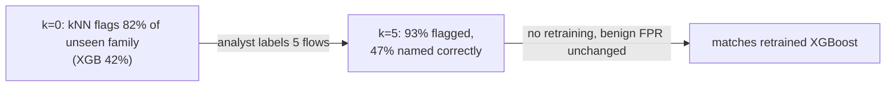

# Experiments log

One entry per experiment: **what we tried → result → why we think so → next**. Plan: [`SPIKE_PLAN.md`](SPIKE_PLAN.md).

---

## H1 · Do unseen attack families land far from everything known?  (2026-11-15, 2 seeds)

**Tried:** `spikes/h1_unknown_separability.py`. Leave one attack family out on CIC-IDS2017 (MachineLearningCVE CSVs, deduplicated, `Destination Port` dropped).
- **Splits:** chronological within each day-file.
  - Train = first 60%, minus the held-out family X.
  - Val = benign rows at 60–70%, used only to set the threshold.
  - Test = benign rows in the last 30%, plus *all* rows of X.
- **Training sample sizes:** 150k benign, ≤ 10k rows per known attack class.
- **Alarm rule:**
  - kNN methods: novel (mean distance to the 10 nearest neighbours > τ) **or** the kNN vote says attack.
  - XGBoost: 1 − P(benign) > τ.
  - Isolation Forest: anomaly score > τ.
- **Threshold:** τ is set on val benign for 1% FPR.

**Result:** mean of 2 seeds; the seed std of AUROC is ≤ 0.02 everywhere.

| held-out family (n) | AUROC kNN-raw | AUROC kNN-enc | AUROC XGB | AUROC IForest | **TPR @1% kNN-raw** | TPR kNN-enc | TPR XGB | TPR IForest |
|---|---|---|---|---|---|---|---|---|
| bot (1,416) | 0.60 | 0.61 | **0.84** | 0.79 | 0.03 | 0.00 | 0.00 | 0.00 |
| bruteforce (9,150) | 0.95 | 0.95 | 0.90 | 0.79 | 0.45 | 0.42 | 0.03 | 0.00 |
| ddos (10k) | 0.99 | 0.99 | 0.96 | 0.91 | 0.86 | 0.64 | 0.29 | 0.00 |
| dos (10k) | 0.98 | 0.98 | 0.92 | 0.92 | 0.81 | 0.64 | 0.13 | 0.02 |
| heartbleed (11) | 1.00 | 1.00 | 0.98 | 1.00 | 1.00 | 0.91 | 0.64 | 0.73 |
| infiltration (36) | 0.97 | 0.93 | 0.84 | 0.96 | 0.86 | 0.22 | 0.00 | 0.33 |
| portscan (1,850) | 0.96 | 0.96 | 0.94 | 0.91 | 0.64 | 0.57 | 0.22 | 0.05 |
| web (2,143) | 0.48 * | 0.94 | 0.99 | 0.86 | 0.92 | 0.92 | 0.91 | 0.00 |
| **median AUROC / mean TPR** | **0.96** | 0.96 | 0.93 | 0.91 | **0.70** | 0.54 | 0.28 | 0.14 |

The real benign FPR on test is 1.5–1.7% for the kNN methods and about 1.3% for XGB, against the 1% target set on val.

\* Raw-feature kNN puts held-out web attacks *next to known attacks*, so the novelty score misses them. The kNN vote still flags 92% of them as an attack.

```
mean TPR on unseen families at ~1% benign FPR
kNN raw   ██████████████      0.70
kNN enc   ███████████         0.54
XGBoost   ██████              0.28
IForest   ███                 0.14
```

**Why:**
- **H1 mostly passes.** The median AUROC is 0.96, and 6 of 8 families are ≥ 0.93. An unseen attack is caught either because it is far from everything known, or because it sits near a known attack (web); both raise an alarm.
- **Ranking well is not the same as catching at low FPR.** Several families score AUROC 0.95+ with TPR of only 45–65%. Most of each family is separable, but a chunk sits inside the benign cloud.
- **Bot fails for everything except XGB's ranking** (0.84 AUROC, still 0% TPR). Bot flows look like benign traffic in these 77 flow features. This is a likely candidate for raw bytes or host/time context.
- **The closed-set classifier misses unknowns.** XGB ranks well but catches only 28% at the operating point. That is the gap the retrieval approach is meant to fill.
- **The learned encoder adds nothing over raw features** (early H4 signal), except for web. It is worse at the operating point, which suggests SupCon tightens known classes but compresses the benign region, so unknowns land closer to benign.
- **The threshold drifts:** a 1% FPR set on the 60–70% slice becomes 1.5–1.7% later in the day. Calibration will need refreshing (C5/C10).

**Caveats:**
- Heartbleed (11) and Infiltration (36) are tiny, so their numbers are anecdotal.
- These are artefact-laden CSVs, not the corrected re-extraction.
- One k (10); no tuning of the encoder or the kNN score.

**Next:**
- H2: few-shot insertion of the held-out family (k = 1/5/10/50), starting from this same setup.
- Re-check H1 on the corrected CIC-IDS2017.
- H4 needs a better encoder candidate (self-supervised, or a loss that keeps benign spread out) before we can call it.

Raw: `spikes/results/h1/seed{0,1}/`.

---

## H2 · Can a few labelled examples teach a new class, with no retraining?  (2026-11-15, 2 seeds, **corrected CIC-IDS2017**)

**Tried:** `spikes/h2_fewshot_insert.py` on the corrected CIC-IDS2017 (Engelen et al., CNS 2022).
- **Data handling** (`spikes/data_improved.py`):
  - Rows sorted by real timestamp; "Attempted" rows dropped.
  - "Infiltration - Portscan" counted as portscan.
  - Identifier columns dropped (IPs, ports, Flow ID, Timestamp).
  - Deduplicated: 1.71M rows, 82 features.
- **Splits:**
  - Benign: by position within the day.
  - Known attacks: by time *within their own class*, since each attack is a single time window.
- **Procedure:**
  - Leave one family out, then take the **first k rows of the held-out family in time** as the analyst's labels, for k ∈ {0, 1, 5, 10, 50}.
  - kNN: insert the shots into the index as "NEW"; the encoder is frozen.
  - XGBoost: **retrained** with the shots.

**Result** (mean over families and seeds; benign FPR does not move with k):

| k | recall NEW: kNN-raw | kNN-enc | XGB (retrained) | detect (any alarm): kNN-raw | kNN-enc | XGB | IForest |
|---|---|---|---|---|---|---|---|
| 0 | 0 | 0 | 0 | **0.82** | 0.63 | 0.42 | 0.17 |
| 1 | 0.05 | 0.02 | 0.04 | **0.82** | 0.63 | 0.68 | 0.17 |
| 5 | **0.47** | 0.34 | 0.47 | **0.93** | 0.74 | 0.83 | 0.17 |
| 10 | **0.47** | 0.44 | 0.44 | **0.93** | 0.77 | 0.82 | 0.11 |
| 50 | **0.62** | 0.60 | 0.59 | **0.91** | 0.75 | 0.85 | 0.12 |

- Benign FPR: kNN-raw 1.4%, kNN-enc 1.1%, XGB 1.0%, IForest 0.7%.
- Known attacks predicted as NEW: about 0 for all methods.

Recall of NEW by family at k = 10 (kNN-raw): bot 0.90, web 0.76, portscan 0.64, bruteforce 0.57, ddos 0.45, dos **0.01**. Heartbleed (6 test rows) and Infiltration (18) are too small to read.



**Why:**
- **H2 passes for the mechanism.** Five inserted examples give the same NEW-class recall as fully retraining XGBoost (0.47 vs 0.47). There is no encoder update, no damage to known classes, and no rise in benign FPR. Bot goes from 0% to 90% recall with 10 shots.
- **The recall ceiling is about variants, not the method.** The first k flows in time all come from one variant:
  - **DoS:** the first flows are Slowloris; the test set is mostly Hulk, so recall is 0.01.
  - **Brute force:** the shots are all FTP-Patator, and the 0.57 recall is exactly the FTP share of the test set.
  - **Portscan:** Thursday's infiltration scan vs. Friday's.

  The other variants are still **flagged** (detect 0.9+), just not named. In the real system the analyst labels them the next day. The daily loop (C7/C8) handles this, and H2 can't show it in a single step.
- **H1 replicates on the corrected data:** with no shots, kNN-raw flags 82% of unseen families vs. 42% for XGB.
- **The learned encoder is again no better than raw features** (H4 signal, now on two datasets).

**Caveats:**
- Shots are "first in time", which is realistic but makes results depend on variant order.
- Small families (heartbleed, infiltration, web) have tiny test sets.
- One analyst step only; multi-day labelling isn't simulated.

**Next:**
- Simulate the daily loop: each day, label k flows sampled from *flagged clusters* rather than the first k. This should lift DoS and brute-force naming.
- Then H3 (benign coverage).
- H4 needs a better encoder candidate.

Raw: `spikes/results/h2/seed{0,1}/`.

---

## H3 · Can a bounded index cover benign traffic?  (2026-11-16, 2 seeds, corrected CIC-IDS2017)

**Tried:** `spikes/h3_benign_coverage.py`. Benign only, kNN-raw, novelty score = mean distance to the 10 nearest index entries.
- **Pool:** Mon+Tue benign (512k candidates after an 80/20 time split; the last 20% is held out to calibrate the threshold).
- **Test:** Wed, Thu, Fri benign, scored per day (50k each).
- **Selection:** random vs. greedy k-center (farthest-first, over a 200k-flow candidate subsample), 500 to 20k entries, plus the full 512k index as a ceiling.
- **Threshold:** τ is the 99th percentile of calibration scores.
- **First version flaw:** it measured only benign FPR, which is about 1% at every size because τ is calibrated to it. The real cost of a small index is a higher τ that misses attacks. I added the share of attack flows (all families, Tue–Fri, 3k per family, no hold-out) scoring above τ.

**Result** (mean of 2 seeds):

| index size | τ (random) | benign FPR Wed/Thu/Fri (random) | attack TPR, mean over 8 families: random | k-center |
|---|---|---|---|---|
| 500 | 12.7 | 0.8–0.9% | 0.23 | 0.26 |
| 2,000 | 8.9 | 1.0–1.2% | 0.32 | 0.34 |
| 5,000 | 7.0 | 1.0–1.3% | 0.49 | 0.42 |
| 10,000 | 6.0 | 1.0–1.3% | 0.60 | 0.42 |
| 20,000 | 4.9 | 1.0–1.4% | **0.68** | 0.63 |
| 512k (full) | 2.5 | 1.1–1.6% | **0.86** | – |

- Benign FPR stays at about 1% at every size and on all three days, so there is no day-to-day drift.
- At 20k random, the families the small index loses most are DoS (0.09 vs. 0.95 full), bot (0.06 vs. 0.06, which is lost at every size) and portscan (0.88 vs. 0.97).

**Why:**
- **H3 fails as stated.** Coverage buys detection, not false-alarm control. A small index gives a large τ, and attacks that sit moderately far from benign slip under it. At 20k entries we keep 0.68 of what the full index detects (0.86).
- **k-center does not beat random.** It is slightly better at 500–2k, and worse from 5k up, because it spends entries on outlier flows and leaves dense benign regions thin. The farthest-first rule is the wrong objective when the threshold is a quantile of the score distribution.
- **Alarm quality depends on a dense benign region near the attacks**, not on covering the extremes.

**Caveats:**
- The novelty channel only. The real system also votes against known-attack exemplars, so known classes don't depend on τ.
- The threshold is set on Mon/Tue, so a Wed–Fri shift would show up as a change in FPR. None appeared.
- Two seeds, one k (10), one dataset.

**Next:**
- Try a density-aware selection, e.g. k-means centroids, or k-center with the farthest 1–5% trimmed.
- Check whether a hybrid fixes it: a smaller coverage index for benign plus a trained one-class model for the benign boundary.
- Index size vs. query latency also matters; 512k flat search is too slow for streaming without an ANN index (HNSW).

Raw: `spikes/results/h3/seed{0,1}/`.

---

## H5 · Does a benign gate (AE / VAE / XGBoost) beat the benign kNN index?  (2026-11-16, 2 seeds, corrected CIC-IDS2017)

**Tried:** `spikes/h5_benign_gate.py`, on the H3 split (Mon/Tue benign for training, Wed–Fri test). τ is the 99th percentile of held-out benign scores for each gate. Attack flows are Tue–Fri, up to 3,000 per family.
- **kNN benign index:** 20k entries and the full 512k (H3 numbers, re-measured).
- **AE and VAE:** MLP 82→128→64→16, trained 20 epochs on benign only. Score is reconstruction error.
- **XGBoost:** benign-vs-rest, trained without the evaluated family each time (leave-one-family-out).

**Result** (mean of 2 seeds; benign FPR is 1–2% for every gate on every day, so no gate changes the false-alarm load):

| gate | mean attack TPR @ 1% FPR | mean AUROC |
|---|---|---|
| kNN full (512k entries) | **0.86** | **0.99** |
| kNN 20k | 0.68 | 0.98 |
| VAE | 0.58 | 0.95 |
| XGBoost (unseen family) | 0.49 | 0.97 |
| AE | 0.47 | 0.95 |

| TPR by family | bot | brute force | ddos | dos | portscan | web | heartbleed* | infiltration* |
|---|---|---|---|---|---|---|---|---|
| kNN full | 0.06 | 1.00 | 1.00 | 0.95 | 0.97 | 0.87 | 1.00 | 1.00 |
| kNN 20k | 0.06 | 0.57 | 1.00 | 0.09 | 0.89 | 0.87 | 1.00 | 0.96 |
| VAE | 0.06 | 0.21 | 1.00 | 0.32 | 0.93 | 0.21 | 1.00 | 0.94 |
| AE | 0.06 | 0.00 | 0.64 | 0.12 | 0.93 | 0.06 | 1.00 | 0.94 |
| XGBoost | 0.16 | 0.15 | 1.00 | 0.97 | 0.17 | 0.10 | 1.00 | 0.40 |

\* 11 and 36 test flows.

**Why:**
- **H5 fails: a compact model does not beat the exemplar index.** The VAE reaches 0.58 and the AE 0.47, below the 20k kNN index (0.68) and far below the full index (0.86).
- **The ranking is fine, the operating point is not.** AUROC is 0.95 or higher for every gate, but at 1% false alarms the AE/VAE miss families like brute force and web. A single reconstruction-error threshold overlaps with benign for these families.
- **XGBoost is uneven:** 0.97 on DoS but 0.17 on portscan and 0.10 on web. A supervised gate generalises from the families it saw, as H1 predicted.
- **Bot is missed by everything** (0.06–0.16).
- **What actually helps is storing benign flows.** The full kNN index wins, so the useful structure is local (fine-grained neighbourhoods of normal flows), which a 16-dimensional bottleneck smooths away.

**Caveats:**
- One untuned architecture and 20 epochs; a larger or differently-regularised VAE may do better.
- The mean TPR includes tiny families (heartbleed 11, infiltration 36, web 104 flows).
- The full kNN index has 512k entries, which is slow without an approximate index (HNSW).
- The end-to-end test (gate → attack index) was not run.

**Next:**
- Decide the benign strategy, probably an exemplar index (full pool, or the biggest size the latency budget allows) rather than a gate.
- Daily update harness in `SPIKE_PLAN_2.md` (a), which now matters more, since the benign index must stay large and current.

Raw: `spikes/results/h5/seed{0,1}/`.

---

## H5b · Benign gate with known and unseen attacks together  (2026-11-16, 2 seeds, corrected CIC-IDS2017)

**Tried:** `spikes/h5b_known_and_unseen.py`. Same data and split as H5, but known and unseen attacks are scored together under **one threshold** per gate (1% benign false alarms).
- **Folds:** 4 folds, each with 2 unseen families (bot+web, dos+portscan, ddos+bruteforce, heartbleed+infiltration) and the other 6 known. The pairings are arbitrary.
- **Known attacks:** XGBoost trains on the first 60% in time; the test uses the later 40%.
- **Unseen attacks:** never trained on; all rows are tested.
- **Gates:** kNN benign index (20k and full), AE, VAE (benign only), XGBoost benign-vs-rest (trained on known attacks).

**Result** (mean of 4 folds × 2 seeds; all gates have about 1% benign false alarms):

| gate | known attacks caught | unseen attacks caught | all 8 families (macro) |
|---|---|---|---|
| XGBoost | **1.00** | 0.47 | 0.87 |
| kNN full (512k) | 0.85 | **0.86** | 0.85 |
| kNN 20k | 0.68 | 0.68 | 0.68 |
| VAE | 0.59 | 0.58 | 0.59 |
| AE | 0.47 | 0.47 | 0.47 |

Unseen attacks caught by fold (XGBoost / kNN full): bot+web 0.15 / 0.46, ddos+bruteforce 0.54 / 1.00, dos+portscan 0.50 / 0.96, heartbleed+infiltration 0.70 / 1.00.

**Why:**
- **The two gates are complementary.** XGBoost catches every known attack but only 47% of unseen ones. The full kNN index catches 85–86% of both, but loses 15% of known attacks that XGBoost gets.
- **Unsupervised gates treat known and unseen alike**, because they never see attack labels. That is why the AE, VAE and kNN known and unseen columns match.
- **The "all" column depends on the mix.** It averages over 8 families, 6 known and 2 unseen. XGBoost looks best there only because most families are known; it would look worse if unseen attacks were more common.
- **Bot + web is the hard fold:** no gate catches more than 46% of the unseen families.

**Caveats:**
- Each gate has its own 1% threshold, so combining two gates would raise false alarms (up to about 2%). That wasn't measured.
- Pairings are arbitrary and several families are tiny (heartbleed 11, infiltration 36, web 104).
- One untuned AE/VAE.

**Next:**
- Test a combined gate: XGBoost for known attacks plus the full kNN novelty score for unseen ones, with one false-alarm budget.
- Daily update harness (`SPIKE_PLAN_2.md` (a)).

Raw: `spikes/results/h5b/seed{0,1}/`.
